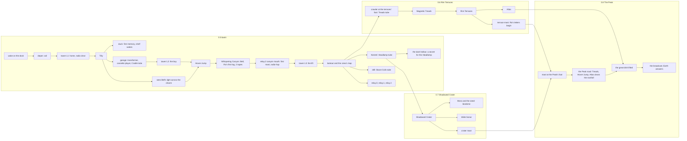

# Game flow: from New Game to the ending and after (0.5 → 1.0)

> Author: the story & flow session ("MoonProject · story & flow"). This is a **proposal** to the Director. Nothing
> here changes VISION, DESIGN, STORY, ROADMAP or a feature spec until the Director accepts it. §8 lists every proposed
> change with a fix.
>
> Sources: VISION, DESIGN, STORY, GDD, ROADMAP (version table), M3-05/06/13/16, the design review of 2026-10-10,
> content on main 6a73dc97 (`Data/Content/**`), box/gameplay d8148e68 (P1 story parts), and the golden-path
> playthrough (`director/Logs/gameplay-captures/playthrough.md`, 914 s for the bot, about 40–45 min for a human).
> Minutes below are for a first-time human player and are targets, not measurements. The cinematic moments named here
> are storyboarded in `docs/design/cutscenes.md`.

## 1. The game in one breath
A tired old rover wakes in the dark next to a sleeping home. A faint music in the static woke it. Trip by trip it
brings power, friends and memories home, lights a chain of radio masts toward the red light on The Peak, learns why
the crew never came back, and sends the crew's last song to Earth. Someone answers. Then the moon is yours to wander.

**The question that pulls the player through the whole game** is set in the opening: *what is that faint music in the
static?* It is Ro's station jingle (M3-05's 3 + 4 notes), still being broadcast from Earth decades later. The player
hears it clear for the first time when Bell comes home (§5), and Ro herself answers at the end.

## 2. The core loop at each scale

| Scale | Loop | What makes it feel good |
|---|---|---|
| **Seconds** (10–60 s) | notice a light → ping → it answers → drive there → the beam works (cut, dig, stitch, feed, tow) → the melody climbs → something changes | every touch sings in D pentatonic; every action eases; nothing can fail |
| **A trip** (5–15 min) | the dock's evening raises one pillar → drive out → a site, a friend or a mast → its **heart**: one *find* (a story part, a blueprint tube, a relic, a friend) → the find rides home on 07, visibly → it is delivered at its home station → home changes → the dock's evening → the next pillar | every trip has exactly one heart and ends with one visible change at home (DESIGN reason 1) and one new light on the horizon (review P6) |
| **A session** (20–40 min) | 2–3 trips. At least one **big change**: a tower level, a friend home, a kit, a new region or a lit mast | the player stops on the dock's evening knowing exactly where they'll drive next time |
| **A version** (1–2 h) | see a gate from far away (the promise) → find its kit's blueprint → the plotter draws it → the bay fits it → enter the region → its friend → its mast makes it home → its memories → from inside it, see the next promise | the metroidvania-lite rhythm of DESIGN reason 4, one region per version (0.6, 0.7, 0.8) |
| **The arc** (5–6 h) | the Peak's red light, seen in the opening → every lit mast is a step toward it → Atlas lifts the great dish → the broadcast → Earth answers | the player looks at the goal all game |
| **After** | free roam: Ro's letters keep arriving, moon drift, the last memories and tapes, photo mode, paint | gentle reasons to visit, never FOMO |

**The rule of the find.** Every trip's heart is a thing the player *brings home*, and it is always visible on the way:
a part or tube on 07's back, a relic on the tether or in the Cradle, a friend flying alongside. Coming home is always
delivering something. Where a find would be invisible (a log, a tape), the delivery is: the log card opens at the
cache, and the tape slides into Bell's rack at home.

## 3. The two progress axes and the unlock graph
Rover kits answer "can I get there?". The station's reach answers "is it home yet?" (DESIGN). Story parts make tower
levels earned, not bought (P1). Friends spot the next thing.

**Gates (ruling 10 holds for every one):**

| Gate | Needs | Seen first from | Exit without the ability |
|---|---|---|---|
| The chasm into Whispering Canyon | Hover-Jump | the canyon mouth, with Bell's light across it (P2) | the canyon's one-way exit (built) |
| The dark hollow (0.5 secret) | Warm Headlamp | the Kestrel crater rim: a black mouth with a faint glint | it is a dead end you drive out of |
| The terrace walls | Magnetic Treads | the lookout, and the crawler site at their foot | a one-way step down from the lowest terrace |
| The Shadowed Crater | Warm Headlamp (and the crater's own dark) | the terraces, looking down into its black bowl | a ≤ 20° ramp out of the rim breach |
| The Peak road | Treads + Hover-Jump + Atlas (rockfall) | the opening, all game | every stage of the road steps down one way |
| The great dish | Atlas lifts it; the chain linked to the Peak's foot | the Peak's red beacon, all game | — |

## 4. Session by session
"Session" means a natural stopping point that ends on the dock's evening. A first-time player usually plays two in a
sitting. Minutes are cumulative within each version.

### 0.5 "Lumen wakes" (~100 min): M3-16 steps 0–8 (~70 min) plus the rest of the basin
Step 8 lands at ~70 min, a little over M3-16's 50–60, because P1's story parts and P2's chasm visit each add a
short trip. That is content, not padding.

| # | Min | New to discover | Home changes | 07 changes | The reason to come back |
|---|---|---|---|---|---|
| S1 | 0–15 | the opening (07's own eye); the depot answers the ping; 4 cuts, and the last panel falls to reveal the coil (P10, P1); feed and stitch the tower | **L1:** cabin windows, porch lamps, the HOME sign straightens, the **radio clears** for the first time; the pilot blink gives way to a lit tower | its eye opens, nothing else yet: 07's arc starts at its most tired | the tower hears a chirp: Tilly's pillar rises in the dock's evening |
| S2 | 15–30 | Tilly broken, her 3 parts, the stitch, she wakes; Tilly spots a glint: the duck, the first memory, towed home | Tilly's perch lamp; **the memory shelf wakes** with its lamp and the duck | Tilly's gift: the solar wing's missing cell is replaced | Tilly spots a warm light **across the chasm** |
| S3 | 30–42 | the chasm: 07 can't cross, sees Bell's light (P2); Tilly spots the garage: the transformer, the cassette player, the Cradle tube; **L2: the bay's shutter**; the plotter draws the Cradle sheet; Hover-Jump is fitted (the long first install) | the bay lit: its "07" sign, the arms, the plotter with 2 sheets; a 2nd memory | **hover coils** under the belly, glowing when charged | the chasm, now crossable |
| S4 | 42–60 | the leap; inside the canyon: the ledge tape (Slow Orbit); Bell at the terminus with Ro's first log and Vol. 1; Bell's parts, her repair; out by the one-way exit; **relay.2 at the canyon mouth is the first mast**, its spare part is L3's story part, and the first radio-hop takes 07 home instead of a 4-min drive | **Bell's corner** and dial; the tape rack with 2 tapes; one lit mast on the horizon; **the station jingle plays clear: the opening's ghost** | Bell's gift: the "07" freshly stencilled and a radio pennant | Bell picks up a signal (Dust & Honey) and the jammed lift now has its part |
| S5 | 60–72 | Bell's signal leads to a tape in the basin; L3 powers the lift; restore the winch; **the ride and the lookout**; the crew's map (M3-07) | the lift runs, the deck lamp, the map board lit; L3's cable | the Cargo Cradle if the player built it (the rear rack, straps parallel, P3) | the map shows Kestrel, the drill, three dark masts, and Ines's pencil notes beyond the rim |
| S6 | 72–100 | Kestrel-3 (the golden record, the Headlamp tube); the drill (Ines's boot, the Boost Coils tube); relay.0, relay.1, relay.3; with the Headlamp, the dark hollow (Theo's first log and a tape); Kenji's first log in the garage heart | the shelf holds all 6 memories; the plotter 4 sheets; **four masts lit: the basin is home**, the radio clear everywhere in it | **lamp bar** and **capacitor drums** (the player's order) | from the lookout, a pillar at the foot of the terrace wall, and Ines's note "Atlas parked here." 0.5 ends on that promise. |

### 0.6 "Rim Terraces" (~75 min)
| # | Min | New to discover | Home changes | 07 changes | The reason to come back |
|---|---|---|---|---|---|
| S7 | 0–35 | moon drift's first morning (M3-08: a fresh glint near home); the crawler wreck at the terraces' foot holds the Treads tube; Magnetic Treads; the first climb, with Earth's best view | the plotter's 5th sheet; the first drift glint visible from the dock | **big treaded wheels, all six matched**: the odd replacement wheel is finally healed, and 07 sits higher | Atlas's dark bulk on a high terrace |
| S8 | 35–75 | Atlas (heavy parts, a long stitch); the terrace mast, the first one that faces Earth: **Ro's first letter** arrives; Ines's logs; Ines's set complete | **Atlas resting by the bay**; **Ines's bunk window lights**; her final log | Atlas's gift: a tow hook | from the terraces you look down into the Shadowed Crater's black bowl, and a faint green glow moves inside it |

### 0.7 "Shadowed Crater" (~90 min)
| # | Min | New to discover | Home changes | 07 changes | The reason to come back |
|---|---|---|---|---|---|
| S9 | 0–40 | the crater under the Headlamp; bioluminescent paths; Moss and the seed; Moss home | **the biodome wakes** beside the lander and grows each session | Moss's gift: a painted flower on the patch | the Wide Sonar tube glints deep in the crater |
| S10 | 40–90 | Wide Sonar; the crater mast; Theo's logs and set; the first **Eclipse** (DESIGN events) | the biodome blooms; **Theo's window**; Kenji's set and window (his last relics come from the crater's wrecks and drift) | **the larger dish, and the bent antenna straightened** | the chain stops one mast short of the Peak's foot |

### 0.8 "The Peak" (~60 min)
| # | Min | New to discover | Home changes | 07 changes | The reason to come back |
|---|---|---|---|---|---|
| S11 | 0–35 | the last mast at the Peak's foot; the Peak road (walls, gaps, Atlas clears the rockfall); Ro's last letters; Ro's set and her final log, "I left the radio on for you, 07." | **all four bunk windows lit** | fully cared for: no sign of solitude left except the half-lidded eye | the great dish lies broken on the summit |
| S12 | 35–60 | 07 lifts Ro's mixtape from the shelf into Bell's deck; Atlas lifts the dish, 07 stitches; **the broadcast and Earth's answer**; credits | Bell plays Side B; the Peak's beacon turns amber: the Peak becomes a home light | — | Ro writes back (§7) |

**Main arc ≈ 5.4 h** (DESIGN target 5–7 h). Completion (all 24 memories, 8 tapes, 12 logs, the events, paint) adds
about 4 h (DESIGN target 10–12 h total).

**1.0** adds no new region. It polishes, adds the title screen's full collections (M3-09), Settings ("Gentle
camera", the next line), controller support, photo mode and paint, and the after-ending letters.

## 5. The crew's mystery: when each piece is revealed
STORY tells it only through objects, short texts, the radio and the base. The schedule below gives each version one
big answer and one new question.

| When | The player learns | Through | The question it leaves |
|---|---|---|---|
| 0:00 opening | 07 is alone; home is dark; someone's music is in the static | the opening's ghost chord | *What is that music?* |
| S1, L1 | this was a home, and the station still plays (an automated weather loop: "clear skies over the Sea of Tranquility, as always") | the radio clearing; ticker fragment 1 | *Who lived here?* |
| S2–S3 | four people, and they were happy: a duck, a gnome, a mixtape | the first memories; place cards naming Kenji's bay and Ro's Bell | *Where did they go?* |
| S4 | Ro ran a night show for "three crew and a rover"; Bell kept it playing while she slept; **the jingle is the music from the opening** | Ro's first log; Bell's repair log; Bell's jingle | *If the station still plays, who is sending it?* |
| S6 | Kenji fixed 07 seven times, and the crew's call sign was "three short, one long; 07 blinks it when it's happy" (proposed text for Kenji's first log). Theo named every seedling | Kenji's and Theo's first logs | *Why did they leave in a hurry?* |
| 0.5 end, the masts | **each lit mast hands over the messages it caught over the years** (proposal, below): "Lumen Station, this is Houston relay. Program review postponed. Stand by." | ticker fragments from relays 0–3 | *Did they try to come back?* |
| 0.6, the terraces | the storm: Ines chose to evacuate; Ro read the warning on air; **Ro kept writing**: "07, it's Ro. They say nobody's listening up there. I'm sending this anyway." | Ines's logs; Ro's second log; the Earth-facing terrace mast | *Why did nobody come?* |
| 0.7, the crater | the program was cancelled; Theo left Moss to water the seedlings: "If anything grows, tell me." The biodome grows | Theo's logs; ticker letters; the biodome | *Is anyone still listening?* |
| 0.8, the Peak | twenty years of Sunday tapes: "It's been twenty years. I still play the long-drive tape on Sundays." The station could hear Earth, but the broken dish meant it could never answer | Ro's last letters and final log | *Will they hear us?* |
| the finale | yes. "I heard you, 07. I'm still here. — Ro." | the broadcast; the call sign blinked back | — |

**Proposal: the masts hold the letters.** Today the ticker's fragments "unlock as the signal grows". Make it causal:
each relay mast kept the messages that reached it while the station was dark, and lighting it plays them back in
order, years apart. Every mast then pays off in story as well as in reach, and it explains in one stroke why 07 never
heard Ro: the masts could only listen, and only the great dish can talk back.

**Logs by version.** STORY plans 12 logs, three per crew member; on main there is one log cache (Ro's, at the canyon
terminus) plus Bell's repair log. Proposed placement: 0.5 has each crew member's **first** log (Ro: terminus, built;
Kenji: the garage heart; Theo: the dark hollow; Ines: the drill). Their second logs come with their regions (Ines 0.6,
Theo 0.7, Ro and Kenji 0.6–0.8). Every **third** log is the reward for completing that crew member's set (DESIGN
collections).

## 6. The excitement curve
Rule: **never more than 3 minutes without something new in view** (a landmark, a glint, a pillar, a friend's beat)
and **never more than 6 minutes without something changing** (at home, on 07 or in the world). Intensity is 1 (calm)
to 5 (a peak). Cozy means many 2s and 3s, regular 4s and a 5 about every 20 minutes.

**0.5, beat by beat:**

| Min | Beat | Feeling | Intensity |
|---|---|---|---|
| 0 | the opening, the blink | wonder, tenderness | 4 |
| 3 | the depot answers the ping | curiosity | 2 |
| 7 | the last cut falls and the coil glints | small surprise | 3 |
| 10 | **L1: home wakes, the radio clears** | warmth | **5** |
| 12 | the tower hears Tilly | curiosity | 3 |
| 16 | Tilly wakes and looks at 07 | joy | 4 |
| 19 | Tilly home, her perch lights, the solar cell | warmth | 4 |
| 24 | the duck is dug, the shelf wakes | tenderness, humour | 3 |
| 30 | the chasm: Bell's light across | longing | 3 |
| 35 | the garage's heart: the tube and the transformer | small surprise | 3 |
| 38 | **L2: the bay's shutter** | pride | **5** |
| 41 | the first install, the coils glow | pride | 4 |
| 45 | **the leap** | exhilaration | **5** |
| 49 | inside the canyon, the ledge tape | discovery | 3 |
| 52 | Bell found, Ro's first log | melancholy | 4 |
| 56 | Bell stands up, her two-step | joy | 4 |
| 59 | the first mast lights, the first radio-hop | relief, wonder | 3 |
| 61 | **Bell home: the jingle is the opening's music** | recognition | **5** |
| 64 | Bell's signal leads to a tape | curiosity | 2 |
| 67 | L3, the lift restored | anticipation | 3 |
| 69 | **the ride and the lookout** | awe, scale | **5** |
| 72 | the crew's map | discovery | 4 |
| 75–95 | Kestrel, the drill, the hollow, the masts: the chain of lights | mastery, warmth | 3–4 |
| 100 | the terrace promise from the lookout | longing | 3 |

**Later versions follow the same shape:** a promise seen → a find → a kit fitted (4) → the gate crossed (5) → the
friend (4) → its mast and the letters (4) → a crew window (5) → the next promise.

**Dead stretches today, and the fix for each:**
- **The 616 m drive home from Bell** (`playthrough` 109 s bot, about 4–5 min human). Fix: relay.2 at the canyon mouth
  is lit on the way out and becomes the first radio-hop (S4). The one-way exit step down is itself a beat.
- **The 255 m drive to the canyon** across a featureless plain (`16-trail-to-the-canyon`). Fix: one landmark on the
  route, such as relay.2's dark silhouette on the rock fins, visible all the way (review, "just below the line").
- **Six equal depot cuts** (135 s bot, about 4 min human). Fix: P10's four cuts, the last opening the heart.
- **Five systems in the last 3 minutes** (dial, tape, relay, hop, dock). Fix: spread one per trip, as in S4–S5.

**No grind (ruling 5).**
- The economy is set to ≈ 2× what each version's steps need (P9), with site signatures so the next wreck is a choice.
- Nothing is collected twice and nothing respawns, except moon drift's small fresh glints (0.6), which are a gift,
  never a need.
- Mast costs escalate, which keeps salvage meaningful after the bay is bought out (DESIGN).
- A material spent always produces a visible change.

## 7. The ending, and after
- **The ending** is cutscene §9: the dish turns, the Peak's red beacon becomes amber, Bell's Side B travels the chain
  up from home, the broadcast, silence, Earth blinks the call sign, the line, credits.
- **After the credits** the game saves as "after the ending". 07 is on the Peak in the chase frame and the HUD returns.
- **What changes for good:**
  - the radio is clear everywhere;
  - the Peak's beacon is amber;
  - Ro's **letters keep coming**: one new letter on the ticker per later session, about ten in all, written as one
    side of a correspondence with a rover. A gentle reason to come back, finite, never time-limited;
  - the title screen shows the lit home and the amber beacon (M3-09 draft: the title is the live world).
- **Free roam holds:** any memories, tapes and logs not yet found; moon drift and the events (Eclipse, Solar Flare,
  Earthrise); photo mode; 07's paint and stickers; base decorations on snap points.

## 8. Gaps and contradictions, with a proposed fix for each

| # | Where | The conflict | Proposed fix |
|---|---|---|---|
| 1 | VISION ruling 5 vs M3-16 | Ruling 5: "all three tower levels in 15–20 min". M3-16 puts L3 at step 8, ~50–60 min. | Amend ruling 5's last sentence: "Target: each version's steps need about half of its materials; the tower's three levels land across the first hour." |
| 2 | STORY vs M3-16 step 2 | STORY: a crew member's window lights when their set completes. M3-16: L1 lights the lander's windows one by one. | L1 lights the cabin windows and porch lamps. The four small **bunk windows** stay dark until each set completes (cutscenes §2). Art builds bunk windows as separate renderers. |
| 3 | VISION ruling 8 and M3-16 P5 vs the owner's brief | The first frame is the chase frame; the owner wants a first-person opening. | Adopted on main (5e7f3a43): ruling 8, the camera bullet, the call sign, M3-16 P5 and step 0. |
| 4 | DESIGN regions vs M3-16 blueprints | The Warm Headlamp gates the Shadowed Crater (0.7), but its tube ships in 0.5 at Kestrel, and DESIGN says every traversal kit opens a region and a nearby secret. In 0.5 it opens nothing. | Keep the tube in 0.5 and add **the dark hollow** near Kestrel's crater: a short lava tube, dark until the Headlamp, holding Theo's first log and a tape. The crater stays 0.7. |
| 5 | DESIGN map vs M3-06 vs M3-16 step 8 | DESIGN: POIs light up "once visited". M3-06: the map draws itself within reach. M3-16: "the crew's map inside opens new regions", but no region opens in 0.5. | M3-07 draft: the crew's paper map already shows everything in Ines's pencil. The station's survey plotter inks what lies within reach, places visited get a stamp, and regions beyond are promises in pencil. It opens no region; it points at them. |
| 6 | STORY collections vs content | STORY: 12 logs, 24 memories, 8 tapes. Built: 1 log cache + Bell's repair log, 6 memories, 3 tapes. ROADMAP 0.5 lists "remaining crew logs in the region". | §5's log placement (4 first logs in 0.5). Memories: +6 per version for 0.6, 0.7 and 0.8. Tapes: 0.6 +2, 0.7 +2, 0.8 +1 (STORY "the other five"). STORY needs the 11 remaining log texts (M3-01 is still 🟦); the story session can draft them. |
| 7 | STORY ending vs the finale's logic | The ending plays "the last song on Ro's mixtape", but the mixtape is a memory on the shelf at home, and the broadcast happens on the Peak. | Before the last climb, 07's beam lifts the tape into Bell's deck. Bell plays Side B and the relay chain carries it up to the dish (cutscenes F2). That makes the chain the reason the ending works. |
| 8 | STORY ending vs setup | "Three short, one long, the station's old call sign" is never taught. | 07's antenna tip blinks it at rest all game; Kenji's first log names it (cutscenes §1.5). |
| 9 | ROADMAP 0.5 row vs ROADMAP M3-09 row | One says the title has New Game; the other says Continue/Settings. | The M3-09 draft: **Continue, New Game, Settings, Quit**. The pause menu's New game becomes \"Quit to title\". |
| 10 | DESIGN collections vs the pause menu | DESIGN: collections show "at the base, never in a spreadsheet menu". The pause menu shows tape and relay counts (`ui.pause.cassettes`, `ui.pause.relays`). | The M3-09 draft: every collection has a home at the base, and the pause card's counts are removed. |
| 11 | The opening's trigger in code | `RoverCameraRig.OnBasePowerChanged` starts the opening on any load at stage Asleep, so a player who quits before L1 sees it again. | Core `SessionStarted(freshGame)` (cutscenes §1.8). |
| 12 | DESIGN friends table vs what is built | Bell is "found on a canyon shelf" (built: the canyon terminus). Tilly is "the scientist's surveyor" (STORY: Ines, the geologist). | Update DESIGN's friends table to match STORY and the build. |
| 13 | DESIGN Atlas vs the rule of the find | Atlas "carries relics home automatically from marked spots", which would remove the homecoming from later trips. | Atlas carries only **heavy** things (the dish, rockfalls, a crew window's part). Memories still ride home with 07. |
| 14 | P6 vs the short wake | Both happen on the dock. A session that starts on the dock could show the short wake and an evening back to back. | The dock's evening never plays in the first minute of a session; the short wake's glance does its job. |
| 15 | DESIGN reason 5 (moon drift) vs ROADMAP | M3-08 moved to 0.6, so 0.5 has no "let me check on the moon" habit. | Take the review's one-line slice into 0.5: on Continue, Tilly has found one new glint near home overnight, and the short wake's glance looks at it. |
| 16 | The P2 order vs today's golden path | Today Hover-Jump is crafted before the chasm is seen, and the first leap is on the base pad. | S3 above: the chasm visit comes first; the base-pad hop becomes the bay's test hop after the first install, if kept at all. |
| 17 | DESIGN "Install moment" (about 3 s, never skippable clutter) vs a first-install ceremony | One length for every install. | The first install plays a ~7 s version once; later installs keep the 3 s moment (cutscenes §5). |
| 18 | VISION "dock's evening" naming vs the world's lighting | The moon has no day cycle in the game; "evening" is the ritual's name, not a time of day. | Keep the name, and never imply a clock (no "night falls" lines). |

## 9. What I checked and what I didn't
- **Checked:** the docs listed at the top; the content assets on main; the wake code (`WakeOpening`,
  `WakeUpSequence`, `RadioWakeUp`, the camera rig's trigger); the Core events; the golden-path timings; the captures
  `wake-0-asleep` and `night_wake_dark_spawn_first_frame`.
- **Not checked:** play feel (no new captures were taken, since no decision here depended on one); box tips other than
  gameplay's P1 commit; the economy after P9 (not landed).
- **Minutes** are targets scaled from the bot run (×2.5–3), not measurements. The Director's Playthrough after P1, P2
  and P9 is the real test.
