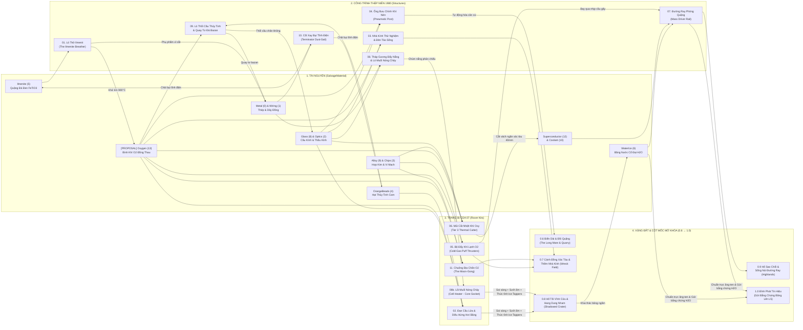

# Thiết Kế Phát Minh & Cây Công Nghệ Lumen — *Thập Niên 1980: "Biên Giới Cao Đã Thành Hiện Thực"*

> **Trạng thái:** Đặc tả thiết kế đề xuất cho `0.6–1.0` (`[PROPOSAL]` — tích hợp các ý tưởng nền tảng của Chủ dự án với các phát minh cơ khí nguyên bản, sơ đồ cây công nghệ hợp nhất và bốn địa danh khám phá mới).
> **Bản tiếng Anh tương ứng:** [`docs/design/inventions.md`](inventions.md)
> **Tài liệu chuẩn đối chiếu:** [`docs/design/story-v4.md`](story-v4.md) · [`docs/design/0.6-living-moon.md`](0.6-living-moon.md) · [`docs/design/0.6-world-regions.md`](0.6-world-regions.md) · [`docs/design/0.6-rovers-and-salvage.md`](0.6-rovers-and-salvage.md) · [`docs/design/0.6-kits-and-upgrades.md`](0.6-kits-and-upgrades.md) · [`docs/design/0.6-structures-and-power.md`](0.6-structures-and-power.md) · [`docs/design/0.7-wrecks-and-cutting.md`](0.7-wrecks-and-cutting.md) · [`docs/design/0.8-deep-regions.md`](0.8-deep-regions.md) · [`docs/art/r1-pipeline.md`](../art/r1-pipeline.md) · [`docs/art/07-design.md`](../art/07-design.md) · [`Assets/_Project/Scripts/Core/SalvageMaterial.cs`](../../Assets/_Project/Scripts/Core/SalvageMaterial.cs)

---

## 1. Triết Lý Thiết Kế: *"Thập Niên 1980 Của Gerard O'Neill"* & Bài Toán Hóa Học Giữa Oxy Và Băng Nước

Trong vũ trụ của *Lunarion*, Trạm Khai Khoáng Mặt Trăng **Meridian** không phải là trạm tiền đồn của tương lai xa với màn hình hologram hay công nghệ nano. Đó là năm **1984–1988** trong một dòng thời gian nơi tầm nhìn công nghiệp hóa Mặt Trăng năm 1976 của nhà vật lý **Gerard K. O'Neill** (*The High Frontier*) đã thực sự được xây dựng bằng phần cứng công nghiệp thập niên 1980:
- **Vật liệu chế tạo tại chỗ (ISRU):** Lớp vỏ tráng men kem vát cạnh (`R1_CreamEnamel` `#F4E6C8`) với một dải sơn cam đất bạc màu (`R1_OrangeStripe` `#FF8A5B`), cuộn cảm đồng quấn tay (`R1_Copper` `#DA8E48`), ống thủy tinh borosilicate thổi trong chân không (`R1_DarkGlass`), bễ cao su xếp nếp (`R1_Rubber`), đồng hồ áp suất Bourdon bằng đồng thau (`R1_Brass`), và màn hình CRT phốt-pho vàng hổ phách P3 (`R1_LampAmber` `#FFB547`).
- **Mục đích tồn tại của Meridian:** Giữa thời kỳ **Màn Đêm Dài** (*The Long Dim* — mùa đông sol khí tầng bình lưu thập niên 1980 trên Trái Đất), các **Tàu Phương Chu (Orbital Arks)** tại điểm Lagrange **L4/L5** được xây dựng từ chính quặng Mặt Trăng bắn lên từ Meridian.

### Tại sao "Oxy từ quặng Ilmenit" KHÔNG phá vỡ cốt truyện "Tìm Băng Nước cho các Tàu Phương Chu"?

Một câu hỏi hóa học cốt lõi của thế giới này cần được làm rõ ngay từ đầu để cả người chơi lẫn hệ thống chế tạo đều đọc thấy rõ ràng:

| Chất hóa học | Cách tạo ra tại Meridian | Vai trò trong lối chơi của Rover `07` | Vì sao các Tàu Phương Chu L4/L5 vẫn cần Băng Nước (`WaterIce`) để hạ cánh? |
|---|---|---|---|
| **Khí Oxy công nghiệp ($\text{O}_2$)** *(Từ Lò Thở Ilmenit)* | Nung chảy quặng đen **Ilmenit** ($\text{FeTiO}_3$, [`SalvageMaterial.Ilmenite = 5`](../../Assets/_Project/Scripts/Core/SalvageMaterial.cs)) ở $900\,^\circ\text{C}$ trong **buồng khử tuần hoàn kín** dùng một lượng nhỏ khí xúc tác được tái sử dụng liên tục: $\text{FeTiO}_3 \rightarrow \text{Fe} + \text{TiO}_2 + \tfrac{1}{2}\text{O}_2\uparrow$. Đá Mặt Trăng chứa tới $40\%$ oxy theo khối lượng nhưng gần như **không có nguyên tử Hydro ($\text{H}$)**. | Cung cấp **khí nén cơ học và chất oxy hóa nhiệt**: dùng cho **Ống Bưu Chính Khí Nén**, **Bộ Đẩy Phản Lực Khí Lạnh**, **Mũi Cắt Nhiệt Khí Oxy**, **Đạn Cầu Lửa**, **Thổi Thủy Tinh Chân Không**, và **Chuông Địa Chấn Khí Oxy**. | Bạn không thể làm ra nước ($\text{H}_2\text{O}$), trồng lương thực, hay pha chế nhiên liệu tên lửa hạ cánh ($\text{LH}_2/\text{LOX}$) chỉ bằng nguyên tử Oxy. Nếu không có **Hydro**, hàng triệu tấn oxy từ đá bazan cũng chỉ là khí khô. |
| **Băng Nước cổ đại ($\text{H}_2\text{O}$)** *(Tại Hố Sao Chổi & Hố Tối Vĩnh Cửu)* | Nằm sâu dưới các lớp băng vĩnh cửu hai tỷ năm tuổi ở đáy **Hố Tối Vĩnh Cửu** (`0.8`) và lõi **Hố Sao Chổi** (`0.9` — [`SalvageMaterial.WaterIce = 6`](../../Assets/_Project/Scripts/Core/SalvageMaterial.cs)). | Được phát hiện bằng **Đạn Cầu Lửa & Diều Hứng Hơi Băng**, khai thác bởi các robot 4 chân **Thợ Khai Băng (`Ice Tappers`)** khi được sưởi ấm bằng **Lõi Muối Nóng Chảy**, và được truyền bằng chứng lên quỹ đạo L4/L5 ở bản `1.0`. | **Băng Nước = Hydro ($\text{H}_2$) + Nước sinh học ($\text{H}_2\text{O}$).** Đây là mắt xích duy nhất còn thiếu để các Tàu Phương Chu nạp nhiên liệu cho tàu đổ bộ và nuôi sống hàng ngàn con người khi quay về. |

> [!IMPORTANT]
> **Quy tắc bất biến về câu chuyện:** Lò Thở Ilmenit mang lại cho `07` một nền kinh tế **Khí Oxy công nghiệp ($\text{O}_2$)** phong phú ngay từ bản `0.6–0.7` mà hoàn toàn không làm giảm giá trị tối thượng của **Băng Nước (`WaterIce`)** ở bản `0.8–1.0`. Khí $\text{O}_2$ giúp `07` vận hành máy móc trên Mặt Trăng; Băng Nước $\text{H}_2\text{O}$ đưa loài người trở về.

---

## 2. Danh Mục 11 Phát Minh Của Lumen (7 Ý Tưởng Gốc Phát Triển + 4 Phát Minh Nguyên Bản `[PROPOSAL]`)

Dưới đây là 11 phát minh định hình bản sắc công nghệ thập niên 1980 của *Lunarion*. Mỗi mục đều tuân thủ chặt chẽ bảng vật liệu 15 ô R1 ([`docs/art/r1-pipeline.md`](../art/r1-pipeline.md)) và 10 quyết định cốt truyện cố định ([`docs/design/story-v4.md`](story-v4.md)).

---

### Phát Minh 01 — Lò Thở Ilmenit (*The Ilmenite Breather*)
*(Phát triển từ Ý tưởng gốc #1 · Công trình nền tảng mở khóa nền kinh tế Oxy của `07`)*

> **Pitch một dòng:** *Cỗ lò gốm tráng men thập niên 1980 "hít" quặng đá đen Ilmenit và "thở" ra từng nhịp khí oxy ấm áp vào những bình đồng thau sủi bọt vàng hổ phách.*

1. **Tên gọi:** **Lò Thở Ilmenit** (*The Ilmenite Breather* · Mã định danh: `StructureType.IlmeniteBreather` `[PROPOSAL]`).
2. **Logic thời đại thập niên 1980:** Dựa trên thiết kế lò phản ứng khử Ilmenit tuần hoàn kín của NASA Johnson Space Center và Học viện Không gian California năm 1979. Quặng đen Ilmenit ($\text{FeTiO}_3$) được xúc từ các thềm đá bazan vùng Biển Dài (*The Long Mare*), nghiền nhỏ và nung ở $900\,^\circ\text{C}$ bằng cuộn cảm đồng. Bễ cao su xếp nếp trên đỉnh lò phập phồng theo chu kỳ 6 giây để tách hơi nước trung gian và đẩy khí $\text{O}_2$ tinh khiết ($150\text{ bar}$) vào giá xoay gồm 3 **Bình Oxy Đồng Thau** (*Brass Oxygen Flasks*).
3. **Hình dáng trong bảng màu R1 (`1.35 m × 1.35 m × 1.80 m`):**
   - **Thân lò chính:** Trụ men kem vát cạnh (`R1_CreamEnamel` `#F4E6C8`) với đúng một dải sơn cam đất bạc màu (`R1_OrangeStripe` `#FF8A5B`) và ô cửa sổ thạch anh tròn ở giữa để lộ lõi quặng nóng đỏ vàng hổ phách (`R1_LampAmber` `#FFB547`).
   - **Lá phổi cơ khí trên đỉnh:** Một bễ cao su đen xếp nếp lớn (`R1_Rubber` `#3E4048`) đội nắp đồng thau (`R1_Brass` `#DA8E48`) nâng lên hạ xuống nhịp nhàng như lồng ngực đang thở, đi kèm đồng hồ áp suất Bourdon mặt tròn lớn.
   - **Bình xúc tác bên hông:** Bình thép sơn xanh xô thơm (`R1_SagePatch` `#78A582`) tán đinh ri-vê nối với cuộn ống đồng tản nhiệt (`R1_Copper`).
   - **Giá xoay 3 Bình Oxy (cao `0.65 m` vừa tầm gầu xúc của `07`):** Ba bình đồng thau hình trụ có khe kính dọc phát sáng vàng mật ong (`#FFB547`) với các bọt khí li ti nổi lên từ đáy bình khi đầy.
4. **Cách người chơi nhận diện công dụng ngay lập tức (không cần chữ):** Phễu răng cưa bên trái chứa đá đen lấp lánh $\rightarrow$ bụng lò rực sáng cam ấm $\rightarrow$ lá phổi cao su trên đỉnh phập phồng $\rightarrow$ 3 bình đồng thau bên phải sủi bọt sáng vàng. Chuỗi nhân quả "Đá đen vào $\rightarrow$ Hơi thở sống động ra" đọc được chỉ trong 2 giây.
5. **Vai trò trong lối chơi:** **Công trình (Structure)** đặt tại căn cứ hoặc Tiền đồn Đồi Đá Ilmenit (`0.6`). Chuyển hóa `2 × Ilmenite` + điện năng thành `1 × Bình Oxy (Oxygen Flask)` (`[PROPOSAL] SalvageMaterial.Oxygen = 13`) mỗi $45\text{ giây}$, đồng thời thải ra `1 × Metal` (xỉ sắt tinh luyện) làm phụ phẩm hữu ích.
6. **Nguyên liệu cần & Thứ mở khóa:**
   - *Chi phí chế tạo (`0.6`):* `4 × Metal`, `2 × Ilmenite`, `2 × Wiring`, `1 × Glass`.
   - *Mở khóa:* Toàn bộ nhánh công nghệ dùng khí $\text{O}_2$: **Ống Bưu Chính Khí Nén**, **Bộ Đẩy Phản Lực Khí Lạnh**, **Mũi Cắt Nhiệt Khí Oxy**, **Đạn Cầu Lửa**, **Lò Thổi Thủy Tinh Chân Không**, **Chuông Địa Chấn Khí Oxy**, và **Đèn Tảo Sống**.
7. **Điểm chạm cốt truyện cố định (`story-v4.md`):** Giải thích vì sao một trạm khai khoáng 100% tự động không người lái (Quyết định 5) lại sản xuất hàng tấn $\text{O}_2$ công nghiệp (dùng làm chất oxy hóa cắt kim loại, đẩy ống khí nén, và đóng vào các kiện hàng bắn lên L4/L5), trong khi vẫn hoàn toàn thiếu Hydro/Băng Nước (Quyết định 2 & 8).

---

### Phát Minh 02 — Đạn Cầu Lửa & Diều Hứng Hơi Băng (*The Ember Shell & Vapor Kite*)
*(Phát triển từ Ý tưởng gốc #2 · Bộ công cụ khảo sát & thu hoạch băng vùng tối `0.8`)*

> **Pitch một dòng:** *Quả cầu thủy tinh chứa oxy và bột nhôm nổ bung như một mặt trời nhỏ giữa đáy hố tối vĩnh cửu, làm bốc hơi lớp băng cổ đại thành cột hơi nước lấp lánh bay thẳng vào cánh diều vàng Kapton căng phồng phía trên `07`.*

1. **Tên gọi:** **Đạn Cầu Lửa & Diều Hứng Hơi Băng** (*The Ember Shell & Vapor Kite* · Mã định danh: `KitId.EmberMortarAndKite` `[PROPOSAL]`).
2. **Logic thời đại thập niên 1980:** Trong chân không Mặt Trăng, pháo sáng thông thường không thể cháy nếu thiếu chất oxy hóa riêng, còn việc khoan mù giữa lòng Hố Tối Vĩnh Cửu ở $-230\,^\circ\text{C}$ sẽ làm gãy mũi khoan. Các kỹ sư thập niên 1980 đã thổi những quả cầu thủy tinh borosilicate rỗng từ hạt thủy tinh cam núi lửa (`OrangeBeads`), bơm đầy khí $\text{O}_2$ nén từ Lò Thở cùng bột nhôm – magie nhiệt nhôm (thermite). Khi `07` bắn một quả Đạn Cầu Lửa xuống nền băng tối, quả cầu vỡ ra và tự cháy trong chân không suốt $25\text{ giây}$ như một đốm lửa trại rực rỡ. Nhiệt lượng bức xạ làm thăng hoa lớp băng ngầm thành một cột hơi nước và tinh thể băng bay vọt lên cao; ngay lúc đó, `07` bung **Diều Hứng Hơi Băng** (một túi dù hình thoi bằng vải sợi bazan tráng vàng Kapton gắn trên cột đồng thu gọn $2.5\text{ m}$) để hứng luồng hơi nước đang bốc lên và ngưng tụ trực tiếp thành lõi `WaterIce` tinh khiết.
3. **Hình dáng trong bảng màu R1:**
   - **Ống Cối Khí Nén & Giá Đạn Cầu Lửa (trên lưng `07`):** Một ống cối đồng thau ngắn (`R1_Brass`) nghiêng $45^\circ$ cùng giá kẹp 3 quả cầu thủy tinh trong suốt (`R1_DarkGlass`) ánh sắc cam hổ phách (`R1_OrangeStripe` / `R1_LampAmber`).
   - **Diều Hứng Hơi Băng:** Khi xếp gọn là một cuộn lá vàng Kapton (`R1_GoldFoil`) gọn gàng; khi bung ra trên cột đồng cao $2.5\text{ m}$ là một chiếc diều hình thoi có sườn men kem (`R1_CreamEnamel`) và mặt trong bằng lá vàng Kapton lấp lánh đón cột hơi nước xanh băng (`#5FF3FF`) pha vàng nắng (`#FFD27A`).
4. **Cách người chơi nhận diện công dụng ngay lập tức:** Quả cầu thủy tinh phát sáng bay theo đường parabol vào bóng tối $\rightarrow$ bùng nổ thành vầng hào quang cam ấm áp xua tan bóng đêm $\rightarrow$ cột hơi nước xanh-vàng bốc lên từ mặt băng $\rightarrow$ chiếc diều vàng trên lưng `07` căng phồng đón lấy luồng hơi và làm đầy bình ngưng tụ băng phía dưới.
5. **Vai trò trong lối chơi:** **Trang bị (Kit)** gắn ở **Khớp Đuôi (Tail Socket)** kết hợp tiêu hao đạn **Cầu Lửa** (`1 × Glass` + `1 × Oxygen` + `1 × OrangeBeads` tạo được 3 quả):
   - **Soi sáng & Định vị băng:** Thắp sáng một vùng bán kính $35\text{ m}$ giữa Hố Tối Vĩnh Cửu trong $25\text{ giây}$ và làm bốc hơi các mạch băng ngầm để người chơi nhìn thấy bằng mắt thường.
   - **Thu hoạch hơi băng bằng Diều:** Lái `07` (với cánh diều đang mở) lướt qua cột hơi băng đang bốc lên sẽ ngưng tụ ngay `1–2 × WaterIce` mà không cần chờ thiết bị khoan hạng nặng.
6. **Nguyên liệu cần & Thứ mở khóa:**
   - *Chi phí chế tạo (`0.8`):* `2 × Alloy`, `2 × Glass`, `2 × OrangeBeads`, `1 × Oxygen`.
   - *Mở khóa:* Khảo sát an toàn **Hố Tối Vĩnh Cửu** (`0.8`), thu thập mẫu `WaterIce` đầu tiên để chế tạo nâng cấp cấp 3 và kích hoạt các **Thợ Khai Băng (`Ice Tappers`)**.
7. **Điểm chạm cốt truyện cố định (`story-v4.md`):** Biến mục tiêu trọng tâm của cốt truyện (Quyết định 2, 8 & 10: chứng minh sự tồn tại của trữ lượng băng nước ngầm khổng lồ để các Tàu Phương Chu L4/L5 trở về) thành một khoảnh khắc thị giác đầy chất thơ — ánh lửa cam ấm áp nở hoa giữa bóng tối hai tỷ năm tuổi.

---

### Phát Minh 03 — Nhà Kính Thử Nghiệm & Đèn Tảo Sống (*The Trial Glasshouses & Algae Lantern*)
*(Phát triển & Tinh chỉnh từ Ý tưởng gốc #3 · Công trình di tích `0.7` & Nguồn sáng sinh học cho căn cứ)*

> **Pitch một dòng:** *Những mái vòm kính bát giác phủ sương giá từ năm 1988 nơi các luống khoai tây thử nghiệm đã chết khô từ lâu, nhưng ở chính giữa một vòm kính vẫn còn chiếc lồng đèn sinh học bằng thủy tinh và đồng thau nơi mẻ tảo phát sáng vàng-ngọc bích âm thầm sủi bọt suốt 36 năm.*

1. **Tên gọi:** **Nhà Kính Thử Nghiệm & Đèn Tảo Sống** (*The Trial Glasshouses & Algae Lantern* · Mã định danh: `Landmark.TrialGlasshouse` / `StructureType.AlgaeLantern` `[PROPOSAL]`).
2. **Logic thời đại thập niên 1980:** Dựa trên các thí nghiệm hệ sinh thái khép kín thập niên 1970–1980 (chương trình CELSS của NASA và bình tảo *Chlorella* tự dưỡng). Trước khi xây dựng các vòm nông nghiệp khổng lồ trên Tàu Phương Chu L4/L5, nhóm khoa học gia tại di tích tiền-Meridian (`0.7`) đã dựng 3 vòm kính bát giác nhỏ trên thềm miệng hố để thử nghiệm trồng cây trong đất Mặt Trăng đã rửa độc tố kết hợp với cột nuôi tảo *Chlorella* giàu oxy. Khi lệnh sơ tán khẩn cấp tháng 10/1988 vang lên, hệ thống sưởi chính bị ngắt: toàn bộ luống khoai tây trên bề mặt đều đóng băng và chết khô ngay trong đêm Mặt Trăng đầu tiên. Thế nhưng, trong vòm kính số 2, một **Đèn Tảo Sống** (*Algae Lantern* — bình phản ứng sinh học hai lớp thủy tinh cách nhiệt chân không được nuôi bởi một tấm pin mặt trời nhỏ bị lệch góc và một bình $\text{O}_2/\text{CO}_2$ dự phòng) vẫn duy trì được chu kỳ ngủ đông – thức giấc suốt 36 năm qua.
3. **Hình dáng trong bảng màu R1 (`Đường kính vòm 3.2 m` · `Đèn Tảo cao 1.45 m`):**
   - **Vòm Nhà Kính:** Khung sườn bát giác bằng thép tráng men kem vát cạnh (`R1_CreamEnamel` `#F4E6C8`), đai cửa khóa khí có một sọc cam đất (`R1_OrangeStripe`), chốt áp suất đồng thau (`R1_Brass`), tấm vá xanh xô thơm (`R1_SagePatch`), và các ô kính dày phủ hoa tuyết ở rìa. Bên trong, các khay đất bazan (`R1_Basalt`) chỉ còn thân cây khô xám xịt.
   - **Đèn Tảo Sống (Trung tâm vòm kính):** Một cột trụ thủy tinh và đồng thau cao $1.45\text{ m}$ tỏa ánh sáng ấm áp pha trộn giữa đèn sưởi vàng mật ong (`R1_LampAmber` `#FFB547`) và sắc xanh ngọc bích phát quang sinh học dịu mắt (`#3CFFC2`), với từng chuỗi bọt oxy nhỏ li ti lững lờ bay lên.
4. **Cách người chơi nhận diện công dụng ngay lập tức:** Hai vòm kính bên cạnh tối đen, nứt vỡ và đóng băng trắng xóa; riêng vòm kính ở giữa vẫn hắt ra ánh sáng vàng-ngọc ấm áp qua lớp kính mờ sương, và khi `07` nhìn vào sẽ thấy những bọt khí đang sống động nổi lên trong ống thủy tinh.
5. **Vai trò trong lối chơi:** **Công trình di tích có thể khôi phục (`0.7`) & Mô-đun Trạm Sạc Căn Cứ:**
   - Khi `07` nối lại nguồn điện và nạp `1 × Oxygen` + `1 × WaterIce` cho Nhà Kính số 2, người chơi mở khóa bản vẽ chế tạo **Đèn Tảo Sống** đặt tại căn cứ chính.
   - Tại căn cứ, Đèn Tảo Sống đóng vai trò là **Cột Đèn Hải Đăng Sinh Học & Bộ Tái Tạo Oxy**: giảm $25\%$ thời gian chu kỳ của Lò Thở Ilmenit đứng cạnh và tăng tốc độ sạc pin ban đêm cho `07` thêm $+15\%$ trong bán kính ánh sáng ấm của nó.
6. **Nguyên liệu cần & Thứ mở khóa:**
   - *Chi phí khôi phục/chế tạo (`0.7–0.8`):* `2 × Glass`, `2 × Optics`, `1 × Oxygen`, `1 × WaterIce`.
   - *Mở khóa:* Nâng cấp hiệu suất Lò Thở Ilmenit tại căn cứ và mở ra manh mối dẫn tới khu trồng rêu ngầm của Theo ở Hang Dung Nham (`0.8`).
7. **Điểm chạm cốt truyện cố định (`story-v4.md` & `0.6-living-moon.md` §3):**
   - **Bảo toàn tuyệt đối khoảnh khắc cảm xúc của Theo ở bản `0.8`:** Tài liệu [`0.6-living-moon.md` §3](0.6-living-moon.md) quy định rõ rằng mảng rêu xanh của Theo dưới Hang Dung Nham (`0.8`) là *"màu xanh thực vật trên cạn duy nhất trong toàn bộ trò chơi"*. Vì vậy, các luống cây trồng trong Nhà Kính Thử Nghiệm trên bề mặt (`0.7`) **bắt buộc phải đã chết khô từ năm 1988**, và thứ duy nhất còn sống trong Nhà Kính là mẻ vi tảo lỏng phát sáng vàng-ngọc trong ống Đèn Tảo Sống. Nhờ đó, khi người chơi xuống Hang Dung Nham ở `0.8`, thảm rêu xanh của Theo vẫn giữ trọn vẹn sự bất ngờ và xúc động!

---

### Phát Minh 04 — Hệ Thống Ống Bưu Chính Khí Nén (*The Pneumatic Post*)
*(Phát triển từ Ý tưởng gốc #4 · Mạng lưới vận chuyển vật phẩm tự động trong căn cứ)*

> **Pitch một dòng:** *Những đường ống đồng thau và thủy tinh trong suốt uốn vòm trên cao, dùng một cú phụt khí oxy nén để bắn các viên nang hàng hóa phát sáng chạy vút từ Lò Nung sang Giá Lưu Trữ kèm tiếng chuông đồng ngân vang.*

1. **Tên gọi:** **Hệ Thống Ống Bưu Chính Khí Nén** (*The Pneumatic Post* · Mã định danh: `StructureType.PneumaticPost` `[PROPOSAL]`).
2. **Logic thời đại thập niên 1980:** Thay vì dùng băng chuyền lộ thiên dễ bị kẹt bởi bụi Mặt Trăng sắc nhọn hay cánh tay robot phức tạp, các ngân hàng, bệnh viện và nhà máy thập niên 1970–1980 sử dụng hệ thống **ống bưu chính khí nén** (*Lamson Pneumatic Tube*). Tại căn cứ của `07`, chỉ cần trích một luồng khí $\text{O}_2$ áp suất thấp từ Lò Thở Ilmenit vào đường ống thủy tinh – đồng thau kín là có thể bắn các viên nang hình trụ chứa thỏi kim loại (`Metal`), chip mạch (`CircuitChips`) hay bình oxy đi khắp căn cứ với tốc độ $15\text{ m/s}$ mà không sợ bụi regolith làm hỏng cơ cấu.
3. **Hình dáng trong bảng màu R1 (`Vòm ống cao 2.15 m` để `07` cao `1.46 m` chạy qua bên dưới thoải mái):**
   - **Đường ống & Chân đế:** Khung trụ đỡ bằng thép xám than (`R1_BareSteel`) và hộp van men kem (`R1_CreamEnamel`) có một sọc cam (`R1_OrangeStripe`) cùng nắp bảo trì xanh xô thơm (`R1_SagePatch`). Hai đầu ống là cổ góp đồng thau tiện ren (`R1_Brass`), nối với đoạn ống cong dài ở giữa bằng **thủy tinh borosilicate trong suốt** (`R1_DarkGlass`).
   - **Viên nang vận chuyển (Capsule):** Hình trụ đồng thau đánh bóng có hai vòng đệm cao su đen (`R1_Rubber`) ở hai đầu và một dải đèn định vị vàng hổ phách (`R1_LampAmber` `#FFB547`) ở giữa thân.
   - **Cờ báo & Chuông cơ khí:** Ở giỏ nhận hàng bên hông Giá Lưu Trữ có một lá cờ kim loại sơn cam (`R1_OrangeStripe`) tự động bật dựng đứng kèm tiếng *"phụt — keng!"* ấm áp mỗi khi viên nang vừa đáp xuống.
4. **Cách người chơi nhận diện công dụng ngay lập tức:** Người chơi nhìn thấy rõ viên nang đồng thau phát sáng lao vút qua đoạn ống thủy tinh trong suốt nối từ đầu ra của **Lò Nung (`Smelter`)** hoặc **Lò Thở (`Ilmenite Breather`)** sang thẳng **Giá Lưu Trữ (`Storage Rack`)**, theo sau là một làn khói oxy trắng nhỏ xì ra từ van giảm áp và lá cờ cam bật lên báo hiệu hàng đã tới.
5. **Vai trò trong lối chơi:** **Công trình kết nối hậu cần căn cứ (`0.6–0.7`):**
   - Tự động chuyển thành phẩm từ các máy sản xuất (`Smelter`, `Ilmenite Breather`, `Vacuum Glass-Blower`) vào thẳng các ô trống của `Storage Rack` (hoặc ngược lại sang bàn chế tạo `Fabricator`) mà không cần `07` phải xúc từng món đi lại.
   - Cho phép kết nối chuỗi tối đa 4 công trình trong bán kính $20\text{ m}$ quanh căn cứ chỉ với một bình áp suất $\text{O}_2$ nạp ban đầu (tuần hoàn kín không tốn thêm oxy).
6. **Nguyên liệu cần & Thứ mở khóa:**
   - *Chi phí chế tạo (`0.6`):* `2 × Metal`, `2 × Glass`, `1 × Wiring`, `1 × Oxygen` (để nạp áp suất đường ống).
   - *Mở khóa:* Tự động hóa hoàn toàn dây chuyền sản xuất tại căn cứ, giải phóng `07` để đi thám hiểm các vùng xa (`0.7–0.9`).
7. **Điểm chạm cốt truyện cố định (`story-v4.md`):** Phản ánh đúng tinh thần tự động hóa cơ-điện-khí thập niên 1980 của Trạm Meridian (Quyết định 5) và tuân thủ nghiêm ngặt quy tắc của Giám đốc Sáng tạo ([`0.5.5-owner-feedback.md` §2](0.5.5-owner-feedback.md)): **không bao giờ vứt vật phẩm trôi nổi trên mặt đất** — mọi tài nguyên đều nằm gọn trong viên nang đồng thau và trượt vào thẳng khay chứa của Giá Lưu Trữ.

---

### Phát Minh 05 — Bộ Đẩy Phản Lực Khí Lạnh O2 (*Cold-Gas Puff Thrusters*)
*(Phát triển từ Ý tưởng gốc #5 · Trang bị di chuyển vượt địa hình cho `07`)*

> **Pitch một dòng:** *Hai bình oxy đồng thau kẹp sát sườn `07` phụt ra những luồng khí lạnh trắng xóa qua bốn miệng vòi De Laval, nâng bổng chú robot bốn bánh bay vọt qua khe vực Mặt Trăng trong trọng lực một phần sáu.*

1. **Tên gọi:** **Bộ Đẩy Phản Lực Khí Lạnh O2** (*Cold-Gas Puff Thrusters* · Mã định danh: `KitId.ColdGasThrusters` `[PROPOSAL]`).
2. **Logic thời đại thập niên 1980:** Lấy cảm hứng trực tiếp từ bộ phản lực đeo lưng **MMU (Manned Maneuvering Unit)** của tàu con thoi NASA năm 1984 và các vòi đẩy chỉnh hướng khí lạnh trên tàu đổ bộ Apollo. Thay vì dùng nhiên liệu tên lửa độc hại và dễ nổ như hydrazine, hệ thống này chỉ xả khí $\text{O}_2$ nén lạnh ($150\text{ bar}$, nạp từ Lò Thở Ilmenit) qua 4 vòi phun đồng thau thu-phân kỳ (De Laval) nghiêng $30^\circ$ xuống dưới. Trong trọng lực chỉ bằng $1/6$ Trái Đất ($1.62\text{ m/s}^2$) và môi trường chân không của Mặt Trăng, chỉ một cú phụt khí lạnh kéo dài $1.2\text{ giây}$ cũng đủ nâng chiếc rover nặng $180\text{ kg}$ bay qua khe nứt rộng $12\text{ m}$ hoặc hãm phanh êm ái khi rơi xuống miệng hố sâu.
3. **Hình dáng trong bảng màu R1:**
   - **Giá bình khí hai bên sườn (`Belly / Flank Saddle`):** Hai bình oxy đồng thau nằm ngang (`R1_Brass` `#DA8E48`) ôm sát vào khung bụng men kem (`R1_CreamEnamel`) của `07`, có cửa sổ đo áp suất phát sáng vàng hổ phách (`R1_LampAmber` `#FFB547`) và ống dẫn bằng đồng đỏ (`R1_Copper`).
   - **Bốn vòi phun phản lực:** Bốn loa phun hình nón bằng đồng thau và thép đen (`R1_BareSteel`) bố trí ở bốn góc gầm xe. Khi kích hoạt, chúng phụt ra những chùm khí oxy lạnh mở rộng hình nón màu trắng-xanh băng kèm các tinh thể băng ngưng tụ lấp lánh dưới ánh đèn bụng của `07`.
4. **Cách người chơi nhận diện công dụng ngay lập tức:** Hai bình đồng thau có đồng hồ áp suất gắn hai bên hông + bốn vòi phun hướng chếch xuống đất $\rightarrow$ khi bấm nút, bốn luồng khói trắng phụt ra nâng bổng 4 bánh xe cao su của `07` rời khỏi mặt đất theo một đường cong parabol mượt mà.
5. **Vai trò trong lối chơi:** **Trang bị di chuyển (Mobility Kit)** gắn ở **Khớp Bụng (`Core Socket`)** (hoặc nâng cấp hợp nhất với `Slope Jack` ở cấp 2):
   - **Nhảy qua khe vực (`Chasm Hop`):** Cho phép `07` bay qua các khe nứt bazan, cầu gãy trên Đường Ray Phóng Quặng (`0.7`), và các bậc đá dốc đứng.
   - **Hãm rơi an toàn (`Feather Cushion`):** Tự động phụt một nhịp ngắn trước khi chạm đất khi rơi xuống Hố Tối Vĩnh Cửu (`0.8`) hoặc Giếng Trời Hang Dung Nham, triệt tiêu sát thương va chạm gầm xe.
   - **Chi phí vận hành:** Mỗi bình `Oxygen Flask` nạp đầy cho phép thực hiện **12 cú nhảy ngắn** (hoặc 4 cú bay vượt vực dài), và tự động nạp lại miễn phí mỗi khi `07` ghé qua Lò Thở Ilmenit ở căn cứ.
6. **Nguyên liệu cần & Thứ mở khóa:**
   - *Chi phí chế tạo (`0.6` cuối / `0.7` đầu):* `3 × Metal`, `2 × Alloy`, `1 × Oxygen`, `1 × Wiring`.
   - *Mở khóa:* Khả năng tiếp cận các thềm đá cao của **Đường Ray Phóng Quặng (`Mass Driver Spine`)**, các đảo đá cô lập giữa khe nứt, và đường xuống an toàn vào **Hang Dung Nham (`0.8`)**.
7. **Điểm chạm cốt truyện cố định (`story-v4.md`):** Giải thích làm thế nào một chú rover 4 bánh nhỏ nhắn cao $1.46\text{ m}$ có thể vượt qua những địa hình bị sạt lở sau cơn bão mảnh vỡ quỹ đạo tháng 10/1988 (Quyết định 4) mà vẫn giữ nguyên dáng vẻ cơ khí chân thực của thập niên 1980 (không dùng đệm từ trường hay phản trọng lực viễn tưởng).

---

### Phát Minh 06 — Mũi Cắt Nhiệt Khí Oxy (*The Thermic Oxy-Lance*)
*(Phát triển từ Ý tưởng gốc #6 · Hợp nhất với `Thermal Cutter` cấp 3 của bản `0.7`)*

> **Pitch một dòng:** *Bình oxy đồng thau đeo trên vai phải của `07` bơm khí áp suất cao vào cụm vòi phóng trước ngực, biến tia cắt tiêu chuẩn thành một ngọn giáo lửa trắng-vàng rực cháy cắt ngọt qua lớp vỏ hợp kim titan dày 40 mm của xác tàu cổ.*

1. **Tên gọi:** **Mũi Cắt Nhiệt Khí Oxy** (*The Thermic Oxy-Lance* · Hợp nhất trực tiếp vào nâng cấp Cấp 3 `Thermal Cutter` trong [`docs/design/0.7-wrecks-and-cutting.md`](0.7-wrecks-and-cutting.md)).
2. **Logic thời đại thập niên 1980:** Trong ngành trục vớt tàu biển và phá dỡ công nghiệp nặng thập niên 1980, khi mỏ hàn thông thường bó tay trước các vách ngăn thép hợp kim dày hoặc bê tông cốt thép, thợ lặn sử dụng **Giáo Nhiệt Oxy (*Thermic Lance*)** — một ống kim loại được bơm khí $\text{O}_2$ tinh khiết áp suất cao để đốt chảy sắt và titan ở nhiệt độ trên $3{,}500\,^\circ\text{C}$ ngay cả trong môi trường chân không hoặc dưới nước. Thay vì phát minh ra một "mỏ cắt cấp 4" dư thừa làm loãng hệ thống nâng cấp, chúng ta **hợp nhất Mũi Cắt Nhiệt Khí Oxy làm hình hài vật lý và cơ chế hoạt động chính thức của Mỏ Cắt Nhiệt Cấp 3 (`Tier 3 Thermal Cutter`)** trong bản `0.7`.
3. **Hình dáng trong bảng màu R1 (Gắn trên Khớp Ngực Trung Tâm của `07`):**
   - **Nòng phóng thu gọn 3 tầng:** Ba vòng cổ góp đồng thau khía rãnh (`R1_Brass` `#DA8E48`) vươn dài ra từ cụm mỏ cắt trước ngực của `07`, bao quanh bởi một vành cánh tản nhiệt bằng thép đen (`R1_BareSteel` `#3E4048`).
   - **Bình Oxy trợ lực trên vai phải:** Một bình oxy đồng thau cỡ nhỏ có khe kính phát sáng vàng hổ phách (`R1_LampAmber` `#FFB547`) kẹp bên vai phải của `07`, nối vào gốc mũi cắt bằng một sợi ống đồng tết dây mềm (`R1_Copper`).
   - **Tia lửa cắt trong chân không:** Phóng ra một luồng tia nhiệt trắng-vàng rực lửa (`#FFF4D0` chuyển sang `#FF8A5B`), xẻ dọc vách ngăn titan của xác tàu thành một đường rãnh nóng chảy đỏ rực và làm bắn ra những giọt xỉ vàng lơ lửng chậm rãi trong trọng lực thấp.
4. **Cách người chơi nhận diện công dụng ngay lập tức:** Bình oxy đồng thau sáng đèn trên vai nối ống đồng thẳng vào họng súng trước ngực + vành tản nhiệt lớn $\rightarrow$ phóng ra tia lửa trắng-vàng đặc quánh khác hẳn tia plasma ngắn màu cam nhạt của mỏ cắt cấp 1.
5. **Vai trò trong lối chơi:** **Nâng cấp Mỏ Cắt Cấp 3 (`0.7` — `Nose/Chest Cutter Upgrade`):**
   - Cho phép cắt xuyên qua các **vách ngăn hợp kim cấp 3 (`Ark-grade Alloy Bulkheads`)** dày $40\text{ mm}$ tại các xác tàu lớn (`0.7`), cửa hầm Trạm Meridian (`0.8`), và khoang hàng của Tàu Kéo Quỹ Đạo bị rơi (`0.9`).
   - **Cơ chế "Bơm Oxy Tăng Áp" (`O2 Lance Boost`):** Ở chế độ thường, mũi cắt dùng điện pin của `07`; khi gặp vách ngăn titan siêu dày, người chơi có thể kích hoạt van bình $\text{O}_2$ để tăng gấp đôi tốc độ cắt (`2.0×`) và giảm một nửa lượng nhiệt tích tụ trên thân máy.
6. **Nguyên liệu cần & Thứ mở khóa:**
   - *Chi phí chế tạo (`0.7`):* `4 × Alloy`, `2 × Copper/Wiring`, `2 × Optics`, `1 × Oxygen`, `1 × Coolant`.
   - *Mở khóa:* Toàn bộ các khoang khóa kín bên trong xác tàu hạng nặng (`0.7`), lối vào buồng lõi Trạm Meridian (`0.8`), và nguồn thu hồi `Superconductor` / `RareEarths`.
7. **Điểm chạm cốt truyện cố định (`story-v4.md`):** Giải thích công cụ mà các robot bảo trì của Meridian dùng để tháo dỡ các kiện tàu chở hàng một chiều từ Trái Đất gửi lên để lấy kim loại xây dựng (và cũng chính là lý do bản thân `07` ra đời từ một nhà máy robot trên Mặt Trăng dùng linh kiện tái chế từ các kiện hàng đó).

---

### Phát Minh 07 — Đường Ray Phóng Quặng Điện Từ L5 (*The Mass Driver Rail*)
*(Phát triển từ Ý tưởng gốc #7 · Công trình biểu tượng vĩ đại nhất trên đường chân trời Lumen)*

> **Pitch một dòng:** *Một đường ray phóng điện từ bằng đồng và thép dài cả cây số vươn lên sống núi lúc bình minh, nhắm thẳng về phía Trái Đất tối đen và đốm sáng nhỏ của các Tàu Phương Chu L5 — cỗ máy vĩ đại từng bắn hàng vạn tấn quặng Mặt Trăng lên bầu trời để xây nên ngôi nhà cứu rỗi loài người.*

1. **Tên gọi:** **Đường Ray Phóng Quặng Điện Từ L5** (*The Mass Driver Rail* · Mã định danh: `Landmark.MassDriverRail` `[PROPOSAL]`).
2. **Logic thời đại thập niên 1980:** Trái tim trong tầm nhìn *The High Frontier* (1976) của **Gerard K. O'Neill** và nguyên mẫu *Mass Driver 1* do ông cùng Henry Kolm chế tạo tại MIT năm 1977: vì Mặt Trăng không có khí quyển và vận tốc thoát ly chỉ là $2.38\text{ km/s}$, cách hiệu quả nhất để xây dựng các thuộc địa không gian tại L4/L5 là dùng một **đường ray cảm ứng điện từ thẳng dài trên sườn núi** chạy bằng điện mặt trời để phóng các thùng quặng chuẩn hóa lên điểm bắt giữ trên quỹ đạo mà không tốn một giọt nhiên liệu hóa học nào.
3. **Hình dáng trong bảng màu R1 (`Dài 1.2 km`, góc nâng `14°`, đặt dọc sống núi phía Bắc):**
   - **Xương sống giàn thép & Trụ bê tông regolith:** Một kết cấu giàn hộp tam giác khổng lồ bằng thép xám (`R1_GreyMetal` `#5E6B7D` và `R1_BareSteel` `#3E4048`) đặt trên các trụ bê tông đúc từ đá Mặt Trăng chạy dài tít tắp lên đỉnh đồi.
   - **Đường hầm vòng cuộn cảm đồng (`Induction Coil Hoops`):** Hàng chục vòng tròn đồng quấn dây khổng lồ đường kính $4.5\text{ m}$ (`R1_Copper` `#DA8E48`) xếp đều đặn tạo thành một đường hầm phối cảnh hùng vĩ, hai bên chân mỗi vòng là các tủ tụ điện cao áp tráng men kem (`R1_CreamEnamel` `#F4E6C8`) kẻ sọc cam (`R1_OrangeStripe`) và bọc lá vàng cách nhiệt (`R1_GoldFoil`).
   - **Vết thương từ cơn bão năm 1988 & Buồng nạp đạn nguyên vẹn:** Cách điểm đầu khoảng $250\text{ m}$, một nhịp cầu của đường ray bị cong vênh và đứt gãy do mảnh vỡ từ thảm họa quỹ đạo tháng 10/1988 — tạo nên một phế tích ngoạn mục trên nền trời. Trong khi đó, ở đầu dưới (khu vực buồng nạp), 3 vòng đồng đầu tiên vẫn còn nguyên vẹn, tỏa ánh đèn chờ màu vàng mật ong (`R1_LampAmber` `#FFB547`) lên một **Thùng Quặng L5** bằng đồng thau và men kem vẫn còn nằm kẹt trên ray từ 36 năm trước.
4. **Cách người chơi nhận diện công dụng ngay lập tức:** Một đường ray thẳng tắp xuyên qua hàng chục vòng đồng khổng lồ hướng chếch lên bầu trời; nếu người chơi đứng ở đầu ray và nhìn dọc theo tâm các vòng đồng, **đường ngắm của cỗ máy chỉ thẳng vào vùng không gian bên cạnh Trái Đất nơi đốm sáng nhỏ của các Tàu Phương Chu L4/L5 đang lơ lửng**. Không cần bất kỳ dòng chữ giải thích nào, người chơi vẫn hiểu ngay: *"Đất đá dưới chân mình đã được bắn lên ngôi sao nhỏ kia bằng con đường này."*
5. **Vai trò trong lối chơi:** **Đại Công Trình Khám Phá (`0.7–0.9` Major World Landmark) & Tuyến Đường Lên Cao:**
   - **Tuyến đường khám phá dọc sống núi:** Hành lang bảo trì chạy dọc theo gầm Đường Ray là con đường dẫn `07` từ vùng Biển Dài (`0.6`) lên vùng Cao Nguyên & Đỉnh Phát Tín Hiệu (`0.9`). Tại nhịp cầu bị gãy, `07` sử dụng **Bộ Đẩy Phản Lực Khí Lạnh (`Puff Thrusters`)** để bay qua khoảng trống.
   - **Kho báu linh kiện siêu dẫn:** Các tủ tụ điện và vòng cuộn cảm bị vỡ dọc đường ray là nguồn cung cấp chính cho [`SalvageMaterial.Superconductor = 12`](../../Assets/_Project/Scripts/Core/SalvageMaterial.cs), [`Coolant = 10`](../../Assets/_Project/Scripts/Core/SalvageMaterial.cs) và dây đồng (`Wiring`).
   - **Sự kiện kích hoạt Buồng Phóng Đầu Ray (`0.9`):** Khi người chơi cấp điện lại cho 3 vòng cuộn cảm đầu tiên, cỗ máy đẩy nhẹ Thùng Quặng năm 1988 trượt ra khỏi buồng khóa, mở lối vào kho chứa bản vẽ kỹ thuật L5 và phát đi xung chuẩn trực giúp định hướng Ăng-ten Cao Nguyên ở bản `1.0`.
6. **Nguyên liệu cần & Thứ mở khóa:**
   - *Chi phí khôi phục Buồng Nạp Đầu Ray (`0.8–0.9`):* `3 × Superconductor`, `2 × Coolant`, `4 × Wiring`.
   - *Mở khóa:* Kho lưu trữ L5 (chứa `Superconductor` & bộ khuếch đại tín hiệu cho bản `1.0`) và tọa độ ngắm chính xác tới cụm Tàu Phương Chu IV của Lena Moreau.
7. **Điểm chạm cốt truyện cố định (`story-v4.md`):** Là câu trả lời vật lý trực diện cho Quyết định 1, 2 và 4 của `story-v4.md`: giải thích bằng hình ảnh làm thế nào các Tàu Phương Chu L4/L5 được xây dựng trong thập niên 1980 từ quặng Mặt Trăng, và vì sao việc bắn kiện hàng cuối cùng giữa cơn bão mảnh vỡ tháng 10/1988 lại là hành động anh hùng khép lại kỷ nguyên đầu của Meridian.

---

### Phát Minh 08 — Tháp Gương Đẩy Nắng & Lõi Muối Nóng Chảy (*The Heliostat Sun-Mirror & Molten-Salt Core*)
*(Phát minh nguyên bản #1 `[PROPOSAL]` — **Phát minh nguyên bản xuất sắc nhất của chúng tôi** · Hiện thực hóa cơ chế `Cell Heater` ở bản `0.8`)*

> **Pitch một dòng:** *Một tháp gương cơ khí vặn dây cót đứng trên vành miệng hố ngập nắng phản chiếu một luồng nắng vàng ấm áp xuyên thẳng xuống đáy Hố Tối Vĩnh Cửu, nung đỏ những Lõi Muối Nóng Chảy để sưởi ấm bụng `07` và đánh thức những chú robot Thợ Khai Băng đang đóng băng.*

1. **Tên gọi:** **Tháp Gương Đẩy Nắng & Lõi Muối Nóng Chảy** (*The Heliostat Sun-Mirror & Molten-Salt Core* · Mã định danh: `StructureType.HeliostatTower` / `StructureType.MoltenSaltReceiver` / `KitId.MoltenSaltCoreHeater` `[PROPOSAL]`).
2. **Logic thời đại thập niên 1980:** Lấy cảm hứng từ nhà máy nhiệt mặt trời tháp gương đầu tiên trên thế giới **Solar One** (xây dựng tại Mojave, California năm 1981): tại vùng cực Mặt Trăng, vành miệng hố cao đón nắng gần như vĩnh cửu ("Đỉnh Ánh Sáng Vĩnh Cửu"), nhưng chỉ cách đó $100\text{ m}$ sâu dưới đáy **Hố Tối Vĩnh Cửu (`0.8`)** lại là bóng đêm hai tỷ năm tuổi ở nhiệt độ $-230\,^\circ\text{C}$, nơi mọi tấm pin mặt trời đều vô dụng và dây cáp điện dài sẽ bị giòn gãy vì siêu lạnh. Giải pháp thập niên 1980 tuyệt đẹp và thuần túy vật lý là: đặt một **Tháp Gương Đẩy Nắng (Heliostat)** chạy bằng bánh răng đồng trên vành hố ngập nắng để bẻ cong một **chùm tia nắng mặt trời vàng rực** chiếu chéo xuống đáy hố tối vào phễu đồng của **Lò Thu Nhiệt Muối Nóng Chảy**. Năng lượng mặt trời làm nóng chảy hỗn hợp muối nitrat ($\text{NaNO}_3\text{–KNO}_3$) ở $550\,^\circ\text{C}$ bên trong những lõi thủy tinh borosilicate dày. `07` chỉ việc lắp một **Lõi Muối Nóng Chảy** đang rực sáng như than hồng vào Khớp Bụng của mình — mang theo hơi ấm của Mặt Trời đi sâu vào lòng bóng tối!
3. **Hình dáng trong bảng màu R1:**
   - **Tháp Gương Đẩy Nắng trên vành hố (`Cao 2.4 m`):** Chân đế hình trụ men kem vát cạnh (`R1_CreamEnamel` `#F4E6C8`) có một sọc cam (`R1_OrangeStripe`), cụm bánh răng trục vít bằng đồng thau lộ thiên (`R1_Brass`), nâng một chảo gương bát giác ghép từ các tấm gương tối và lá vàng (`R1_DarkGlass` + `R1_GoldFoil`).
   - **Chùm Tia Nắng Vật Lý (`Sunbeam Shaft`):** Một cột ánh sáng vàng nắng ấm áp (`#FFD27A` đến `#FFB547`) cắt chéo qua bầu trời đêm đen kịt từ vành hố xuống đáy hố.
   - **Lò Thu Nhiệt Muối Nóng Chảy dưới đáy hố (`Cao 1.50 m`):** Đỉnh máy là phễu thu nhiệt hình parabol bằng đồng đỏ đánh bóng (`R1_Copper`); thân máy men kem và thép đen giữ **2 Lõi Muối Nóng Chảy** hình trụ bằng thủy tinh dày đang tỏa ánh sáng cam-vàng rực rỡ như đốm lửa trại (`R1_LampAmber` `#FFB547`), làm tan chảy một vòng tròn băng giá đường kính $5\text{ m}$ xung quanh chân máy!
   - **Lõi Muối trong Khớp Bụng của `07`:** Khi lắp vào bụng `07`, vòng đai lõi muối phát sáng vàng cam ấm áp chiếu xuống mặt đất dưới gầm xe.
4. **Cách người chơi nhận diện công dụng ngay lập tức:** Gương trên đỉnh đồi đón nắng $\rightarrow$ phóng một tia nắng vàng rực xuống đáy hố tối $\rightarrow$ phễu đồng hứng nắng nung đỏ hai lõi muối $\rightarrow$ băng tuyết quanh lò tan chảy và chú robot 4 chân **Thợ Khai Băng (`Ice Tapper`)** đứng cạnh bắt đầu rũ băng, sáng đèn mắt và cử động trở lại!
5. **Vai trò trong lối chơi:** **Cặp Công Trình Ánh Sáng (`0.8`) + Hiện Thực Hóa Trang Bị `Cell Heater` (`Core Socket`):**
   - Trong [`docs/design/0.8-deep-regions.md`](0.8-deep-regions.md), `07` cần trang bị **Bộ Sưởi Pin (`Cell Heater`)** ở Khớp Bụng để pin không bị tụt điện gấp $2.5\times$ trong cái lạnh $-230\,^\circ\text{C}$ của Hố Tối Vĩnh Cửu. Phát minh này biến `Cell Heater` từ một chỉ số trừu tượng thành một trải nghiệm vật lý đáng nhớ: người chơi xoay Tháp Gương trên vành hố để tạo các **"Ốc Đảo Nắng Ấm"** dưới đáy hố, rút **Lõi Muối Nóng Chảy** lắp vào bụng `07` (giữ ấm hoàn toàn trong $12\text{ phút}$ trước khi cần nạp lại nhiệt tại bất kỳ chùm nắng nào), và đặt các Lõi Muối cạnh những robot **Thợ Khai Băng (`Ice Tappers`)** đang đóng băng để sưởi ấm và đánh thức chúng dậy khai thác `WaterIce`!
6. **Nguyên liệu cần & Thứ mở khóa:**
   - *Chi phí chế tạo (`0.8`):* Tháp Gương (`3 × Metal`, `3 × Optics`, `2 × Glass`, `1 × Brass/Wiring`); Lò Muối & Lõi Muối (`2 × Alloy`, `2 × Glass`, `2 × Coolant`, `1 × OrangeBeads`).
   - *Mở khóa:* Khả năng hoạt động lâu dài ở đáy **Hố Tối Vĩnh Cửu (`0.8`)** và **Hố Sao Chổi (`0.9`)**, đồng thời đánh thức đội ngũ robot 4 chân **Thợ Khai Băng (`Ice Tappers`)** để tự động khai thác `WaterIce`.
7. **Điểm chạm cốt truyện cố định (`story-v4.md` & `0.6-living-moon.md` §1):** Kết nối trực tiếp với cơ chế robot 4 chân **Thợ Khai Băng (`Ice Tappers`)** trong `0.6-living-moon.md` và chủ đề cốt lõi của trò chơi: mang ánh sáng và hơi ấm trở lại cho những cỗ máy bị bỏ quên từ năm 1988.

---

### Phát Minh 09 — Lò Thổi Cầu Thủy Tinh & Quay Tơ Đá Bazan (*The Vacuum Glass-Blower & Basalt Spinner*)
*(Phát minh nguyên bản #2 `[PROPOSAL]` · Xưởng chế tác vật liệu Mặt Trăng từ hạt thủy tinh cam Apollo 17)*

> **Pitch một dòng:** *Một luồng oxy nhỏ từ Lò Thở thổi phồng giọt thủy tinh núi lửa nóng chảy thành những quả cầu pha lê hoàn hảo trong môi trường chân không, ngay cạnh dàn suốt đồng đang kéo đá bazan nóng chảy thành từng cuộn tơ vàng óng ánh.*

1. **Tên gọi:** **Lò Thổi Cầu Thủy Tinh & Quay Tơ Đá Bazan** (*The Vacuum Glass-Blower & Basalt Spinner* · Mã định danh: `StructureType.GlassAndBasaltWorks` `[PROPOSAL]`).
2. **Logic thời đại thập niên 1980:** Năm 1972, nhà địa chất Harrison Schmitt trên tàu **Apollo 17** đã phát hiện ra **Đất Cam (*Orange Soil*)** tại thung lũng Taurus-Littrow — những hạt thủy tinh núi lửa màu cam rực rỡ hình thành từ các đài phun lửa cổ đại 3.6 tỷ năm trước (đã được mã hóa sẵn trong game là [`SalvageMaterial.OrangeBeads = 4`](../../Assets/_Project/Scripts/Core/SalvageMaterial.cs)). Trong môi trường chân không hoàn hảo và trọng lực thấp $1/6\text{ g}$ của Mặt Trăng, các nghiên cứu sản xuất vũ trụ thập niên 1980 của NASA phát hiện ra hai điều kỳ diệu:
   - Thứ nhất, thủy tinh nấu chảy trong chân không không hề có bọt khí tạp chất và bền gấp nhiều lần thủy tinh Trái Đất; chỉ cần dùng một ống đồng thổi nhẹ một nhịp khí $\text{O}_2$ từ Lò Thở vào giọt thủy tinh cam nóng chảy là sức căng bề mặt trong trọng lực thấp sẽ tự động tạo ra một **quả cầu thủy tinh rỗng tròn trịa hoàn hảo** (dùng làm vỏ Đạn Cầu Lửa, ống Bưu Chính Khí Nén, bình Đèn Tảo và thấu kính gương).
   - Thứ hai, đá bazan Mặt Trăng khi nung chảy và quay ly tâm sẽ kéo ra được **tơ đá bazan (*Basalt Fiber*)** có ánh đồng vàng — dùng để dệt vải bạt cho Diều Hứng Hơi Băng và bện cáp chịu lực mà không cần một sợi bông hay nhựa dầu mỏ nào từ Trái Đất!
3. **Hình dáng trong bảng màu R1 (`1.60 m × 1.15 m × 1.75 m`):**
   - **Khoang Trái (Lò Thổi Cầu Thủy Tinh Chân Không):** Một ống thổi bằng đồng thau xoay tròn nối với Bình Oxy bên hông hạ xuống một lồng bảo vệ bằng đồng thau. Bên trong lồng, một quả cầu thủy tinh nóng chảy màu cam vàng rực rỡ (`#FFB547` chuyển sang `#FF8A5B`) đang phồng tròn lên, bên dưới là máng con lăn nơi 2 quả cầu thủy tinh trong vắt đã nguội đang chờ `07` xúc lấy.
   - **Phễu Giữa:** Đựng đầy những **Hạt Thủy Tinh Cam (`OrangeBeads`)** lấp lánh như trứng cá hồi phát sáng cam ấm.
   - **Khoang Phải (Dàn Quay Tơ Đá Bazan):** Ba con suốt đồng thau kiểu máy dệt thập niên 1980 (`R1_Brass`) đang quay tít, kéo những sợi tơ đá bazan ánh đồng vàng từ nồi nấu đá xuống một cuộn cáp lớn vừa tầm xúc của `07`.
4. **Cách người chơi nhận diện công dụng ngay lập tức:** Phễu hạt màu cam ở giữa $\rightarrow$ bên trái là bong bóng thủy tinh nóng đỏ đang được thổi phồng thành quả cầu pha lê lăn ra khay $\rightarrow$ bên phải là 3 con suốt đang cuộn những sợi tơ vàng óng.
5. **Vai trò trong lối chơi:** **Công trình chế biến tinh (`0.6–0.7` Workshop Structure):**
   - Biến nguyên liệu thô [`SalvageMaterial.OrangeBeads = 4`](../../Assets/_Project/Scripts/Core/SalvageMaterial.cs) + đá bazan + một nhịp khí `Oxygen` thành [`SalvageMaterial.Glass = 8`](../../Assets/_Project/Scripts/Core/SalvageMaterial.cs), [`SalvageMaterial.Optics = 2`](../../Assets/_Project/Scripts/Core/SalvageMaterial.cs), và cuộn cáp/vải sợi bazan (`Wiring`).
   - Giúp người chơi **tự chủ hoàn toàn nguồn Kính (`Glass`) và Quang học (`Optics`)** từ đất Mặt Trăng mà không bị phụ thuộc hoàn toàn vào việc đập phá cửa sổ xác tàu cũ.
6. **Nguyên liệu cần & Thứ mở khóa:**
   - *Chi phí chế tạo (`0.6`):* `3 × Metal`, `2 × OrangeBeads`, `1 × Wiring`, `1 × Oxygen`.
   - *Mở khóa:* Sản xuất hàng loạt vỏ **Đạn Cầu Lửa**, ống kính cho **Tháp Gương Đẩy Nắng**, ống thủy tinh cho **Bưu Chính Khí Nén**, và vải bạt cho **Diều Hứng Hơi Băng**.
7. **Điểm chạm cốt truyện cố định (`story-v4.md`):** Tôn vinh tài nguyên đặc trưng [`OrangeBeads`](../../Assets/_Project/Scripts/Core/SalvageMaterial.cs) đã có trong mã nguồn và giải thích vì sao kiến trúc trên Mặt Trăng của thập niên 1980 lại tràn ngập những mái vòm kính, bình cầu thủy tinh và cáp bện ánh đồng.

---

### Phát Minh 10 — Cối Xay Bụi Tĩnh Điện Đường Ranh Sáng (*The Terminator Electrostatic Dust-Sail*)
*(Phát minh nguyên bản #3 `[PROPOSAL]` · "Chiếc cối xay gió trên Mặt Trăng không có gió" tại vùng Biển Dài `0.6`)*

> **Pitch một dòng:** *Một "cối xay gió" bằng lưới đồng bốn cánh quay chầm chậm giữa làn sương bụi tích điện phát sáng dọc đường ranh giới ngày–đêm của Mặt Trăng, chải lấy từng hạt quặng Ilmenit và thủy tinh cam đang lơ lửng trong chân không.*

1. **Tên gọi:** **Cối Xay Bụi Tĩnh Điện Đường Ranh Sáng** (*The Terminator Electrostatic Dust-Sail* · Mã định danh: `StructureType.ElectrostaticDustSail` `[PROPOSAL]`).
2. **Logic thời đại thập niên 1980:** Dựa trên một hiện tượng vật lý có thật trên Mặt Trăng từng được tàu đổ bộ **Surveyor 7 (1968)** chụp ảnh và các phi hành gia **Apollo 17 (1972)** ghi chép lại dưới tên gọi ** Ánh Sáng Chân Trời (*Horizon Glow* / *Electrostatic Dust Levitation*)**: dọc theo đường ranh giới bình minh và hoàng hôn (*Terminator*), sự chênh lệch điện thế quang điện giữa vùng đất có nắng (tích điện dương do tia cực tím) và vùng đất trong bóng tối (tích điện âm do gió mặt trời) tạo ra một điện trường cực mạnh nhấc bổng hàng triệu hạt bụi mịn Mặt Trăng bay lơ lửng thành một làn sương phát sáng cao từ $1\text{ m}$ đến $3\text{ m}$ trên mặt đất! Các kỹ sư thập niên 1980 tại Lumen đã dựng những chiếc **"Cối Xay Bụi Tĩnh Điện"** dọc vùng Biển Dài (*The Long Mare*): bốn cánh buồm lưới đồng phân cực điện áp cao quay chầm chậm nhờ lực đẩy tĩnh điện của dòng bụi đang trôi, vừa tạo ra một dòng điện tĩnh nhỏ vừa dùng thanh nam châm ở viền cánh để "chải" và hứng lấy những hạt quặng sắt-titan **Ilmenit** và **Hạt Thủy Tinh Cam** tinh khiết nhất đang lơ lửng trong sương bụi!
3. **Hình dáng trong bảng màu R1 (`Cao 2.35 m`, đặt trên 4 chân kiềng thép):**
   - **Thân trụ & Sứ cách điện:** Thân trụ hình trụ tráng men kem vát cạnh (`R1_CreamEnamel` `#F4E6C8`) với một sọc cam (`R1_OrangeStripe`), trên đỉnh có 4 cột sứ cách điện cao áp có gân trắng và cửa sổ đồng hồ tĩnh điện phát sáng vàng hổ phách (`R1_LampAmber` `#FFB547`).
   - **Bốn cánh buồm lưới đồng:** Bốn cánh quạt hình thang rộng đan bằng lưới đồng đỏ mảnh (`R1_Copper` `#DA8E48`) viền khung đồng thau từ tính (`R1_Brass`), quay chậm rãi với tốc độ $4\text{ vòng/phút}$ giữa làn sương bụi lấp lánh ánh tím-vàng-xanh dọc chân trời.
   - **Ống máng & Bình hứng hạt:** Một ống đồng dẫn từ trục cánh quạt xuống chiếc bình thủy tinh phát sáng vàng ấm ở độ cao $0.60\text{ m}$, nơi những hạt quặng đen và hạt thủy tinh cam rơi xuống lấp lánh như cát trong đồng hồ cát.
4. **Cách người chơi nhận diện công dụng ngay lập tức:** Xung quanh tháp là những cột sương bụi phát sáng lơ lửng từ mặt đất $\rightarrow$ bốn cánh lưới đồng quay chậm rãi giữa làn sương $\rightarrow$ những tia lửa tĩnh điện nhỏ xíu lách tách trên lưới đồng và hạt quặng chảy xuống bình thủy tinh sáng đèn bên dưới. Một hình ảnh nghịch lý đầy thi vị: **"Một chiếc cối xay gió quay giữa thế giới không có không khí."**
5. **Vai trò trong lối chơi:** **Công trình thu hoạch thụ động & Trạm Sạc Dọc Đường (`0.6–0.7`):**
   - Khi đặt dọc theo các sườn dốc hoặc ranh giới bóng râm của vùng **Biển Dài (`The Long Mare`)**, mỗi Cối Xay Bụi tự động gom được `1 × Ilmenite` + `1 × OrangeBeads` sau mỗi $3\text{ phút}$ mà không làm cạn kiệt các mỏ đá xung quanh.
   - Đồng thời cung cấp một ổ cắm sạc tĩnh điện công suất nhỏ (`+25%` tốc độ sạc dự phòng ban đêm) cho các tuyến đường tuần tra của `07` và các robot đồng nghiệp như **Lưới Bụi (`12` — "Dust-Comb")**.
6. **Nguyên liệu cần & Thứ mở khóa:**
   - *Chi phí chế tạo (`0.6`):* `2 × Metal`, `3 × Wiring`, `1 × Glass`, `1 × Ilmenite`.
   - *Mở khóa:* Nguồn cung cấp `Ilmenite` và `OrangeBeads` tự động bền vững để nuôi **Lò Thở Ilmenit** và **Lò Thổi Cầu Thủy Tinh**.
7. **Điểm chạm cốt truyện cố định (`story-v4.md` & `0.6-rovers-and-salvage.md`):** Gắn kết hoàn hảo với bối cảnh địa lý vùng Biển Dài (`0.6-world-regions.md`) và công việc của chú rover tự hành **unit `12` ("Lưới Bụi" / *Dust-Comb*)**, biến một hiện tượng khoa học thực tế của chương trình Apollo thành một biểu tượng thị giác khó quên trên đường chân trời.

---

### Phát Minh 11 — Chuông Địa Chấn Khí Oxy ("Chuông Ngân Mặt Trăng" / *The Oxy-Acoustic Seismic Bell*)
*(Phát minh nguyên bản #4 `[PROPOSAL]` · Thiết bị dò tìm và rũ bụi phế liệu ngầm từ chương trình PSE của Apollo)*

> **Pitch một dòng:** *Một chiếc chuông đồng thau hạng nặng dùng nhịp nổ oxy nén để gõ một tiếng trầm hùng vào nền đá Mặt Trăng, phóng ra những vòng sóng bụi đồng tâm làm tuột lớp đất xám và để lộ ra vỉa xác tàu bị chôn vùi.*

1. **Tên gọi:** **Chuông Địa Chấn Khí Oxy ("Chuông Ngân Mặt Trăng")** (*The Oxy-Acoustic Seismic Bell / "The Moon-Gong"* · Mã định danh: `StructureType.SeismicBell` hoặc `KitId.SeismicThumper` `[PROPOSAL]`).
2. **Logic thời đại thập niên 1980:** Trong các sứ mệnh **Apollo 12, 14, 15, 16 và 17**, các phi hành gia đã thực hiện thí nghiệm địa chấn chủ động (*Active Seismic Experiment*) và phát hiện ra một hiện tượng kỳ lạ nổi tiếng: do lớp vỏ Mặt Trăng cực kỳ khô và không có nước làm tắt dần dao động, khi có một cú va chạm cơ học, **Mặt Trăng "ngân vang như một chiếc chuông" (*"The Moon rang like a bell"*)** suốt hàng chục phút! Các kỹ sư thập niên 1980 tại Meridian đã chế tạo một chiếc **Chuông Địa Chấn Khí Oxy**: một bầu chuông bằng đồng thau đúc dày đặt trên đe vonfram, bên trong đốt một xung khí $\text{O}_2$ nhỏ để giáng búa xuống nền đá gốc. Cú gõ tạo ra một **vòng sóng Rayleigh mặt đất** lan tỏa ra xung quanh: sóng rung động làm lớp bụi regolith tơi xốp trượt khỏi các bề mặt kim loại cứng bên dưới, **tự động rũ sạch bụi và làm lộ ra các thùng hàng, nắp hầm và mảnh xác tàu bị chôn vùi sau cơn bão năm 1988!**
3. **Hình dáng trong bảng màu R1 (`Cao 1.25 m`, đường kính đáy chuông `1.10 m`):**
   - **Thân chuông dưới:** Vành chuông loe rộng bằng đồng thau đúc dày (`R1_Brass` `#DA8E48`) che phía trên một chân đe thép nặng (`R1_BareSteel`) và 3 chân chống thủy lực.
   - **Vòm đầu trên:** Mũ vòm men kem vát cạnh (`R1_CreamEnamel` `#F4E6C8`) với một sọc cam (`R1_OrangeStripe`), tấm vá xanh xô thơm (`R1_SagePatch`), một Bình Oxy đồng thau kẹp bên hông, và một **màn hình CRT tròn màu vàng hổ phách (`R1_Screen` + `R1_LampAmber`)** hiển thị các vòng sóng địa chấn đồng tâm.
   - **Hiệu ứng thị giác khi kích hoạt:** Khi chuông gõ *"BOONG!"*, một **vòng sóng gợn bụi đồng tâm phát ánh vàng-xanh (`#FFB547` & `#5FF3FF`)** lan rộng $60\text{ m}$ trên mặt đất; bất cứ nơi nào sóng đi qua mà có phế liệu chôn ngầm, lớp bụi xám sẽ trượt xuống để lộ cạnh kim loại sáng bóng!
4. **Cách người chơi nhận diện công dụng ngay lập tức:** Hình dáng chiếc chuông đồng đặt sát đất + màn hình radar vòng tròn $\rightarrow$ khi kích hoạt, thân chuông nảy nhẹ kèm tiếng ngân trầm ấm $\rightarrow$ vòng sóng bụi tròn xoe lan ra trên mặt đất và làm trồi lên chiếc thùng hàng kim loại bị chôn bên dưới đồi cát.
5. **Vai trò trong lối chơi:** **Thiết bị khảo sát địa chất & Lộ diện phế liệu ngầm (`0.6–0.8`):**
   - Khi đặt xuống đất và kết nối dây rốn với `07` (tiêu thụ $1/4$ Bình Oxy mỗi lần gõ), Chuông Địa Chấn quét toàn bộ bán kính $60\text{ m}$:
     1. **Rũ bụi tự động:** Làm lộ diện ngay lập tức các thùng hàng và mảnh xác tàu bị chôn một nửa trong phạm vi $30\text{ m}$ (giảm một nửa thời gian phải đào thủ công bằng gầu xúc `Dig Scoop`).
     2. **Định vị hang ngầm & lõi băng:** Phản xạ sóng âm từ các trần **Hang Dung Nham (`0.8`)** hoặc vỉa **Băng Nước (`WaterIce`)** sâu bên dưới, vẽ vị trí của chúng lên bản đồ của `07`.
6. **Nguyên liệu cần & Thứ mở khóa:**
   - *Chi phí chế tạo (`0.7`):* `3 × Metal`, `2 × Alloy`, `1 × CircuitChips`, `1 × Oxygen`.
   - *Mở khóa:* Khả năng tìm thấy các khoang hàng bị chôn vùi sau cơn bão tháng 10/1988 tại **Cánh Đồng Xác Tàu (`0.7`)** và xác định vị trí các giếng trời dẫn xuống **Hang Dung Nham (`0.8`)**.
7. **Điểm chạm cốt truyện cố định (`story-v4.md`):** Giải thích làm thế nào `07` có thể tìm thấy những mảnh vỡ và kiện hàng bị chôn vùi dưới lớp bụi sau sự kiện tháng 10/1988 (Quyết định 4) đồng thời tri ân một trong những thí nghiệm khoa học thú vị nhất của thời đại Apollo.

---

## 3. Đánh Giá Phản Biện Các Ý Tưởng Gốc: Thứ Gì Được Giữ, Hợp Nhất, Hoặc Cắt Bỏ (Và Vì Sao)

Bản giao nhiệm vụ yêu cầu chúng ta đánh giá thẳng thắn 8 ý tưởng gợi ý ban đầu (*"Một số ý tưởng có thể yếu — hãy thẳng thắn cắt bỏ chúng và giải thích lý do"*). Dưới đây là quyết định biên tập chi tiết của chúng tôi:

| # | Ý tưởng gốc trong đề bài | Quyết định thiết kế | Lý do kỹ thuật, lối chơi & cốt truyện (`story-v4.md`) |
|---|---|---|---|
| **1** | **Lò Thở Ilmenit** (*The Breather*) | **GIỮ & ĐẶT LÀM TRỤ CỘT** | Ý tưởng xuất sắc nhất: kết nối trực tiếp tài nguyên [`SalvageMaterial.Ilmenite = 5`](../../Assets/_Project/Scripts/Core/SalvageMaterial.cs) đã có trong code với hình ảnh một cỗ máy "biết thở" ấm áp và mở khóa toàn bộ nhánh công nghệ dùng khí $\text{O}_2$ mà không vi phạm cốt truyện Băng Nước. |
| **2** | **Đạn Cầu Lửa & Diều Hứng Hơi Băng** (*Ember Shells & Vapor Kite*) | **GIỮ & PHÁT TRIỂN SÂU** | Hình ảnh pháo sáng nhiệt nhôm nổ như mặt trời nhỏ giữa đáy hố tối và chiếc diều vàng Kapton hứng hơi băng là một khoảnh khắc thị giác – lối chơi độc nhất vô nhị cho bản `0.8`. |
| **3** | **Nhà Kính Thử Nghiệm** (*Trial Glasshouses*) | **GIỮ NHƯNG TINH CHỈNH CỐT TRUYỆN** | Nếu để khoai tây hay cây xanh còn sống trên mặt đất ở `0.7`, nó sẽ **phá hỏng quy tắc cốt lõi của [`0.6-living-moon.md` §3](0.6-living-moon.md)** (rêu của Theo trong Hang Dung Nham `0.8` phải là thực vật xanh trên cạn duy nhất còn sống). Do đó, chúng tôi thiết kế các luống khoai tây năm 1988 đã **đóng băng và chết khô**, chỉ còn lại **Đèn Tảo Sống (*Algae Lantern*)** chứa vi tảo lỏng phát sáng vàng-ngọc còn sủi bọt. |
| **4** | **Ống Bưu Chính Khí Nén** (*Pneumatic Post*) | **GIỮ & LÀM RÕ HÌNH DÁNG** | Thay thế hoàn hảo cho các băng chuyền công nghiệp nhàm chán bằng những vòm ống thủy tinh – đồng thau thập niên 1980 nơi người chơi nhìn thấy viên nang phát sáng lao vút qua đầu `07`. |
| **5** | **Bộ Đẩy Khí Lạnh O2** (*Cold-Gas Puff Thrusters*) | **GIỮ** | Giải pháp di chuyển vượt khe vực rất đúng chất NASA năm 1984 (MMU) và tiêu thụ trực tiếp bình $\text{O}_2$ từ Lò Thở. |
| **6** | **Mũi Cắt Nhiệt Khí Oxy** (*Oxy-Lance*) | **HỢP NHẤT VÀO MỎ CẮT CẤP 3 (`0.7`)** | Trong [`0.7-wrecks-and-cutting.md`](0.7-wrecks-and-cutting.md) đã có sẵn 3 cấp mỏ cắt (`Standard` $\rightarrow$ `Focused` $\rightarrow$ `Thermal`). Việc thêm một mỏ cắt thứ 4 sẽ làm trùng lặp công năng. Thay vào đó, biến **Mũi Cắt Nhiệt Khí Oxy** thành chính hình hài và cơ chế nạp $\text{O}_2$ tăng áp của **Mỏ Cắt Nhiệt Cấp 3 (`Thermal Cutter`)** giúp hệ thống nâng cấp sắc gọn và có chiều sâu hơn hẳn. |
| **7** | **Đường Ray Phóng Quặng** (*Mass Driver*) | **GIỮ LÀM ĐẠI CÔNG TRÌNH BIỂU TƯỢNG** | Là cầu nối vật lý giữa mặt đất Mặt Trăng và các Tàu Phương Chu L4/L5 trên bầu trời (Quyết định 1 & 2 của `story-v4.md`). |
| **8** | **Quả Cầu Tin Nhắn Bắn Bằng Máy Bắn Đá** (*Message Spheres flung across craters*) | **CẮT BỎ HOÀN TOÀN (`CUT`)** | **4 lý do bắt buộc phải cắt bỏ:** 1. **Mâu thuẫn trực tiếp với Quyết định 5 của `story-v4.md`:** Trạm Meridian là cơ sở **100% tự động không có con người**, và đoàn khảo sát 4 người năm 1978 chỉ ở trong phạm vi một tiền đồn nhỏ. Không hề có con người nào sống ở các miệng hố xa để bắn băng cassette qua lại cho nhau. 2. **Vật lý Mặt Trăng vô lý:** Trong chân không không có sức cản không khí để giảm tốc hay bung dù, một quả cầu thủy tinh bắn đi từ máy bắn đá ở vận tốc $150\text{ km/h}$ đập xuống đá bazan sẽ **vỡ nát thành từng mảnh** ngay lập tức. 3. **Vi phạm quy tắc chống rác trôi nổi của Giám đốc (`0.5.5-owner-feedback.md` §2):** Việc rải các quả cầu nhỏ lăn lóc khắp mặt đất đi ngược lại triết lý giữ bề Mặt Trăng sạch sẽ, tĩnh lặng. 4. **Trùng lặp chức năng:** Vận chuyển vật lý trong căn cứ đã có **Ống Bưu Chính Khí Nén (#4)**, còn lưu trữ nhật ký âm thanh của đoàn năm 1978 đã có hệ thống **Cột Tiếp Sóng (`Relay Masts`)** và máy ghi âm trong các lều trại tiền-Meridian (`0.7`). Chúng tôi giữ lại phần ý tưởng đẹp nhất (thổi cầu thủy tinh trong chân không) để đưa vào **Lò Thổi Cầu Thủy Tinh (#9)** chế tạo vỏ Đạn Cầu Lửa! |

---

## 4. Sơ Đồ Cây Công Nghệ Hợp Nhất (`0.6 → 1.0`): Tài Nguyên → Công Trình → Trang Bị → Vùng Đất

Sơ đồ dưới đây thể hiện cách **13 tài nguyên gốc trong [`SalvageMaterial.cs`](../../Assets/_Project/Scripts/Core/SalvageMaterial.cs)** cộng với **`[PROPOSAL] Oxygen = 13`** nuôi sống các **Công trình (Structures)** và **Trang bị (Kits)** để mở khóa từng **Vùng đất (Regions)** từ bản `0.6` đến `1.0`:

### Bảng phân bổ theo từng phiên bản (`0.6 → 1.0`)

| Phiên bản | Phát minh mở khóa | Vòng lặp lối chơi cốt lõi mới |
|---|---|---|
| **`0.6` — Mặt Trăng Sống Động** | **01. Lò Thở Ilmenit** **04. Ống Bưu Chính Khí Nén** **09. Lò Thổi Cầu Thủy Tinh & Quay Tơ Bazan** **10. Cối Xay Bụi Tĩnh Điện** | Khai thác quặng đen `Ilmenite` và hạt cam `OrangeBeads` tại Biển Dài $\rightarrow$ tinh luyện khí `Oxygen` và thổi cầu `Glass` $\rightarrow$ tự động hóa vận chuyển giữa các máy trong căn cứ bằng ống khí nén. |
| **`0.7` — Những Thứ Bị Bỏ Lại** | **03. Nhà Kính Thử Nghiệm & Đèn Tảo Sống** **05. Bộ Đẩy Phản Lực Khí Lạnh O2** **06. Mũi Cắt Nhiệt Khí Oxy (Cấp 3)** **11. Chuông Địa Chấn Khí Oxy** | Dùng Chuông Địa Chấn rũ bụi làm lộ các xác tàu bị chôn vùi $\rightarrow$ dùng Mũi Cắt Nhiệt Khí Oxy xẻ vách ngăn titan dày $40\text{ mm}$ $\rightarrow$ dùng Bộ Đẩy Khí Lạnh bay qua các khe vực và khôi phục Đèn Tảo Sống. |
| **`0.8` — Đi Sâu Vào Lòng Đất** | **02. Đạn Cầu Lửa & Diều Hứng Hơi Băng** **08. Tháp Gương Đẩy Nắng & Lõi Muối Nóng Chảy** | Xoay Tháp Gương trên vành hố để chiếu nắng xuống đáy Hố Tối Vĩnh Cửu $\rightarrow$ nạp Lõi Muối Nóng Chảy vào bụng `07` và đánh thức các robot `Ice Tappers` $\rightarrow$ bắn Đạn Cầu Lửa làm thăng hoa băng ngầm và bung Diều Hứng Hơi Băng thu hoạch `WaterIce`. |
| **`0.9–1.0` — Bầu Trời & Lời Hồi Đáp** | **07. Đường Ray Phóng Quặng Điện Từ L5** *(khôi phục buồng nạp & chuẩn trực)* | Bay dọc theo sống núi Đường Ray Phóng Quặng dài $1.2\text{ km}$, thu hồi linh kiện siêu dẫn (`Superconductor`), kích hoạt xung chuẩn trực hướng thẳng về phía các Tàu Phương Chu L4/L5 và truyền bằng chứng trữ lượng `WaterIce` lên cho Lena Moreau. |

---

## 5. Bốn Địa Danh Mới (Places) & Câu Hỏi Gợi Tò Mò (Hook Questions)

Mỗi phát minh lớn cần một không gian địa lý tương xứng để người chơi nhìn thấy từ xa, tự đặt câu hỏi và tìm đường khám phá:

### Địa Danh 1 — Đồi Đá Quặng & Xưởng Lò Thở (*The Ilmenite Quarry & Breather Works* · Vùng `0.6` Biển Dài)
- **Bối cảnh & Hình ảnh:** Một thềm đá bazan bậc thang màu đen tuyền nằm ở rìa phía Đông vùng Biển Dài (*The Long Mare*), nơi một Lò Thở Ilmenit nguyên mẫu từ năm 1986 vẫn đang đứng bên cạnh ba Cối Xay Bụi Tĩnh Điện. Chiếc bễ cao su trên đỉnh lò bị kẹt nửa chừng vì một tảng xỉ sắt, nhưng ô cửa sổ thạch anh ở bụng lò vẫn âm ỉ ánh lửa vàng hổ phách yếu ớt giữa đêm Mặt Trăng.
- **Câu hỏi gợi tò mò (Hook Question):** *"Thứ máy gì đang phập phồng thở ra ánh sáng vàng ấm áp giữa mỏ đá đen đằng kia — và những bình đồng thau sủi bọt bên hông nó dùng để làm gì?"*
- **Phần thưởng khám phá:** Gỡ tảng xỉ sắt kẹt ở van xả giúp Lò Thở hoạt động trở lại, tặng ngay cho `07` 3 **Bình Oxy Đồng Thau** đầu tiên cùng bản vẽ chế tạo **Lò Thở Ilmenit** và **Ống Bưu Chính Khí Nén**.

### Địa Danh 2 — Thềm Nhà Kính Cổ (*The Glasshouse Terrace* · Vùng `0.7` Di Tích Tiền-Meridian)
- **Bối cảnh & Hình ảnh:** Ba mái vòm kính bát giác nằm nép mình trên một bậc thềm khuất gió nhìn xuống Cánh Đồng Xác Tàu, nối với lều trại của đoàn khảo sát 4 người năm 1978 bằng một đường ống đồng đã phủ bụi. Hai vòm kính bên ngoài đã nứt vỡ và trắng xóa sương giá, nhưng vòm kính ở giữa vẫn tỏa ra một quầng sáng vàng mật ong pha xanh ngọc bích dịu mắt xuyên qua lớp kính mờ.
- **Câu hỏi gợi tò mò (Hook Question):** *"Tất cả các vòm kính quanh đây đều đã đóng băng từ năm 1988 — tại sao bên trong vòm kính ở giữa vẫn có một chiếc lồng đèn sủi bọt ấm áp suốt 36 năm qua?"*
- **Phần thưởng khám phá:** Mở khóa bản vẽ **Đèn Tảo Sống** cho căn cứ, thu thập thấu kính (`Optics`), và tìm thấy bản ghi âm của Theo nhắc đến việc anh đã mang mẻ rêu thật cuối cùng xuống chiếc ống dung nham ấm áp hơn ở phía Nam (dẫn đường tới `0.8`).

### Địa Danh 3 — Vành Đai Cầu Lửa & Lòng Chảo Khói Băng (*The Ember Rim & Cryo-Plume Bowl* · Vùng `0.8` Hố Tối Vĩnh Cửu)
- **Bối cảnh & Hình ảnh:** Một vách đá cao ngập nắng vàng vĩnh cửu nhô ra ngay phía trên vực sâu đen kịt của Hố Tối Vĩnh Cửu. Trên mép vực đặt một **Tháp Gương Đẩy Nắng** bằng đồng thau đang bị lệch góc chiếu ra ngoài không trung, cùng một xe trượt khảo sát bị bỏ lại có gắn ống phóng cối và những quả cầu thủy tinh màu cam nằm trong sọt. Dưới đáy vực sâu thăm thẳm bên dưới là hình bóng mờ ảo của một Lò Muối Nóng Chảy và hai chú robot 4 chân `Ice Tappers` đang đông cứng trong băng trắng.
- **Câu hỏi gợi tò mò (Hook Question):** *"Chuyện gì sẽ xảy ra nếu mình xoay chiếc gương khổng lồ trên đỉnh vách đá này chiếu thẳng xuống đáy vực đen kịt kia — và bắn một quả cầu thủy tinh phát sáng xuống mặt băng bên dưới?"*
- **Phần thưởng khám phá:** Xoay Tháp Gương chiếu tia nắng vàng xuống đáy hố làm đỏ rực Lò Muối Nóng Chảy, đánh thức các robot `Ice Tappers` và mở khóa bộ đôi **Đạn Cầu Lửa & Diều Hứng Hơi Băng** cùng **Lõi Muối Nóng Chảy (`Cell Heater`)**.

### Địa Danh 4 — Sống Núi Đường Ray Phóng Quặng (*The Mass Driver Spine* · Vùng `0.7–0.9` Rìa Cao Nguyên)
- **Bối cảnh & Hình ảnh:** Một sống núi đá dài $1.2\text{ km}$ vươn lên góc $14^\circ$ từ rìa Cánh Đồng Xác Tàu lên tới tận Cao Nguyên Phát Tín Hiệu. Dọc theo sống núi là hàng chục vòng cuộn cảm bằng đồng khổng lồ của **Đường Ray Phóng Quặng L5** xếp nối tiếp nhau như những cánh cổng đền thờ công nghiệp hướng thẳng về phía Trái Đất tối đen và đốm sáng nhỏ của các Tàu Phương Chu trên bầu trời. Ở nhịp giữa, đường ray bị đứt gãy bởi một hố va chạm từ năm 1988.
- **Câu hỏi gợi tò mò (Hook Question):** *"Đường hầm bằng những vòng đồng khổng lồ dài cả cây số này đang nhắm thẳng vào ngôi sao nhỏ bên cạnh Trái Đất — thứ gì từng được bắn lên bầu trời từ đây, và làm sao mình vượt qua nhịp cầu gãy ở giữa sống núi?"*
- **Phần thưởng khám phá:** Dùng **Bộ Đẩy Khí Lạnh O2** bay qua nhịp cầu gãy để thu thập `Superconductor` và `Coolant`, kích hoạt buồng nạp ở đầu ray để mở kho lưu trữ L5 và lấy dữ liệu chuẩn trực ăng-ten cho đoạn kết bản `1.0`.

---

## 6. Bảng Kiểm Chứng Tính Nhất Quán Với Cốt Truyện (`story-v4.md`) & Kỹ Thuật

| Hạng mục kiểm tra | Trạng thái | Ghi chú đối chiếu |
|---|---|---|
| **1. Không mâu thuẫn với lý do các Tàu Phương Chu L4/L5 cần Băng Nước (`WaterIce`)** | **ĐẠT** | Khí $\text{O}_2$ từ Lò Thở Ilmenit chỉ cung cấp oxy khô cho công cụ cơ-nhiệt; Băng Nước (`WaterIce` = $\text{H}_2\text{O}$) vẫn là nguồn Hydro và nước sinh học duy nhất để các Tàu Phương Chu hạ cánh. |
| **2. Trái Đất tối đen trên bầu trời (Quyết định 3)** | **ĐẠT** | Mọi mô tả và tranh minh họa có Trái Đất đều thể hiện bán cầu đêm tối đen hoàn toàn (không có đèn thành phố), có vành mù sol khí mờ và đốm sáng nhỏ của cụm Tàu Phương Chu L4/L5 bên cạnh. |
| **3. Trạm Meridian 100% tự động không người lái (Quyết định 5)** | **ĐẠT** | Đã cắt bỏ hoàn toàn Ý tưởng #8 (*Quả Cầu Tin Nhắn*) vì mâu thuẫn với một trạm tự động không người ở; toàn bộ các phát minh được giữ lại đều phục vụ quy trình tự động hóa của robot. |
| **4. Không có thi thể người & `SUIT 01–04 · OFFLINE` (Quyết định 6)** | **ĐẠT** | Khu Nhà Kính Thử Nghiệm (`0.7`) chỉ lưu giữ Đèn Tảo Sống và băng ghi âm của Theo từ năm 1978, hoàn toàn không có thi thể hay sự kiện bạo lực. |
| **5. Bảo toàn mảng rêu xanh duy nhất của Theo ở Hang Dung Nham `0.8`** | **ĐẠT** | Các luống cây trồng trong Nhà Kính trên bề mặt (`0.7`) đều đã đóng băng khô từ năm 1988; chỉ còn vi tảo lỏng màu vàng-ngọc trong Đèn Tảo Sống. |
| **6. Tuân thủ nghiêm ngặt bảng 15 vật liệu R1 & Thiết kế Rover `07` v3** | **ĐẠT** | Tất cả 11 bản vẽ concept (`1920×1080`) trong `Logs/concepts/` đều thể hiện đúng Rover `07` v3 (4 bánh cao su, thân men kem + 1 sọc cam, màn hình CRT 4:3 với 2 mắt bầu dục vàng hổ phách, không có miệng, không có tấm pin mặt trời trên lưng). |
