# Lunarion — The Retro-Future Inventions of Lumen: "The High Frontier That Happened" (`0.6–1.0`)

> **Status:** Design & Worldbuilding Specification (`box/agy-inventions`). Companion to `docs/design/story-v4.md` ("The Departure"), `docs/design/0.6-living-moon.md`, `docs/design/0.6-world-regions.md`, `docs/design/north-star.md`, `docs/design/0.5.5-owner-feedback.md`, `docs/features/M3-27-materials-and-crafting.md`, and `docs/art/r1-pipeline.md`. Vietnamese edition: [`docs/design/inventions-vi.md`](inventions-vi.md). Concept art: `Logs/concepts/*.png`. Interactive review page: `Logs/inventions/index.html`.
>
> **Labeling Convention (`RULES.md` §"Facts and creativity"):**
> - **Existing codebase & design facts** are cited with their exact file path and line number (`Assets/_Project/...`, `docs/...`).
> - **Locked Story v4 decisions** from `docs/design/story-v4.md` are marked **`[DECIDED]`**.
> - **All new inventions, places, material extensions, and tech-tree links introduced in this document** are explicitly marked **`[PROPOSAL]`**.

---

## 0. Core Premise: "The High Frontier That Happened"

### 0.1 Why Lumen Was the Quarry and Kitchen of the Departure
In *Lunarion*'s alternate 1970s–1980s history (`docs/design/story-v4.md:60-79`, `[DECIDED]`), Gerard K. O'Neill's 1974 *High Frontier* plan was not a speculative paperback—it was humanity's survival blueprint. When the **Long Dim** stratospheric aerosol winter (`story-v4.md:44-47`, `[DECIDED]` Decision 1) collapsed global monsoons and harvests between 1978 and 1988, spacefaring nations pooled their heavy industry under the **International Lunar Commission (`ILC`, `[PROPOSAL]`)** to construct the rotating **Orbital Arks** in a stable **halo orbit at Earth–Moon L4/L5** (`story-v4.md:53-54`, `[DECIDED]` Decision 4).

Launching millions of tonnes of steel hull plating, silicate window glass, radiation shielding, and breathable oxygen out of Earth's deep $1\,g$ gravity well ($11.2\text{ km/s}$ escape velocity) was physically impossible within a ten-year window. Instead, **the Arks were built from the Moon** ($1/6\,g$, $2.4\text{ km/s}$ escape velocity, zero atmospheric drag). **Lumen Station** (`story-v4.md:18-25`) and automated **Meridian Station** (`story-v4.md:25, 55-56`, `[DECIDED]` Decision 5) served as the quarry, foundry, and agricultural test kitchen of the Departure.

### 0.2 The Crucial Chemistry Distinction: Abundant Rock-Oxygen ($\text{O}_2$) vs. Missing Water-Ice ($\text{H}_2\text{O}$)
A careful reader might ask: *If 1980s lunar engineers could bake oxygen gas ($\text{O}_2$) out of dry lunar rock, why did the Arks refuse to land on the Moon in October 1988 without Ines Kalani's buried water-ice proof (`story-v4.md:74-83`, `[DECIDED]`)?*

Real lunar geochemistry answers this cleanly and locks our inventions into `story-v4.md` without contradiction:
1. **Lunar Rock Is 42% Bound Oxygen—Giving Lumen Air, Fire, and Thrust (`[PROPOSAL]`):** Mare basalt and **Ilmenite** ($\text{FeTiO}_3$, already in the codebase as `SalvageMaterial.Ilmenite = 5` at `Assets/_Project/Scripts/Core/SalvageMaterial.cs:26` and `Assets/_Project/Data/Localization/en.json:1702-1706`) are rich in iron-bound oxygen. Using a closed-loop hydrogen catalyst inside **The Ilmenite Breather**, 1980s engineers stripped oxygen atoms out of roasted ilmenite ore ($\text{FeTiO}_3 + \text{H}_2 \xrightarrow{900^\circ\text{C}} \text{Fe} + \text{TiO}_2 + \text{H}_2\text{O} \xrightarrow{\text{electrolysis}} \text{H}_2\text{ (recycled)} + \frac{1}{2}\text{O}_2\uparrow$). Because the small charge of hydrogen gas was $99.8\%$ recycled inside the sealed kiln, Lumen could exhale endless flasks of pure **Oxygen ($\text{O}_2$)** from dry black rock—powering welding torches, pneumatic tube post, cold-gas rover thrusters, glass-blowing kilns, and small trial Glasshouses.
2. **Dry Lunar Rock Has Zero Bulk Hydrogen—Making Buried Water-Ice (`H2O`) the Existential Prize (`[DECIDED]`):** While dry ilmenite yields $\text{O}_2$ gas, it contains **no bulk hydrogen ($\text{H}_2$)** to make new water. Without millions of tonnes of native **Water Ice** (`SalvageMaterial.WaterIce = 6` at `SalvageMaterial.cs:29`), the twelve Orbital Arks could not fill their agricultural soil beds, replenish closed-loop drinking reservoirs, or manufacture the liquid-hydrogen ($\text{LH}_2$) propellant required to lower heavy habitat modules into the Moon's gravity well (`story-v4.md:80-83`).
3. **Gameplay Synergy:** **Oxygen (`O2`, `[PROPOSAL]`)** is the tactile working gas that 07 produces at home to run 1980s contraptions, cut thick hulls, hop chasms, and crack open the Shadowed Crater—where 07 harvests the **Water Ice (`H2O`)** and **Survey Proof** that bring humanity home.

### 0.3 Non-Negotiable Design Rules Applied to Every Invention
Every device in this document strictly obeys the owner's and Director's locked rules:
- **Purpose reads at a glance (`docs/VISION.md:28-30`, Ruling 11 & 13):** Silhouette, moving mechanical parts, and warm amber status lamps (`#FFB547`) tell the player what a machine does from `30 m` without reading a paragraph of UI text (`docs/design/0.5.5-owner-feedback.md:227-230, 318`).
- **Every ability is a real, physical device (`docs/VISION.md:143-145, 155-159`, Ruling 11 & 14):** 07 has no hands (`VISION.md` Ruling 14). Every structure operates at rover height (`0.35 m–1.46 m`) via ramps, hoppers, induction pads, pantograph cradles, or overhead wrench arms; every rover upgrade bolts into a physical socket on 07's chassis (`0.5.5-owner-feedback.md:232-248`).
- **Warm, calm, lonely-but-peaceful (`docs/VISION.md:37-65`, Pillars 2, 4, 6):** Zero enemies, zero timers, zero oxygen-suffocation bars (07 is a robot!), zero violence, and zero *Fallout*-style grime or cynicism (`story-v4.md:10`). Every sound is tuned to **D major pentatonic (`D E F# A B`)** (`VISION.md:28-29`).
- **Operational human-to-machine logic (`story-v4.md:10, 200-201`; `writing-style.md:18-22`):** Crew stencils, CRT readouts, and logs are strictly operational or human-to-human; no human ever confides sentimentally in a robot.
- **R1 Stylized Realism material discipline (`docs/art/r1-pipeline.md:48-71`):** All 3D models use only the 15 canonical R1 material slots (`R1_CreamEnamel`, `R1_OrangeStripe`, `R1_GreyMetal`, `R1_BareSteel`, `R1_Rubber`, `R1_GoldFoil`, `R1_DarkGlass`, `R1_Copper`, `R1_SagePatch`, `R1_LampAmber`, `R1_SolarCell`, `R1_Screen`, `R1_Brass`, `R1_Basalt`, `R1_Signage`) with `15–25 mm` primary bevels and baked vertex colours (`R = AO`, `G = convex wear`, `B = cavity dust`).

---

## 1. Master Ledger of Lumen's Retro-Future Inventions (`[PROPOSAL]`)

| # | Invention Name (EN / VI) | Origin | Gameplay Role | Region / Ver | Needs (Scan + Recipe) | Unlocks / Effect | Concept Art |
|---|---|---|---|---|---|---|---|
| **01** | **The Ilmenite Breather** / *Lò Thở Ilmenit* | Seed #1 (Developed) | `Structure` + `Resource` (`Oxygen`) | Long Mare → Base (`0.6`) | 3 scans (Mare Quarry) · `2 Alloy + 2 Glass + 1 Wiring` | Refines `2 Ilmenite` → `1 Oxygen Flask` + `1 Metal`; unlocks all $\text{O}_2$ tech | `Logs/concepts/breather.png` |
| **02** | **The Ember Shell & Vapor Kite** / *Đạn Cầu Lửa & Diều Hứng Hơi Băng* | Seed #2 (Owner's Idea) | `Region Key` + `Kit` + `Awe Beat` | Shadowed Crater (`0.8`) | 3 scans (Crater Rim Post) · `2 Alloy + 2 Glass + 1 Oxygen` | Fires self-oxidizing glass flare into dark crater; kite condenses steam plume → `3 Water Ice` | `Logs/concepts/ember_shell.png` |
| **03** | **The Trial Glasshouses & Algae Lantern** / *Nhà Kính Thử Nghiệm & Đèn Tảo Sống* | Seed #3 (Owner's Idea) | `World Outpost` + `Base Light` + `O2 Trickle` | Glasshouse Terrace (`0.6–0.7`) | 3 scans (Dome 3 Tank) · Restore: `2 Glass + 1 Coolant + 1 Oxygen` | Restored dome yields passive `Oxygen` + charger; unlocks buildable **Algae Lantern** for base | `Logs/concepts/glasshouse.png` |
| **04** | **The Pneumatic Post** / *Ống Bưu Chính Khí Nén* | Seed #4 (Developed) | `Structure` (Visible Base Automation) | Home Base (`0.6`) | 2 scans (Garage-Depot Arch) · `2 Metal + 1 Glass + 1 Oxygen` | Overhead brass/glass tubes whoosh ingots & flasks `Smelter/Breather → Storage → Fabricator` | `Logs/concepts/pneumatic_post.png` |
| **05** | **Cold-Gas Puff Thrusters** / *Bộ Đẩy Phản Lực Khí Lạnh O2* | Seed #5 (Developed) | `Kit` (`Belly` Socket Mobility) | Chasm / Terraces / Peak (`0.6–0.8`) | 3 scans (Terrace Ledge) · `2 Alloy + 1 Oxygen` | Replaces spring jump with proportional $\text{O}_2$ cold-gas RCS nozzles & white condensation plumes (`Long Leap`) | `Logs/concepts/puff_thrusters.png` |
| **06** | **The Thermic Oxy-Lance** / *Mũi Cắt Nhiệt Khí Oxy* | Seed #6 (Unified w/ `0.7` Thermal Cutter) | `Kit` (`Cutter` Socket Tier 3) | Rim Terraces & Wrecks (`0.7`) | 3 scans (Meridian Vault) · `2 Alloy + 1 Coolant + 1 Oxygen` | $\text{O}_2$-fed $3600^\circ\text{C}$ exothermic lance slices sealed Ark-grade titanium hulls → `Circuit Chips` | `Logs/concepts/oxy_lance.png` |
| **07** | **The Mass Driver Rail** / *Đường Ray Phóng Quặng Điện Từ L5* | Seed #7 (Developed) | `Landmark Vista` + `Place` + `1.0 Finale Beat` | Mass Driver Spine (`0.7–1.0`) | Segment 01 Repair (`1.0+`): `2 Superconductor + 1 Oxygen` | 1.2 km copper induction rail aimed at L5 Arks; optional post-Answer launch of physical Ice Core | `Logs/concepts/mass_driver.png` |
| **08** | **The Heliostat Sun-Mirror & Molten-Salt Core** / *Tháp Gương Đẩy Nắng & Lõi Muối Nóng Chảy* | **Original #1 (Best Own Invention)** | `Structure` + `Kit` (`Core` Socket `Cell Heater`) + `Awe Beat` | Shadowed Crater Rim & Floor (`0.8`) | 3 scans (Theo's Rim Sled) · `2 Glass + 2 Alloy + 1 Coolant` | Bounces polar sunlight beam into dark crater; heats glowing salt core in 07's belly (cancels `×1.25` cold drain & wakes Ice Tappers) | `Logs/concepts/heliostat_salt.png` |
| **09** | **The Vacuum Glass-Blower & Basalt Spinner** / *Lò Thổi Cầu Thủy Tinh & Quay Tơ Bazan* | **Original #2 (`[PROPOSAL]`)** | `Structure` (Smelter Companion) | Glasshouse Terrace → Base (`0.6`) | 2 scans (Glasshouse Shed) · `2 Metal + 1 Glass + 1 Oxygen` | Uses $\text{O}_2$ puff in vacuum to blow molten `OrangeBeads` into hollow spheres & spins basalt fiber for Kite/Anchor Line | `Logs/concepts/glass_spinner.png` |
| **10** | **The Terminator Electrostatic Dust-Sail** / *Cối Xay Bụi Tĩnh Điện* | **Original #3 (`[PROPOSAL]`)** | `Structure` (Phenomenon Harvester) + `Awe Beat` | The Long Mare Terminator (`0.6`) | 2 scans (Mare Weather Post) · `2 Metal + 2 Wiring + 1 Optics` | "Windmill on an airless moon" turned by electrostatic dust levitation; combs `Ilmenite` & `OrangeBeads` from horizon glow | `Logs/concepts/dust_sail.png` |
| **11** | **The Oxy-Acoustic Seismic Bell ("Moon-Gong")** / *Chuông Địa Chấn Khí Oxy* | **Original #4 (`[PROPOSAL]`)** | `Kit` / `Field Device` + `Phenomenon Trigger` | Long Mare & Lava Tube (`0.6–0.8`) | 2 scans (Drill Rig Seismic Line) · `2 Alloy + 1 Wiring + 1 Oxygen` | $\text{O}_2$-pulse brass diving bell rings bedrock in `D2`, sending a dust-ripple wave that uncovers buried wrecks & maps the Lava Tube | `Logs/concepts/seismic_bell.png` |

---

## 2. Detailed Invention Specifications (1–11)

### 2.1 Invention 01: The Ilmenite Breather (*Lò Thở Ilmenit*) `[PROPOSAL]`

- **Name:** **The Ilmenite Breather** (VI: *Lò Thở Ilmenit* · Stencil: `BREATHER-02 · H2-LOOP O2 KILN`)
- **Era Logic (Who, When, Why & Plausible Retro Science):**
  Built in **1982** by the **International Lunar Commission (`ILC`, `[PROPOSAL]`)** and field-modified at Lumen Station in **1985** by station mechanic **Kenji Morrow** (`docs/STORY.md:40-45`; `crew.kenji.plate` at `Assets/_Project/Data/Localization/en.json:1590`) to supply breathable air, torch oxidizer, and cold-gas thruster propellant without lifting liquid oxygen from Earth. The Breather exploits real **closed-loop hydrogen reduction of lunar ilmenite** ($\text{FeTiO}_3$, `SalvageMaterial.Ilmenite = 5` at `Assets/_Project/Scripts/Core/SalvageMaterial.cs:26`): crushed black ilmenite ore is tumbled inside an induction drum at $900^\circ\text{C}$ while a sealed green bottle of catalyst hydrogen gas ($\text{H}_2$) circulates through the hot ore bed, stripping oxygen atoms from the iron-titanium oxide lattice ($\text{FeTiO}_3 + \text{H}_2 \to \text{Fe} + \text{TiO}_2 + \text{H}_2\text{O}$). The resulting superheated steam passes into a copper condenser and platinum-mesh electrolysis cell ($2\text{H}_2\text{O} \to 2\text{H}_2 + \text{O}_2$): the hydrogen gas loops straight back into the kiln to repeat the cycle endlessly, while pure **Oxygen ($\text{O}_2$)** is compressed with a rhythmic mechanical sigh into heavy, removable **Brass $\text{O}_2$ Flasks**.
- **How It Looks (1980s Industrial Aesthetic):**
  A stocky, friendly `1.80 m`-tall (`1.23×` 07's `1.46 m` height) cylindrical kiln in beveled warm cream enamel (`R1_CreamEnamel`, `docs/art/r1-pipeline.md:56`) wrapped with one horizontal worn warm-orange stripe (`R1_OrangeStripe`), thick spiral copper cooling coils (`R1_Copper`), and a riveted sage-green catalyst bottle (`R1_SagePatch`) on its left hip. Crowning its roof is an expandable **black accordion rubber bellows lung** (`R1_Rubber`) capped with a heavy brass weight (`R1_Brass`) and a large round Bourdon pressure dial. On the front-left at `y = 0.60 m` sits a toothed steel hopper (`R1_BareSteel`) for raw black ilmenite chunks; on the front-right sits a three-slot rotary brass carousel cradling cylindrical **Brass $\text{O}_2$ Flasks** (`R1_Brass`), each with a vertical amber sight-glass window (`R1_LampAmber`) and an amber CRT strip above the rack (`O2 KILN · 99.4% · 180 BAR` on `R1_Screen`).
- **How Its Purpose Reads at a Glance:**
  From `30 m`, the machine **visibly breathes**: the top rubber accordion lung rises slowly over `4 s` as steam pressure builds and sinks over `2 s` with a warm *whuff-hiss*, pushing a bright stream of golden-lit bubbles upward through the sight-glasses of the three brass flasks on its carousel. 07 tips black ilmenite rock into the left hopper with its front scoop (`VISION.md` Ruling 14), and picks up glowing brass $\text{O}_2$ flasks from the right carousel—or lets the **Pneumatic Post** whoosh them straight into storage.
- **Gameplay Role:**
  `Structure` (Home / Outpost Production Building) + `Resource` (**Oxygen Flask / Bình Khí Oxy**, `[PROPOSAL]` `SalvageMaterial.Oxygen = 13`, keeping total materials within the Director's cap in `docs/design/0.6-world-regions.md:174`).
- **What It Needs & What It Unlocks:**
  - **Blueprint:** 3 fragments (`medium ×2, large ×1`) scanned at **The Ilmenite Quarry & Breather Works** on the Long Mare (`0.6`, `docs/design/0.5.5-owner-feedback.md:30-64`).
  - **Build Cost:** `2 Alloy + 2 Glass + 1 Wiring` (`Assets/_Project/Scripts/Core/SalvageMaterial.cs:10-38`).
  - **Automatic Refining (`M3-27` §4):** Every `25 s`, refines `2 Ilmenite` → `1 Oxygen Flask` + `1 Metal` (reduced iron byproduct).
  - **Unlocks:** **Ember Shell Mortar**, **Cold-Gas Puff Thrusters**, **Thermic Oxy-Lance**, **Pneumatic Post**, **Vacuum Glass-Blower**, and **Oxy-Acoustic Seismic Bell**.
- **Locked Story Facts It Touches:**
  - Uses existing `SalvageMaterial.Ilmenite = 5` (`SalvageMaterial.cs:26`; `material.ilmenite` at `en.json:1702-1706`) and `docs/design/0.6-world-regions.md:142-143, 284` (Ilmenite on the Long Mare).
  - Preserves `story-v4.md:74-83` (`[DECIDED]`): explains why Lumen had abundant $\text{O}_2$ for industrial tools and station breathing while still needing the **Shadowed Crater's buried Water-Ice (`H2O`)** to supply bulk hydrogen and water for the L4/L5 Arks to descend.

---

### 2.2 Invention 02: The Ember Shell & Vapor Kite (*Đạn Cầu Lửa & Diều Hứng Hơi Băng*) `[PROPOSAL]`

- **Name:** **The Ember Shell & Vapor Kite** (VI: *Đạn Cầu Lửa & Diều Hứng Hơi Băng* · Stencil: `EMBER-07 · THERMITE-O2 FLARE / H2O TRAP`)
- **Era Logic (Who, When, Why & Plausible Retro Science):**
  Invented in **September 1987** by chief geologist **Ines Kalani** (`docs/STORY.md:33-38`; `en.json:1586`) and **Kenji Morrow** after three diamond drill bits snapped like glass against the $-220^\circ\text{C}$ cryogenic permafrost of the **Shadowed Crater** (`docs/design/0.6-world-regions.md:188-208`). Because the Moon has no atmospheric oxygen, ordinary flares or fuel cannot burn in a dark crater. Ines and Kenji solved both problems at once with a self-oxidizing glass sphere: a hollow **lunar glass orb** (`SalvageMaterial.Glass = 8`) is packed with fine **Aluminium powder** (refined from terrace anorthite, `0.6-world-regions.md:172-175`) and pressurized to `40 bar` with pure **Breather $\text{O}_2$**. Lobbed on a gentle $1/6\,g$ arc by a pneumatic mortar, the glass shell cracks open on the frozen crater floor and sparks its internal oxygen-aluminium mixture ($4\text{Al} + 3\text{O}_2 \to 2\text{Al}_2\text{O}_3 + \Delta H$). For six seconds, a self-contained **$2500^\circ\text{C}$ orange-gold sun-bloom** blazes in eternal night—instantly sublimating the dirty cryogenic ice beneath it into a clean, towering geyser of water vapour ($\text{H}_2\text{O}$). Above 07, a deployed **Vapor Kite Bag** woven from spun basalt silk and gold Kapton foil catches the rising vapour plume in vacuum, freezing the steam on contact into pure **Water Ice** cores (`SalvageMaterial.WaterIce = 6`) that slide down a chute into 07's hold!
- **How It Looks (1980s Industrial Aesthetic):**
  - **The Ember Shell (`Ammo / Consumable Charge`):** A `Ø 0.28 m` thick-walled amber-tinted borosilicate glass sphere (`R1_DarkGlass` + `R1_LampAmber` core) girdled by a bolted `R1_Brass` equator collar and a copper pressure-fill valve (`R1_Copper`), showing silvery aluminium powder swirled inside pressurized $\text{O}_2$.
  - **The Mortar & Vapor Kite (`Kit` on 07's Rear/Utility Mount):** A compact `R1_Brass` and `R1_CreamEnamel` pneumatic launch mortar angled at $45^\circ$ behind 07's cab, paired with a telescoping copper mast that unfurls a `2.4 m`-wide diamond-shaped **parafoil funnel kite** (`R1_GoldFoil` outer thermal skin, `R1_CreamEnamel` ribs with `R1_OrangeStripe` tips, and a central transparent condensation tube).
- **How Its Purpose Reads at a Glance:**
  A round glass bomb with a glowing filament inside, paired with an upward-facing funnel kite above 07. When 07 presses `[E]` at a frosted crater pocket, the pneumatic mortar goes *THOOMP!*, the glass orb arcs into the pitch-black bowl, and—**an unforgettable awe beat**—the entire eternal-night crater lights up in warm golden-orange sunrise colours for 6 seconds while a sparkling cyan-white steam geyser rises straight into 07's floating kite funnel and clinks down into the cargo hold as solid ice cylinders!
- **Gameplay Role:**
  `Region Key` (Shadowed Crater `0.8`) + `Kit` + `Awe Beat` (player-triggered version of `docs/design/0.6-living-moon.md:303` *"Frost sublimation"*).
- **What It Needs & What It Unlocks:**
  - **Blueprint:** 3 fragments (`small, medium ×2`) scanned at **Ines's Crater Rim Mortar Post** at the `0.7 → 0.8` seam (`0.6-world-regions.md:42` Rule R5: *"learn the key at the door"*).
  - **Kit Recipe:** `2 Alloy + 2 Glass + 1 Oxygen Flask` (fitted at the Upgrade Bay).
  - **Per-Flare Operation:** Uses `1 Oxygen Flask` (or auto-recharged at a Breather pad) to sublimate a dark frost sheet, harvesting `3 Water Ice` (`SalvageMaterial.WaterIce = 6` at `SalvageMaterial.cs:29`) and exposing the underlying glacier so dormant **Ice Tappers** (`0.6-living-moon.md:60, 174`) and 07's Core Drill can work it permanently.
- **Locked Story Facts It Touches:**
  - Directly realizes the **Owner's core prompt (`Logs/TASK.md:9-11`)** (*"a device that fills a sphere with O2 and fires it out to burn something and collect some gas"*).
  - Connects directly to **Survey Piece 5/6 (`Sealed Ice Core Cache`)** in the Shadowed Crater (`story-v4.md:142`) and `SalvageMaterial.WaterIce = 6` → `Coolant = 10` (`SalvageMaterial.cs:28-41`).

---

### 2.3 Invention 03: The Trial Glasshouses & The Algae Lantern (*Nhà Kính Thử Nghiệm & Đèn Tảo Sống*) `[PROPOSAL]`

- **Name:** **The Trial Glasshouses & The Algae Lantern** (VI: *Nhà Kính Thử Nghiệm & Đèn Tảo Sống* · Stencil: `AGRO-DOME 03 · LINDQVIST · CHLORELLA-B`)
- **Era Logic (Who, When, Why & Plausible Retro Science):**
  Constructed between **1985 and 1987** by station botanist **Theo Lindqvist** (`docs/STORY.md:27-31`; `crew.theo.plate` at `en.json:1582`; `log.theo_1` at `en.json:1150-1152`) on a sheltered step of the lower Rim Terraces. Because the **Long Dim** (`story-v4.md:44-47`, `[DECIDED]` Decision 1) had ruined Earth's surface harvests, the L4/L5 Arks needed proof that lunar regolith flushed with **Breather $\text{O}_2$** could grow staple crops (`Solanum` dwarf potatoes) and oxygen-recycling algae (`Chlorella pyrenoidosa` and bioluminescent *Pyrocystis*). When the **28 October 1988 solar storm** (`story-v4.md:76`, `[DECIDED]`) cut main grid power, Theo evacuated his living *Bryum* moss tray down into the deep **Lava Tube Storm Shelter** under an isotope cell (`story-v4.md:21, 76, 142`; `0.6-living-moon.md:317-322`). Up on the surface, the Glasshouses' potato beds froze solid—leaving dry, frost-rimed stems that never woke again. Yet inside **Glasshouse Dome 3**, a double-walled borosilicate cylinder of **extremophile bioluminescent algae** connected to a single tilted solar panel and a passive Breather check-valve kept bubbling on a $4\text{ W}$ solar trickle for 36 years—sighing out a tiny breath of $\text{O}_2$ every lunar dawn.
- **How It Looks (1980s Industrial Aesthetic):**
  - **The Glasshouse Dome (`3.2 m` wide × `2.1 m` tall):** An octagonal 1980s geodesic greenhouse framed in heavy `R1_CreamEnamel` ribs with a circular `R1_OrangeStripe` airlock collar, dogged `R1_Brass` pressure latches, a field-riveted `R1_SagePatch` repair panel replacing one cracked pane, and thick `R1_DarkGlass` windows rimed with sparkling white lunar frost around the mullions. Inside, low regolith troughs hold desiccated, frost-preserved 1988 potato haulms (brown-grey, never green).
  - **The Algae Lantern (`1.45 m` tall inside Dome 3; `1.55 m` when built at 07's base):** A heavy cylindrical brass-capped bioreactor column (`R1_Brass` end-caps, `R1_Copper` bubble-return pipe, and `R1_CreamEnamel` base with an amber CRT readout `CULTURE 03 · 18.4°C · O2 OK`). Inside the thick glass cylinder spins a slow brass magnetic stirrer paddle (`12 RPM`), swirling a warm, living **golden-amber and soft bioluminescent teal culture (`#FFB547` + `#3CFFC2`)** threaded with rising strings of tiny oxygen pearls.
- **How Its Purpose Reads at a Glance:**
  Two neighbouring domes on the terrace are dark, cracked, and frosted dead; the third dome **glows like a warm honey-mint hearth in the night** and emits a soft, rhythmic pneumatic *sigh-blub-blub* (in D major, `D3 → F#3 → A3`) as bubbles rise through its central glass column.
- **Gameplay Role:**
  `Restorable World Structure` (Forward Charger + Passive `Oxygen` Trickle) + `Buildable Base Light` (**The Algae Lantern**) + `Awe Beat`.
- **What It Needs & What It Unlocks:**
  - **Restoring Glasshouse Dome 3:** 07 feeds `2 Glass + 1 Coolant + 1 Oxygen Flask` into Dome 3's exterior service hopper (`VISION.md` Ruling 14). The frosted panes clear, the dome's induction pad comes online as a warm forward charger, and its external brass rack fills with **1 free `Oxygen Flask` per session** (a calm biological trickle).
  - **Scanning the Bioreactor (3 fragments inside Dome 3):** Unlocks **The Algae Lantern (*Đèn Tảo Sống*)** (`1 Glass + 1 Water Ice + 1 Oxygen Flask`), a buildable living lantern for 07's base that bathes the home yard in warm golden-teal bioluminescence and boosts 07's dock recharge speed by `+25%`.
- **Locked Story Facts It Touches:**
  - Directly fulfills the **Owner's prompt (`Logs/TASK.md:10-11, 47-50`)** (*"And because there is O2, there are trial farming areas left by earlier expeditions"*).
  - **Strictly protects `docs/design/0.6-living-moon.md:317-322` & `story-v4.md:142` (`[DECIDED]`):** By keeping the surface potato beds frosted and dead since 1988 and making Dome 3's survivor a sealed golden-teal *algae bioreactor column*, Theo's underground **Lava Tube moss (`0.8`)** remains *"the game's one moment of real green before the biodome."*

---

### 2.4 Invention 04: The Pneumatic Post (*Hệ Thống Ống Bưu Chính Khí Nén*) `[PROPOSAL]`

- **Name:** **The Pneumatic Post** (VI: *Hệ Thống Ống Bưu Chính Khí Nén* · Stencil: `PNEUMO-LINE · 1.2 BAR O2 LOOP`)
- **Era Logic (Who, When, Why & Plausible Retro Science):**
  Installed at Lumen Station in **1984** by **Kenji Morrow** and communications officer **Ro Amadi** (`docs/STORY.md:20-25, 40-45`). On the Moon, exposed conveyor belts and chain drives grind to a halt within days because electrostatically charged, razor-sharp lunar dust (`regolith`) infiltrates every open bearing, and suiting up just to carry smelted ingots, spare circuit boards, or Ro's cassette tapes between buildings wasted hours of crew air. Kenji adapted 19th-century and 1980s department-store **closed-loop pneumatic capsule tubes**: sealed overhead pipes of polished brass and borosilicate glass (`Ø 0.22 m`) pressurized to `1.2 bar` with surplus **Breather $\text{O}_2$**. When a heavy brass carrier capsule with felt-and-rubber wiper rings is dropped into a breech, a rotary blower valve opens a pressure differential that shoots the capsule overhead from building to building at $15\text{ m/s}$, braking on an air cushion at the receiving basket with a deeply satisfying *thunk-whoosh-clonk!*
- **How It Looks (1980s Industrial Aesthetic):**
  Graceful overhead **brass and glass tube arches** (`2.15 m` vertical clearance so 07 v3 at `1.46 m` drives freely underneath without ever bumping its antenna!) supported on dark charcoal A-frame stanchions (`R1_GreyMetal`). The straight runs are polished `R1_Brass` with `R1_CreamEnamel` flanged couplings and `R1_OrangeStripe` direction arrows; the overhead curves are **transparent `R1_DarkGlass` viewing tubes** ringed by warm amber guide collars (`R1_LampAmber`). At each connected building (`Smelter`, `Ilmenite Breather`, `Vacuum Glass-Blower`, `Storage Rack`, `Fabricator`) sits a rover-height (`0.65 m`) brass breech and wire-mesh receiving basket equipped with a round Bourdon pressure gauge and a spring-loaded **orange mechanical clapper flag (`R1_OrangeStripe`)** that snaps upright whenever a capsule lands.
- **How Its Purpose Reads at a Glance:**
  Physical pipes literally connect the output side of your refining machines to the input of your **Storage Rack** and **Fabricator**. Every time the Smelter finishes an ingot or the Breather fills an $\text{O}_2$ flask, you **see** a glowing amber-banded brass capsule streak through the overhead glass arch, **hear** its musical pneumatic *foomp-whooooosh-clack!* (`D3 → A3 → D4`), and watch the Storage Rack's tilt-bin pip lamp light up—visible, zero-menu automation (`docs/features/M3-27-materials-and-crafting.md:31, 80-83`).
- **Gameplay Role:**
  `Structure` (Base Logistics & Visible Automation).
- **What It Needs & What It Unlocks:**
  - **Blueprint:** 2 fragments (`medium ×2`) scanned at the broken pneumatic dispatch arch between **Kenji's Garage** (`site.garage.name`, `en.json:970`) and the **Supply Depot** (`site.depot.name`, `en.json:958`) in `0.5.5 / 0.6`.
  - **Build Cost:** `2 Metal + 1 Glass + 1 Oxygen Flask` (one-time closed-loop gas charge).
  - **Effect:** Automatically transfers finished `Metal`, `Glass`, `Alloy`, `Oxygen Flasks`, and `Coolant` from production structures (`Smelter`, `Breather`, `Ice Still`, `Glass-Spinner`) directly into the **Storage Rack** and **Fabricator** hopper, eliminating manual ferrying inside the base while turning home into a living kinetic machine.
- **Locked Story Facts It Touches:**
  - Respects `docs/VISION.md:155-159` (Ruling 14: *"07 has no hands... Everything else is done for it by machines"*), `docs/design/0.5.5-owner-feedback.md:191-203` (home storage shelves), and `docs/features/M3-27-materials-and-crafting.md:31` (*"automatic home refining at a visible, calm pace; the base works while 07 explores, with no belts to plan"*).

---

### 2.5 Invention 05: Cold-Gas Puff Thrusters (*Bộ Đẩy Phản Lực Khí Lạnh O2*) `[PROPOSAL]`

- **Name:** **Cold-Gas Puff Thrusters** (VI: *Bộ Đẩy Phản Lực Khí Lạnh O2* · Stencil: `RCS-HOP · COLD O2 · 22 BAR`)
- **Era Logic (Who, When, Why & Plausible Retro Science):**
  Designed in **early 1988** by **Kenji Morrow** after his first spring-and-capacitor test jumper crashed just short of the **Whispering Canyon** chasm lip (`docs/design/0.5.5-owner-feedback.md:70, 102-103, 136`). Mechanical springs only push against solid ground at launch—once a rover is airborne in $1/6\,g$ vacuum, springs cannot extend a glide across a wide rift, correct pitch over uneven boulders, or cushion a hard touchdown. Toxic hypergolic rocket fuels (hydrazine) were banned near Lumen'sGlasshouses and habitat airlocks. Instead, Kenji mounted **proportional cold-gas De Laval reaction control thrusters** (the same safe, clean technology used on NASA's 1984 Manned Maneuvering Unit) fed by compressed **Breather $\text{O}_2$**. In lunar vacuum and $1/6\,g$, venting compressed oxygen at `22 bar` through four flared brass nozzles produces crisp, silent reaction thrust and a characteristic white cone of Joule-Thomson condensation mist—letting 07 hop chasms and feather its landings like a miniature lunar module.
- **How It Looks (1980s Industrial Aesthetic):**
  Bolted symmetrically onto 07's lower **Belly / Flank Saddle** (`docs/design/0.5.5-owner-feedback.md:239, 410-415` symmetry rule): twin horizontal brushed-brass high-pressure $\text{O}_2$ accumulator cylinders (`R1_Brass`) held in `R1_CreamEnamel` saddle brackets with one `R1_OrangeStripe` band, braided stainless-steel flex lines (`R1_BareSteel`), fast-acting solenoid clack-valves (`R1_Copper`), and **four flared conical brass RCS nozzles** canted $30^\circ$ downward at the four corners of 07's chassis. Each side tank carries a recessed warm-amber pressure sight-gauge (`R1_LampAmber`) that refills visibly when 07 rests or charges.
- **How Its Purpose Reads at a Glance:**
  Four unmistakable brass rocket nozzles under 07's corners paired with twin brass gas cylinders. When the player taps or holds `[Space]`, the solenoid valves click and fire **crisp white-cyan puffs of expanding $\text{O}_2$ vapour** downward, lifting 07 on a floaty, cushioned arc (`docs/VISION.md:22-25` Pillar 2: *"Weightless calm"*) and firing a gentle retro-puff just before the wheels touch down!
- **Gameplay Role:**
  `Kit` (`Belly` / `Flanks` Mobility Socket — evolves `0.5`'s `Hover-Jump` into `0.6–0.8`'s $\text{O}_2$-boosted **`Long Leap`**, `docs/design/0.6-world-regions.md:194, 227, 242`).
- **What It Needs & What It Unlocks:**
  - **Progression Integration (Zero Save Breakage):**
    - In `0.5` (before the Ilmenite Breather is unlocked in `0.6`), the chasm-lip jumper fragments (`0.5.5-owner-feedback.md:70`) build the **Tier 1 Pneumatic Coil-Hopper (`Hover-Jump`)**, which uses a pre-sealed gas spring + capacitor kick to cross the Whispering Canyon chasm.
    - In `0.6–0.7`, scanning 3 fragments at the **Rim Terraces Upper Ledge** (`0.6-world-regions.md:179`) and crafting with `2 Alloy + 1 Oxygen Flask` upgrades the socket into **Tier 2 Cold-Gas Puff Thrusters (`Long Leap`)**, adding twin brass $\text{O}_2$ saddle tanks and four vectoring cold-gas nozzles that sustain mid-air glides across the **Lava Tube skylight ledges** (`0.8`) and **The Peak Road rifts** (`1.0`).
  - **Calm Fuel Rule (`VISION.md` Ruling 15):** The thrusters' brass accumulator refills automatically at any charger/pad or from 07's capacitor/$\text{O}_2$ reserve—never stranding 07 and refusing cleanly with a soft valve *pffft* at the lip if uncharged (`gdd-v3.md:50`).
- **Locked Story Facts It Touches:**
  - Builds directly on Kenji's test jumper at the chasm lip (`0.5.5-owner-feedback.md:70, 136`) and `gdd-v3.md:179, 192-194, 221` (`Hover-Jump` → `Long Leap`).

---

### 2.6 Invention 06: The Thermic Oxy-Lance (*Mũi Cắt Nhiệt Khí Oxy*) `[PROPOSAL]`

- **Name:** **The Thermic Oxy-Lance** (VI: *Mũi Cắt Nhiệt Khí Oxy* · Stencil: `OXY-LANCE III · 3600°C · ARK HULL SPEC`)
  *(Note: Unified with `0.7`'s canonical **`Thermal Cutter`** in `docs/design/0.5.5-owner-feedback.md:109, 236, 381` and `docs/features/M3-27-materials-and-crafting.md:42, 53, 115` as its concrete physical 1980s hardware—see §3.2).*
- **Era Logic (Who, When, Why & Plausible Retro Science):**
  Built in **1986** by **Kenji Morrow** for heavy salvage and emergency bulkhead entry. While 07's baseline electric plasma cutter (`Tier 0–2`) slices thin `2 mm` station sheet metal and solar frames, the **Orbital Arks** and deep-space relay birds like **Kestrel-3** (`site.kestrel.name`, `en.json:962`; `gdd-v3.md:508` A2) were constructed from `40 mm` double-hulled **Ark-grade titanium-ilmenite armor** designed to survive micrometeorite impacts at L5. An electric battery rover cannot melt `40 mm` titanium without draining its battery pack in five seconds. Kenji solved this by strapping a **pressurized Brass $\text{O}_2$ Flask** to a **thermic lance nozzle** around 07's chest emitter: when the emitter strikes an initial electric arc and injects pure gaseous $\text{O}_2$ through a sacrificial iron-aluminium core tube, chemical oxidation takes over ($3600^\circ\text{C}$ exothermic burn in vacuum), slicing thick titanium vault doors like butter while drawing minimal battery charge!
- **How It Looks (1980s Industrial Aesthetic):**
  Mounts directly onto 07's centered front-chest **Cutter Socket** (`0.5.5-owner-feedback.md:236, 418-437`): three concentric telescoping fluted **brushed-brass lance collars** (`R1_Brass`) surrounded by a crown of six radial dark-steel cooling fins (`R1_BareSteel`), fed by a thick braided copper oxygen line (`R1_Copper`) running from a horizontal **Brass $\text{O}_2$ Flask** bolted to 07's right front shoulder plate. During `0.5.5` §5's weighted 3-stage charge-up (`0.72 s` fresh / `0.13 s` warm at Tier 3, `0.5.5-owner-feedback.md:381`), the three brass collars extend forward notch by notch (`Click 1 → 2 → 3`) as the oxygen valve hisses open and the pilot tip shifts from tech-cyan (`#5FF3FF`) to incandescent white-gold (`#FFF4D0` / `#FFB547`).
- **How Its Purpose Reads at a Glance:**
  07's chest emitter gains a heavy brass blowtorch barrel, radial heat-sink fins, and a visible copper pipe leading to a glowing brass $\text{O}_2$ bottle on its shoulder. When cutting a thick sealed vault door, the beam burns with a warm white-amber thermic core and showers the grey dust with slow-falling $1/6\,g$ golden slag sparks.
- **Gameplay Role:**
  `Kit` (`Cutter` Socket Tier 3 — physical realization of `Thermal Cutter`, `0.7`) + `Region / Wreck Key`.
- **What It Needs & What It Unlocks:**
  - **Blueprint:** 3 fragments (`medium ×2, large ×1`) scanned at the **Meridian Heavy Salvage Yard / Sealed Wreck** on the Rim Terraces (`0.7`, `0.5.5-owner-feedback.md:109`).
  - **Recipe:** `2 Alloy + 1 Coolant + 1 Oxygen Flask` (`M3-27` §2.2 + `Oxygen`).
  - **Unlocks:** Cuts open **sealed Ark-grade hulls and vaults** (`Kestrel-3`'s inner vault in the Home Basin per `gdd-v3.md:508` A2, Meridian's sealed telemetry vault on the Rim Terraces, and the Peak Dish vaults) to harvest **Circuit Chips** (`SalvageMaterial.CircuitChips = 3` at `SalvageMaterial.cs:20`) and **Survey Piece 4/6** (`story-v4.md:141`).
- **Locked Story Facts It Touches:**
  - Fulfils `docs/design/0.5.5-owner-feedback.md:109, 236, 381, 436` (Tier 3 Thermal Cutter hardware and weighted 3-stage charge) and `docs/features/M3-27-materials-and-crafting.md:42, 119-121` (`Circuit Chips` inside sealed hulls, labeled `"NAV · K.M."`).

---

### 2.7 Invention 07: The Mass Driver Rail (*Đường Ray Phóng Quặng Điện Từ L5*) `[PROPOSAL]`

- **Name:** **The Mass Driver Rail ("L5 Electromagnetic Catapult")** (VI: *Đường Ray Phóng Quặng Điện Từ L5* · Stencil: `ILC MASS DRIVER · L5 CORRIDOR · 2.42 KM/S`)
- **Era Logic (Who, When, Why & Plausible Retro Science):**
  Built between **1979 and 1984** by the **International Lunar Commission (`ILC`, `[PROPOSAL]`)** along the north-eastern ridge of the basin, directly implementing Gerard O'Neill's 1974 **Mass Driver 1** concept. Chemical rockets were far too expensive to lift the hundreds of thousands of tonnes of lunar ilmenite, anorthite aluminium, glass, and liquid oxygen needed to build the **twelve Orbital Arks at Earth–Moon L4/L5** (`story-v4.md:53-54, 72`, `[DECIDED]` Decision 4). Instead, this `1.2 km`-long solar- and capacitor-powered **linear induction electromagnetic launch track** accelerated standardized `1.2 m` cylindrical ore and $\text{O}_2$ canisters along magnetic levitation guide rails at $30\,g$ to lunar escape / Lagrange-point transfer velocity ($2.42\text{ km/s}$). At the top of the ramp, magnetic pinch coils decelerated the reusable bucket while the payload canister coasted silently through vacuum to the L5 mass-catcher net! When the **28 October 1988 solar storm** (`story-v4.md:76`, `[DECIDED]`) struck, a ground fault buckled **Coil Segment 04** mid-ridge, leaving one final unlaunched canister locked in the lower breech—still pointing straight at the L5 Arks near Earth.
- **How It Looks (1980s Industrial Aesthetic):**
  A breathtaking horizon-spanning megastructure (`3.5 m` wide triangular steel box-truss spine in `R1_GreyMetal` and `R1_BareSteel` mounted on cast-regolith piers) climbing the north-eastern crater rim at a $14^\circ$ incline into the low golden polar dawn (`0.6-living-moon.md:80-104` L1 light model). Threading the rail are **36 monumental circular wound-copper induction coil hoops** (`R1_Copper`, `Ø 2.6 m` each), flanked every `50 m` by beveled `R1_CreamEnamel` pulse-capacitor sheds wearing the worn `R1_OrangeStripe` band, crinkled `R1_GoldFoil` thermal blankets, heavy knife switches, and `R1_Signage` stencils (`L5 INJECTION RAIL · AZ 062°`). About `220 m` up the slope, the truss is dramatically buckled and drifted with regolith, while at the intact lower launch breech (`Segment 01`), three copper coil hoops still glow with warm amber standby lamps (`R1_LampAmber`) around a cradled brass-and-cream payload canister.
- **How Its Purpose Reads at a Glance:**
  A giant copper-ringed electromagnetic cannon track stretching over a kilometre up the mountain rim, aimed like a rifle barrel directly at the **faint orbital point of the L4/L5 Arks beside Earth** (`story-v4.md:53-54`, `[DECIDED]` Decision 4).
- **Gameplay Role:**
  `Landmark Vista` + `Place` (`0.7–1.0`) + `Optional Post-Answer Finale Beat [PROPOSAL]` (`Awe Beat`).
- **What It Needs & What It Unlocks:**
  - **Mid-Game (`0.7–0.8`):** Serves as a major visual landmark (Far Landmark layer, `north-star.md:205`), a drivable service road toward the upper ridges, and a source of high-tier salvage (`Wiring`, `Alloy`, and **Cold-Gas Puff Thruster / Superconductor** fragments in its capacitor houses).
  - **`[PROPOSAL]` Optional Post-Answer Epilogue Beat (`1.0+`, after Step 4 `Answer the signal`):**
    - The main story spine remains **`Power → Link → Dish → Answer`** (`VISION.md` Ruling 16; `story-v4.md:28-29, 153-160`, `[DECIDED]`).
    - In Post-Ending Free Roam (`story-v4.md:160`, `letter.after_1..10`), **Dr. Lena Moreau aboard Ark IV** sends a dispatch noting that the Mass Driver's lower 300 m injector section (`Segment 01`) has enough acceleration to lob a light sample capsule into a low lunar orbit where an Ark IV scout tug can catch it.
    - 07 feeds `2 Superconductor + 1 Oxygen Flask` into Segment 01's capacitor house and loads **Ines's physical Core 41 Blue Pebble + a live cutting of Theo's Shelter Moss + one Brass $\text{O}_2$ Flask** into the breech canister.
    - **The Launch Moment (`Awe Beat`):** The 12 intact copper coil hoops charge in a rising D-major pentatonic harmonic (`D2 → A2 → D3 → F#3 → A3 → D4`), and with a deep magnetic *THWUMP-ZIIIING!* the glowing golden canister streaks up the copper rail and climbs into the starry sky toward the blinking point of the Arks!
- **Locked Story Facts It Touches:**
  - Anchors `story-v4.md:53-54` (`[DECIDED]` Decision 4: Arks in Earth–Moon L4/L5 halo orbit visible as a faint point near Earth) and `story-v4.md:72-79` (how the Moon built the Arks during the 1978–1988 Long Dim).

---

### 2.8 Invention 08 (Original #1 — Best Own Invention): The Heliostat Sun-Mirror & Molten-Salt Core (*Tháp Gương Đẩy Nắng & Lõi Muối Nóng Chảy*) `[PROPOSAL]`

- **Name:** **The Heliostat Sun-Mirror & Molten-Salt Core** (VI: *Tháp Gương Đẩy Nắng & Lõi Muối Nóng Chảy* · Stencil: `HELIO-SALT 04 · RIM BEAM / 550°C CORE`)
- **Era Logic (Who, When, Why & Plausible Retro Science):**
  Built in **1986** by **Kenji Morrow** and **Theo Lindqvist** on the knife-edge rim of the **Shadowed Crater** (`docs/design/0.6-world-regions.md:188-208`). Because Lumen sits near the lunar pole (`docs/design/0.6-living-moon.md:80-104`, Owner Decision L1), the high crater rim enjoys near-eternal low sunlight (`≤ 8°`), while the crater floor `60 m` below sits in two-billion-year-old permanent darkness at $-220^\circ\text{C}$. Laying heavy copper power cables down the sheer crater wall failed repeatedly when cryogenic thermal contraction snapped the conductors during the 1988 storm (`0.6-living-moon.md:174, 281`). Kenji's solution was pure 1980s optical-thermal engineering: a clockwork **Heliostat Mirror Tower** on the sunlit rim tracks the skimming polar Sun and reflects a tight, collimated **golden sunbeam** straight down into the pitch-black crater onto a parabolic copper **Molten-Salt Thermal Kettle**. The concentrated solar beam melts a eutectic mixture of lunar sodium-potassium salt ($550^\circ\text{C}$, high latent heat capacity) sealed inside removable borosilicate-and-brass **Molten-Salt Cores**. Slotted into 07's center belly **Core Socket** (`0.6-world-regions.md:194-196`), one glowing salt core acts as a reusable thermal battery—keeping 07's cells toasted warm in eternal night without burning a single watt of electrical charge!
- **How It Looks (1980s Industrial Aesthetic):**
  - **Rim Heliostat Tower (`2.45 m` tall on the sunlit crater rim):** A sturdy tripod and `R1_CreamEnamel` clockwork azimuth housing with one `R1_OrangeStripe` belt, exposed `R1_Brass` worm-gears, and a `1.85 m` octagonal mirror array composed of 8 beveled `R1_GoldFoil`-backed optical glass facets (`R1_DarkGlass`) with a brass central alignment scope.
  - **Crater-Floor Thermal Kettle & 07's Molten-Salt Core (`Cell Heater` in Core Socket):** A squat `1.50 m` cast-iron and `R1_Copper` receiver kettle on the dark crater floor with an upward-facing copper collector cone and two glowing amber-orange cylindrical **Molten-Salt Cores** (`R1_LampAmber` + `R1_Brass` end-caps) visible in its heated belly rack. When fitted into 07's center **Core Socket** (`0.6-world-regions.md:194-196`), a warm glowing amber thermal band (`#FFB547`) wraps 07's battery spine and vents a soft golden heat shimmer onto the frost beneath 07's wheels.
- **How Its Purpose Reads at a Glance:**
  From `200 m` away, a **solid diagonal shaft of golden sunlight** slices from the sunny cliff edge down into the black crater bowl, creating a glowing `8 m` oasis of melted frost around the receiver kettle. When 07 slots the glowing orange salt drum into its belly, 07 literally carries a warm campfire heart into the dark: frost sparkles and melts around 07's tyres wherever it drives, and parking beside a frozen **Ice Tapper** (`0.6-living-moon.md:60, 174`) visibly thaws the frost off its legs until its amber eye blinks awake!
- **Gameplay Role:**
  `Structure` (Rim-to-Floor Solar Beam Relay) + `Kit` (Concrete physical realization of `0.6-world-regions.md` §3.3's **`Cell Heater`** in the `Core` Socket) + `Region Key` + `Awe Beat`.
- **What It Needs & What It Unlocks:**
  - **Blueprint:** 3 fragments (`medium ×3`) scanned beside **Theo's Garden-Survey Sled** at the Shadowed Crater's rim (`docs/design/0.6-world-regions.md:196, 199`).
  - **Recipe:** `2 Glass + 2 Alloy + 1 Coolant` (`SalvageMaterial.cs:35-41`).
  - **Unlocks:**
    1. Aligning the Rim Heliostat beams real sunlight onto the crater floor pad (powering a crater charger and waking dormant solar/thermal equipment without needing a 500 m cable).
    2. Fitting the **Molten-Salt Core (`Cell Heater`)** into 07's `Core` socket permanently cancels the `×1.25` Shadowed Crater cold battery drain (`0.6-world-regions.md:192-196, 283` Q3).
    3. Parking 07 within `4 m` of frozen **Ice Tappers** thaws their actuators so they resume cracking ice veins for 07 and **Moss** (`0.6-living-moon.md:60, 174`).
- **Locked Story Facts It Touches:**
  - Directly implements **Owner Decision L1** (`0.6-living-moon.md:100-113`: near-polar sunlit rims vs. permanently shadowed craters where light is physical) and **Owner Decision Q3** (`0.6-world-regions.md:194-196, 283`: the `Cell Heater` in the `Core` socket, fragments beside Theo's sled at the crater rim).

---

### 2.9 Invention 09 (Original #2): The Vacuum Glass-Blower & Basalt Spinner (*Lò Thổi Cầu Thủy Tinh & Quay Tơ Đá Bazan*) `[PROPOSAL]`

- **Name:** **The Vacuum Glass-Blower & Basalt Spinner** (VI: *Lò Thổi Cầu Thủy Tinh & Quay Tơ Đá Bazan* · Stencil: `VAC-BLOW 02 · O2 SPHERE / BASALT YARN`)
- **Era Logic (Who, When, Why & Plausible Retro Science):**
  Built in **1984** by ILC materials engineers and **Kenji Morrow** to make Lumen Station self-sufficient in curved pressure glass and high-tensile cables. Based on real 1970s Gerard O'Neill / NASA Ames lunar glass-forming studies: on Earth, atmospheric pressure and $1\,g$ gravity make blowing large, uniform glass spheres difficult, and trace moisture weakens glass fibers. In **lunar hard vacuum and $1/6\,g$**, a gob of molten **Orange Glass Beads** (`SalvageMaterial.OrangeBeads = 4` at `SalvageMaterial.cs:23`, volcanic titanium-silicate glass) suspended at the tip of a rotating brass blow-pipe needs only a **single tiny puff of Breather $\text{O}_2$** (`0.05 bar`) to inflate into a flawless, crystal-clear, thick-walled sphere (`Ember Shell` casing or `Algae Lantern` cylinder)! Beside the blow-cage, a platinum spinneret extrudes molten mare basalt at $1250^\circ\text{C}$ into continuous **Basalt Rock Fiber** ($3\times$ stronger than steel wire and immune to vacuum UV or $2500^\circ\text{C}$ thermite flash), braiding it on three clattering bobbins into heat-proof **Vapor Kite cloth** and `0.8`'s `25 m` **Anchor Line** winch cable!
- **How It Looks (1980s Industrial Aesthetic):**
  A charming `1.72 m`-tall twin-bay workshop machine in beveled `R1_CreamEnamel` with one `R1_OrangeStripe` band, dark charcoal frame (`R1_GreyMetal`), and wound `R1_Copper` crucible heaters:
  - **Left Bay (Vacuum Glass-Blower):** A vertical rotating `R1_Brass` blow-pipe fed by a side-mounted **Brass $\text{O}_2$ Flask** dips into a spherical open-ribbed brass sizing cage. Inside the cage, a gob of molten orange glass (`R1_LampAmber`) inflates like a glowing soap bubble until it touches the brass ribs, cools into a clear orb (`R1_DarkGlass`), and rolls onto a padded cradle.
  - **Right Bay (Basalt Fiber Spinner):** Three 1980s textile-mill style `R1_Brass` bobbins spin shimmering bronze-silver basalt threads down onto a rover-height (`0.60 m`) cable and fabric spool rack, watched over by a warm amber tension dial (`YARN TENSION · OK`).
- **How Its Purpose Reads at a Glance:**
  One side literally **blows glowing orange glass bubbles** inside a brass rib-cage with a gentle *pffft-swell*, while the other side **spins glowing rock thread on three whirling brass bobbins** onto a cable drum!
- **Gameplay Role:**
  `Structure` (Base / Outpost Companion to the `Smelter`) + `Crafting Bridge` (explains physically how raw `OrangeBeads`, `Ilmenite`, and `Oxygen` become spherical `Ember Shells`, `Glasshouse` domes, `Vapor Kite` parafoils, and the `0.8` `Anchor Line`).
- **What It Needs & What It Unlocks:**
  - **Blueprint:** 2 fragments (`medium ×2`) scanned at the **Glasshouse Terrace Workshop Shed** (`0.6`).
  - **Build Cost:** `2 Metal + 1 Glass + 1 Oxygen Flask` (built on a pad adjacent to the Smelter or at the Glasshouse Terrace).
  - **Effect:** Upgrades `OrangeBeads → Glass` refining speed by `2×` (`20 s → 10 s`, `M3-27` §4), automatically stocks **Ember Shell spheres** whenever `Glass` + `Oxygen` are available, and unlocks the **Vapor Kite Bag** (`0.8`) and **Anchor Line** winch cable (`0.6-world-regions.md:211`, `0.8` Lava Tube skylight drop).
- **Locked Story Facts It Touches:**
  - Uses existing `SalvageMaterial.OrangeBeads = 4` and `SalvageMaterial.Glass = 8` (`Assets/_Project/Scripts/Core/SalvageMaterial.cs:23, 35`; `docs/features/M3-27-materials-and-crafting.md:43, 50`) and grounds `0.6-world-regions.md:211`'s `Anchor Line` in real lunar basalt-fiber engineering.

---

### 2.10 Invention 10 (Original #3): The Terminator Electrostatic Dust-Sail ("Lunar Windmill") (*Cối Xay Bụi Tĩnh Điện Đường Ranh Sáng*) `[PROPOSAL]`

- **Name:** **The Terminator Electrostatic Dust-Sail ("Lunar Windmill")** (VI: *Cối Xay Bụi Tĩnh Điện Đường Ranh Sáng* · Stencil: `E-SAIL 06 · TERMINATOR ION HARVESTER`)
- **Era Logic (Who, When, Why & Plausible Retro Science):**
  Built in **1986** by **Ines Kalani** and **Kenji Morrow** along the **Long Mare's terminator zone** (`docs/design/0.6-living-moon.md:90, 300`; `docs/design/0.6-world-regions.md:296`). At first glance, a windmill on an airless moon looks like a paradox—until the player watches the **Levitating Dust Glow** phenomenon sweep across the Mare at dawn and dusk (`0.6-living-moon.md:300`). In real lunar physics (first observed by the Surveyor landers and Apollo 17's LEAM experiment), solar UV photons strip electrons from sunlit dust grains (charging them positive) while adjacent shadow-side grains charge negative, creating a powerful $1000\text{ V/m}$ electrostatic field along the terminator that levitates fine mineral dust into a glowing horizon mist. Kenji and Ines mounted **four hexagonal woven-copper mesh sails** on low-friction sapphire bearings and biased alternate sails to $+1.5\text{ kV}$ and $-1.5\text{ kV}$. As the rising curtain of electrostatically charged dust sweeps past, Coulomb repulsion and attraction **push the four copper sails around at a calm `4 RPM` in complete vacuum silence**—while permanent magnet bars along each sail comb magnetic **Ilmenite micro-grains (`FeTiO3`), volcanic Orange Glass spherules, and KREEP Rare-Earth fines** straight out of the glowing mist and drop them into a brass collection jar!
- **How It Looks (1980s Industrial Aesthetic):**
  A poetic, lonely `2.35 m`-tall (`1.6×` 07) cross between a Dutch windmill and a 1970s Pioneer space probe: a tripod base of `R1_GreyMetal` legs supporting a beveled `R1_CreamEnamel` high-voltage cabinet with one `R1_OrangeStripe` stripe, a `R1_SagePatch` hatch, white ribbed ceramic stand-off insulators, and a warm amber gold-leaf electroscope window (`R1_LampAmber`). High on its horizontal `R1_Brass` spindle turn **four wide hexagonal sails of fine woven `R1_Copper` wire mesh** edged with brass magnetic bars. At rover height (`0.60 m`) hangs a removable transparent glass-and-brass **Mineral Jar** (`R1_DarkGlass` + `R1_Brass`) that glows warmly as harvested ore grains trickle down the copper funnel.
- **How Its Purpose Reads at a Glance:**
  When the Mare is in full day or deep night, the copper sails stand still; **when the glowing terminator dust haze sweeps across the plain (`0.6-living-moon.md:300`), the four copper sails wake up and turn slowly in the mist**, crackling with tiny cyan-amber electrostatic sparks as glittering black and orange mineral grains rain down into the glass jar at 07's chest height!
- **Gameplay Role:**
  `Structure` (Passive Regional Harvester on the Long Mare `0.6`) + `Phenomenon Synergy` (`0.6-living-moon.md` §2 *"Levitating dust glow"*) + `Awe Beat`.
- **What It Needs & What It Unlocks:**
  - **Blueprint:** 2 fragments (`medium ×2`) scanned at **Ines's Terminator Weather Post** on the Long Mare (`0.6`).
  - **Build Cost:** `2 Metal + 2 Wiring + 1 Optics` (built on terminator pads on the Long Mare).
  - **Effect:** Every time the 2-hour polar Sun cycle (`0.6-living-moon.md:95, 104` Owner Decision L1) sweeps the terminator dust glow across the Mare, each built Dust-Sail automatically combs `2 Ilmenite + 2 Orange Glass Beads` (plus a `25%` bonus of `1 Rare Earths`, `SalvageMaterial.RareEarths = 7`) into its jar for 07 or **Tilly's Sister Drones** (`gdd-v3.md:205`) to collect.
- **Locked Story Facts It Touches:**
  - Directly connects **Owner Decision L1** (`0.6-living-moon.md:90-104`: the sweeping terminator line) and the **Levitating dust glow** phenomenon (`0.6-living-moon.md:300`) to `SalvageMaterial.Ilmenite = 5`, `OrangeBeads = 4`, and `RareEarths = 7` (`SalvageMaterial.cs:22-32`).

---

### 2.11 Invention 11 (Original #4): The Oxy-Acoustic Seismic Bell ("The Moon-Gong") (*Chuông Địa Chấn Khí Oxy*) `[PROPOSAL]`

- **Name:** **The Oxy-Acoustic Seismic Bell ("The Moon-Gong")** (VI: *Chuông Địa Chấn Khí Oxy* · Stencil: `SEISMO-BELL 04 · D-FUNDAMENTAL · KALANI`)
- **Era Logic (Who, When, Why & Plausible Retro Science):**
  Built in **1987** by **Ines Kalani** and **Ro Amadi** (`docs/STORY.md:20-25, 33-38`) to map subsurface lava tubes and deep ice lenses without running out of chemical explosive charges. On the airless Moon, sound waves cannot travel through the sky—they travel only through **solid rock and regolith** (which decays slowly so the Moon "rings like a bell", as discovered during the real Apollo 12 seismic experiment, and as used for 07's ground-conducted pentatonic sounds in `docs/design/0.6-living-moon.md:68`). Instead of single-use pyrotechnic thumpers, Ines and Ro cast a thick **bronze-brass acoustic diving bell** (`1.25 m` tall) over a free-floating tungsten anvil piston. Injecting a tiny puff of **Breather $\text{O}_2$** and fine aluminium-regolith dust into the top combustion chamber and firing a spark plug drives the tungsten piston down onto the basalt bedrock with a resonant, ground-coupled **D-major temple-bell strike (`D2`, $73.4\text{ Hz}$)**. The acoustic wave travels `150 m` through the crust, shaking loose regolith off buried wrecks and echoing back off underground caverns into a top CRT seismograph!
- **How It Looks (1980s Industrial Aesthetic):**
  A squat, bell-skirted `1.25 m`-tall contraption that 07 deploys on seismic pads or tows behind its rear hitch: a thick turned `R1_Brass` acoustic bell skirt at the bottom resting on three rubber-shod outrigger feet (`R1_Rubber`), topped by a beveled `R1_CreamEnamel` pressure dome with one `R1_OrangeStripe` stripe, a `R1_SagePatch` inspection plate, a strapped **Brass $\text{O}_2$ Flask** (`R1_Brass` + `R1_Copper` spark coil), and an upward-angled circular P3-amber CRT oscilloscope screen (`R1_Screen`) that draws glowing concentric seismic echo rings.
- **How Its Purpose Reads at a Glance:**
  It looks like a heavy brass temple bell mixed with a 1980s seismograph. When 07 triggers it, the bell drops `4 cm` onto its anvil with a deep, warm, soothing *BOOOOOONG* (`D2` fundamental + `A2 / D3 / F#3` overtones) felt through the controller (`rumble 0.1`, `0.6-living-moon.md:302`), and a **visible concentric ring of levitating lunar dust** ripples outward across the terrain—sliding dust caps off half-buried supply crates, revealing glinting salvage seams, and outlining the hollow **Lava Tube** roof beneath the Mare!
- **Gameplay Role:**
  `Deployable Kit / Field Device` + `Phenomenon Trigger` (player-triggered localized micro-moonquake from `docs/design/0.6-living-moon.md:302` *"Gentle moonquake"*, paired with `Wide Sonar`).
- **What It Needs & What It Unlocks:**
  - **Blueprint:** 2 fragments (`medium ×2`) scanned at **Ines's Drill Rig / Mare Seismic Line** (`0.6`).
  - **Recipe:** `2 Alloy + 1 Wiring + 1 Oxygen Flask`.
  - **Effect:** Ringing the Seismic Bell at a survey marker or suspicious dune sends a `60 m` seismic dust-ripple wave that:
    1. Shakes loose regolith off **buried relic pockets, crew crates, and hull plates** (`0.5.5-owner-feedback.md:28, 179`; `0.6-living-moon.md:302`);
    2. Maps underground **Ilmenite / Rare-Earth veins** and the **Lava Tube skylight hollow** (`0.8`) onto Ines's survey chart in the Lab;
    3. Causes nearby **Echo Beacons** (`0.6-living-moon.md:61, 175`) in the Lava Tube below to blink back in D-major harmony!
- **Locked Story Facts It Touches:**
  - Directly connects **Ines Kalani's geological survey** (`story-v4.md:19, 75, 139-142`), **Ro Amadi's acoustic tuning** (`VISION.md:28-29, 85-90`), and `0.6-living-moon.md:68, 302` (ground-conducted pentatonic sound and gentle moonquakes that reveal buried pockets without damage).

---

## 3. Critical Review of Seed Ideas: What We Cut or Merged, and Why

Per `Logs/TASK.md:34, 75-76` (*"The Director's seed ideas (develop them, cut the weak ones, add better ones)... Cut any seed idea that does not hold up, and say why"*), we audited all eight seed ideas against the locked rules in `docs/design/story-v4.md`, `docs/design/0.5.5-owner-feedback.md`, `docs/design/0.6-living-moon.md`, and `docs/VISION.md`:

### 3.1 CUT COMPLETELY — Seed #8: "Message Spheres" (Glass balls with cassette tapes thrown between stations by a small catapult)
> **Verdict: CUT.** Replaced by the **Pneumatic Post (Seed #4)** for intra-base physical capsule transport, **Relay Masts (`M3-06`)** for inter-station radio letters, and our new **Oxy-Acoustic Seismic Bell (#11)** & **Vacuum Glass-Blower (#9)**.

**Four strict reasons why Message Spheres do not hold up:**
1. **Contradicts Locked Story v4 Decision 5 (`docs/design/story-v4.md:25, 55-56, 94`, `[DECIDED]`):**
   There are only two stations in the region: **Lumen Station** (crewed by Ines, Kenji, Theo, and Ro) and **Meridian Station** on the Rim Terraces, which is locked as **100% automated and uncrewed (`[DECIDED]` Decision 5: *"no humans ever lived there"*).** Humans at Lumen would never load magnetic cassette tapes into glass balls and catapult them over a mountain rim to an uncrewed robot outpost where no human exists to listen to a cassette tape! And when Ines collaborated with **Dr. Lena Moreau**, Lena was coordinating Meridian remotely by radio before boarding **Ark IV** (`story-v4.md:55-56, 73-75`).
2. **Violates the Locked "No Floating Loot on Open Regolith" Rule (`docs/design/0.5.5-owner-feedback.md:2, 28, 171-189`):**
   `0.5.5-owner-feedback.md` §2 explicitly states: *"Rule: nothing pickable rests on open regolith. Every find sits in, on or under something that explains it."* For that exact reason, `0.5.5` deleted `Kestrel-3`'s loose trail bits and re-homed all loose cassettes into specific site containers (a fallen supply pod and Ro's tape case beside Bell, `0.5.5-owner-feedback.md:181-182`). Scattering half-buried glass cassette balls across open regolith between stations re-introduces loose items on bare ground.
3. **Fails Real Lunar Ballistics ("Everything Must Be Extremely Logical", `docs/design/0.6-living-moon.md:73`):**
   To throw a payload $0.5\text{–}1.5\text{ km}$ between stations in $1/6\,g$ requires a launch velocity of $30\text{–}50\text{ m/s}$ ($110\text{–}180\text{ km/h}$). Because the Moon is a vacuum with zero air resistance to slow a projectile or deploy a parachute, a hollow **glass sphere** hitting jagged basalt rock at $150\text{ km/h}$ would shatter into microscopic glass shrapnel and destroy the cassette tape on impact. (By contrast, **Seed #2: The Ember Shell** is *designed* to shatter on impact so its internal $\text{O}_2$ + aluminium powder ignites!)
4. **Redundant with Pneumatic Post (Seed #4) & Relay Masts (`M3-06`):**
   Within Lumen's base, the **Pneumatic Post** already delivers the charming tactile fantasy of brass capsules shooting between buildings with a *whoosh*. Across the lunar landscape, the **Relay Masts** (`relay.0..3` and regional dishes) already store the 10 October 1988 dispatches (`letter.mast_1..10`, `story-v4.md:182`), while Ro's voice cassettes (`cassette.*`, `en.json:750-772`) rest in meaningful crew containers.

### 3.2 MERGED — Seed #6 ("The Oxy-Lance") Unified into `0.7`'s Canonical `Thermal Cutter`
> **Verdict: MERGED (Cut as a standalone 4th cutter tier; adopted as the physical hardware of Tier 3 `Thermal Cutter`).**

- **Why:** `docs/design/0.5.5-owner-feedback.md:109, 236, 378-381` and `docs/features/M3-27-materials-and-crafting.md:42, 53, 115` already lock a tight 3-tier cutter progression on 07's chest emitter (`Tier 0 Base → Tier 1 Focus Lens → Tier 2 Cutter Ribs → Tier 3 Thermal Cutter`), where Tier 3's single job is cutting open **sealed hulls** for `Circuit Chips`. Adding a separate 4th cutter tier (`Oxy-Lance`) would either duplicate `Thermal Cutter`'s exact job or split "thick hulls" into two arbitrary sub-tiers. By making **The Thermic Oxy-Lance** the concrete, $\text{O}_2$-flask-fed physical hardware of `0.7`'s `Thermal Cutter`, we get 100% of the visual and mechanical coolness of an oxygen-fed thermic lance without bloating the socket progression!

### 3.3 REFINED — Seed #3 ("The Glasshouses"): Dead Surface Potato Furrows vs. Living Algae Lantern
> **Verdict: REFINED to protect Theo's Lava Tube Moss (`0.8`) as the sole surviving green land plant.**

- **Why:** `docs/design/0.6-living-moon.md:317-322` locks Theo's moss inside the dogged `0.8` Lava Tube storm shelter as *"The game's one moment of real green before the biodome."* If a surface Glasshouse in `0.6–0.7` still had green, leafy potato plants growing in 2024, it would undercut the emotional discovery of the Lava Tube shelter (`story-v4.md:76, 142`). Therefore, the surface potato beds in the Glasshouses are **frosted and dead since the October 1988 storm**, while the living survivor inside Dome 3 is a sealed, golden-teal **bioluminescent algae bioreactor column (`The Algae Lantern`)** kept warm by a double-walled water jacket and a single unbroken solar panel trickle.

---

## 4. The Complete Lumen Tech Tree (`Resources → Structures → Kits → Regions`)

### 4.1 Mermaid Tech Tree Diagram
Below is the complete progression spine integrating the existing `M3-27` / `0.5.5` / `0.6-world-regions` baseline with Lumen's 1980s oxygen and retro-future inventions (`[PROPOSAL]` nodes marked with `★`):

```mermaid
flowchart LR
  %% Styling
  classDef res fill:#1A2035,stroke:#5FF3FF,stroke-width:1.5px,color:#F4E6C8;
  classDef o2res fill:#2A1C11,stroke:#FFB547,stroke-width:2px,color:#FFD27A;
  classDef struct fill:#1F263D,stroke:#FF8A5B,stroke-width:1.5px,color:#F4E6C8;
  classDef kit fill:#16292B,stroke:#3CA6A2,stroke-width:1.5px,color:#E2F8F6;
  classDef reg fill:#2B1F14,stroke:#FFB547,stroke-width:2px,color:#FFB547;

  subgraph R_RES["1. RESOURCES (Salvage & Lunar)"]
    M_T1["T1 Salvage: Metal · Wiring · Optics<br/>(0.5 Basin Wrecks)"]:::res
    M_BEAD["Orange Glass Beads<br/>(0.6 Basin Vent Field · Dig)"]:::res
    M_ILM["Ilmenite Ore (FeTiO3)<br/>(0.6 Long Mare · Core Drill)"]:::res
    M_O2["★ Oxygen Flask (O2)<br/>(0.6 Brass Flask · Breather)"]:::o2res
    M_ICE["Water Ice (H2O)<br/>(0.8 Shadowed Crater · Sublimate/Drill)"]:::res
    M_CHIP["Circuit Chips<br/>(0.7 Sealed Ark Hulls · Oxy-Lance)"]:::res
    M_RE["Rare Earths (KREEP)<br/>(0.8 Lava Tube / Peak · Drill & Dust-Sail)"]:::res
  end

  subgraph R_STRUCT["2. 1980s BASE & FIELD STRUCTURES"]
    S_SMELT["Smelter (0.6)<br/>Beads → Glass · Ilmenite → Alloy"]:::struct
    S_BREATH["★ 01. The Ilmenite Breather (0.6)<br/>2 Ilmenite → 1 O2 Flask + 1 Metal"]:::struct
    S_POST["★ 04. The Pneumatic Post (0.6)<br/>Whooshes items Smelter/Breather → Rack → Fab"]:::struct
    S_SPIN["★ 09. Vacuum Glass-Blower & Basalt Spinner (0.6)<br/>O2 Puff Glass Spheres + Basalt Fiber"]:::struct
    S_SAIL["★ 10. Terminator Electrostatic Dust-Sail (0.6)<br/>Harvester in Mare Dust Glow"]:::struct
    S_GLASS["★ 03. Trial Glasshouse & Algae Lantern (0.6–0.7)<br/>Warm Base Light + Passive O2 Trickle"]:::struct
    S_HELIO["★ 08. Heliostat Sun-Mirror & Salt Kettle (0.8)<br/>Beams Polar Sunlight into Dark Crater"]:::struct
    S_STILL["Ice Still & Smelter II (0.7–0.8)<br/>Ice → Coolant · RE + Chips → Superconductor"]:::struct
  end

  subgraph R_KIT["3. 07's PHYSICAL KITS & DEVICES"]
    K_DRILL["Core Drill + Cutter Ribs (0.6)<br/>Nose Arm · Drills Ilmenite Outcrops"]:::kit
    K_BELL["★ 11. Oxy-Acoustic Seismic Bell (0.6)<br/>D2 Bedrock Thump · Uncovers Buried Salvage"]:::kit
    K_PUFF["★ 05. Cold-Gas O2 Puff Thrusters (0.6–0.7)<br/>Belly RCS Nozzles · Long Leap Glide"]:::kit
    K_TREAD["Magnetic Treads (0.7)<br/>Wheels Socket · Climbs Marked Terrace Walls"]:::kit
    K_LANCE["★ 06. Thermic Oxy-Lance / Thermal Cutter (0.7)<br/>Cutter Tier 3 · 3600°C O2 Jet Cuts Ark Hulls"]:::kit
    K_EMBER["★ 02. Ember Shell Mortar & Vapor Kite (0.8)<br/>Fires O2-Al Glass Flare · Condenses Steam Plume"]:::kit
    K_SALT["★ 08b. Molten-Salt Core / Cell Heater (0.8)<br/>Core Socket · Cancels Cold Drain & Thaws Tappers"]:::kit
    K_ANCHOR["Anchor Line Winch (0.8)<br/>Braided Basalt Cable · 25 m Skylight Drop"]:::kit
  end

  subgraph R_REG["4. REGIONS & FINALE UNLOCKED"]
    G_MARE["0.6 THE LONG MARE<br/>(& Ilmenite Quarry)"]:::reg
    G_TERR["0.7 RIM TERRACES<br/>(Glasshouse Terrace & Meridian)"]:::reg
    G_CRAT["0.8 SHADOWED CRATER<br/>(Ember Rim & Cryo-Plume Bowl)"]:::reg
    G_TUBE["0.8 LAVA TUBE SHELTER<br/>(Theo's Living Green Moss)"]:::reg
    G_PEAK["1.0 THE PEAK & MASS DRIVER<br/>(Answer Ark IV + ★ 07. L5 Ice Launch)"]:::reg
  end

  %% Edges: Resources to Structures
  M_T1 --> S_SMELT
  M_BEAD --> S_SMELT
  M_ILM --> S_SMELT
  M_ILM --> S_BREATH
  S_SMELT -->|Alloy + Glass| S_BREATH
  S_BREATH -->|Exhales O2| M_O2
  M_O2 --> S_POST
  M_O2 --> S_SPIN
  M_BEAD --> S_SPIN
  M_T1 --> S_SAIL
  S_SAIL -->|Combs Dust Glow| M_ILM
  S_SAIL -->|Combs Dust Glow| M_BEAD
  M_O2 --> S_GLASS
  S_GLASS -->|Trickle| M_O2

  %% Edges: Structures & O2 to Kits
  S_SMELT -->|Alloy| K_DRILL
  M_O2 --> K_BELL
  M_O2 --> K_PUFF
  S_SMELT -->|Alloy| K_TREAD
  M_O2 --> K_LANCE
  S_SPIN -->|Glass Sphere + Basalt Silk| K_EMBER
  M_O2 --> K_EMBER
  S_SPIN -->|Basalt Cable| K_ANCHOR
  S_HELIO -->|550°C Salt Drum| K_SALT

  %% Edges: Kits to Regions & Downstream Resources
  K_DRILL --> G_MARE
  K_BELL --> G_MARE
  K_TREAD --> G_TERR
  K_LANCE -->|Opens Sealed Vaults| G_TERR
  K_LANCE --> M_CHIP
  K_EMBER -->|Sublimates Cryo-Ice| G_CRAT
  K_EMBER -->|Vapor Kite Condenses| M_ICE
  K_SALT -->|Cancels Cold & Wakes Tappers| G_CRAT
  M_ICE --> S_STILL
  S_STILL -->|Coolant| K_LANCE
  S_STILL -->|Coolant| S_HELIO
  K_ANCHOR --> G_TUBE
  K_BELL -->|Maps Hollow Roof| G_TUBE
  G_TUBE --> M_RE
  M_RE --> S_STILL
  M_CHIP --> S_STILL
  K_PUFF -->|Crosses Peak Rifts| G_PEAK
  S_STILL -->|Superconductor| G_PEAK
```

### 4.2 Step-by-Step Progression Chain Across Versions (`0.5` → `1.0`)

| Version | New Lunar Resource | New Base / Field Structures | New 07 Kits & Inventions | Region / Gate Opened |
|---|---|---|---|---|
| **0.5 (`Home Basin & Canyon`)** | `Metal`, `Wiring`, `Optics` (T1 Salvage) | Charging Pad, Radio Tower L1–L3, Relay Masts (`relay.0..3`), Upgrade Bay | `Hover-Jump` (Tier 1 Coil-Hopper), `Cargo Cradle`, `Warm Headlamp`, `Boost Coils`, `Cell Pack II`, `Focus Lens`, `Side Bins` | **Whispering Canyon** (`Hover-Jump` crosses chasm) & **Kestrel-3** outer hull |
| **0.6 (`The Long Mare`)** | `Orange Glass Beads` → **`Glass`**; `Ilmenite` → **`Alloy`** + **`Oxygen Flask (O2)`** `[PROPOSAL]` | **Smelter**, **01. Ilmenite Breather**, **04. Pneumatic Post**, **09. Vacuum Glass-Blower & Basalt Spinner**, **10. Terminator Dust-Sail** | `Cell Pack III`, `Core Drill`, `Cutter Ribs`, **11. Oxy-Acoustic Seismic Bell**, **05. Cold-Gas Puff Thrusters** | **The Long Mare** & **The Ilmenite Quarry**; base logistics automated by Pneumatic Post |
| **0.7 (`Rim Terraces & Meridian`)** | `Anorthite` → `Aluminium` (`0.6-world-regions.md` §6 Q4); **`Circuit Chips`** (cut from sealed hulls) | **03. Trial Glasshouses & Algae Lantern**, `Power Bridge` (for Meridian hex docks), `Fabricator` | `Magnetic Treads`, `Charge Adapter`, **06. Thermic Oxy-Lance (`Thermal Cutter` Tier 3)** | **Glasshouse Terrace**, **Rim Terraces**, **Automated Meridian Station**, and **Kestrel-3's** sealed inner vault |
| **0.8 (`Shadowed Crater & Lava Tube`)** | **`Water Ice`** → **`Coolant`** & **`Crystal`**; **`Rare Earths`** (KREEP) | **08. Heliostat Sun-Mirror & Salt Kettle**, `Ice Still`, `Biodome` (with **Moss**), `Smelter II` | `Floodlights`, **02. Ember Shell Mortar & Vapor Kite**, **08b. Molten-Salt Core (`Cell Heater`)**, `Anchor Line` (braided basalt cable) | **Shadowed Crater** (Ember Shell sublimates ice; Salt Core cancels `×1.25` cold drain & wakes Ice Tappers) & **Lava Tube Shelter** (Theo's living moss) |
| **1.0 (`The Peak & Mass Driver Finale`)** | **`Superconductor`** (`Rare Earths + Circuit Chips` in `Smelter II`) | **The Great Dish** + **07. The Mass Driver Rail (Segment 01)** `[PROPOSAL]` | **05. Cold-Gas Puff Thrusters (`Long Leap`)**, `Star Tracker`, **Atlas** lift | **The Peak Road** → **Dr. Lena Moreau answers from Ark IV** (`[DECIDED]` #5) → Optional **L5 Ice-Core Canister Launch** |

---

## 5. Four New Places Implied by These Inventions (`[PROPOSAL]`)

Each of these four places slots directly into the continuous streamed world map (`docs/design/0.6-world-regions.md:52-126`, Owner Decisions Q1 & Q2) and obeys the **Interest-Density & Five Variety Axes rules** (`docs/design/north-star.md:191-237`):

### 5.1 Place 1: The Ilmenite Quarry & Breather Works (*Mỏ Đá Đen & Xưởng Lò Thở*)
- **Region & Adjacency (`0.6`, The Long Mare):**
  Located `780 m` west-southwest of Home Basin along the southern margin of **The Long Mare** (`docs/design/0.6-world-regions.md:133-167`), reached by following a branch trench cut by the **Lumen Trencher** (`docs/design/0.6-living-moon.md:58, 171`).
- **Visual Identity & Variety Axes:**
  - **Albedo & Landform:** Stepped amphitheatre of glittering jet-black titanium-rich basalt benches (`SalvageMaterial.Ilmenite = 5`) contrasting sharply with pale ejecta dust drifts and copper-coiled machinery.
  - **Human Traces & Inventions:** A pair of dormant **Ilmenite Breather kilns** (`BREATHER-01` cracked open showing its internal hydrogen-reduction retort—holding the 3 scan fragments; `BREATHER-02` intact beside a rack of tarnished brass $\text{O}_2$ flasks), an overhead stub of the **Pneumatic Post** leading to a loading crane, and a **Terminator Electrostatic Dust-Sail** perched on the western quarry lip where the terminator mist pools.
  - **Machine Ecology:** **Panel mites** (`0.6-living-moon.md:55`) huddling on the quarry's tilted solar wing; Elder rover **`05`** (`0.6-living-moon.md:279`) resting nearby along the mare dish road.
- **The Player's Hook Question:**
  > *"Why did the crew carve a stepped black-rock quarry out here and bake the stone inside breathing copper kilns—and what were all these heavy brass oxygen flasks fueling?"*

### 5.2 Place 2: The Glasshouse Terrace (*Bậc Thềm Nhà Kính*)
- **Region & Adjacency (`0.6 → 0.7` Seam, Lower Rim Terraces):**
  A sheltered, south-facing shelf (`620 m` northwest of Home Basin) perched at the boundary where the dark basalt of **The Long Mare** meets the pale anorthite steps of the **Rim Terraces** (`docs/design/0.6-world-regions.md:118, 168-187`).
- **Visual Identity & Variety Axes:**
  - **Albedo & Light:** Pale gold-lit highland rock walls reflecting low polar sunlight down onto three octagonal 1980s **Trial Glasshouses** (`AGRO-DOME 01..03`) and an adjacent **Vacuum Glass-Blower & Basalt Spinner** shed.
  - **Human Traces & Inventions:** Domes 1 and 2 are depressurized and frosted over—inside lie Theo Lindqvist's 1986–1988 soil troughs with dry, frost-crystallized potato stems and an operational stencil: `TRIAL 14 · REGOLITH + ILMENITE O2 · HARVEST MOVED TO SHELTER VAULT`. **Dome 3** still hums on a single tilted solar panel: inside its frosted panes, the **`Algae Lantern`** bioreactor column glows warm golden-mint (`#FFB547` + `#3CFFC2`), percolating tiny oxygen bubbles into an exterior brass flask rack.
  - **Machine Ecology:** A pair of **Cable Climbers** (`0.6-living-moon.md:59`) ascending the pneumatic pipe and power cable toward the upper terraces.
- **The Player's Hook Question:**
  > *"Two of the glass domes are frosted and still, but the third one is glowing warm golden-green from the inside—what did Theo leave alive on a solar trickle for thirty-six years?"*

### 5.3 Place 3: The Ember Rim & Cryo-Plume Bowl (*Vành Cối Lửa & Lòng Chảo Băng Ngầm*)
- **Region & Adjacency (`0.8`, Shadowed Crater):**
  The dramatic knife-edge northeast rim (`sunlit`) and `60 m`-deep eternal-night floor (`permanent dark`) of the **Shadowed Crater** (`docs/design/0.6-world-regions.md:188-208`).
- **Visual Identity & Variety Axes:**
  - **Light & Albedo Contrast:** The sharpest light boundary on the Moon. On the sunlit knife-edge rim stand **Ines Kalani's Ember Mortar Post** (a pneumatic brass mortar aimed into the dark pit, surrounded by wooden-and-steel crates of hollow glass **Ember Shells** and **Theo's Garden-Survey Sled**, `0.6-world-regions.md:196, 199`) and **Kenji's Clockwork Heliostat Sun-Mirror** (`2.45 m` tall, octagonal gold mirror facets). Below the rim drops a pitch-black bowl (`#05060F`) where ancient water-ice frost sheets glitter only under 07's Floodlights, the golden shaft of the Heliostat beam, or the breathtaking 6-second orange bloom of an **Ember Shell** flare!
  - **Machine Ecology & Friends:** Dormant **Ice Tappers** (`0.6-living-moon.md:60, 174`) frozen mid-tap around the **Molten-Salt Thermal Kettle**, Theo's garden bot **Moss** (`docs/STORY.md:29`; `0.6-world-regions.md:201`) tending the sealed ice core cache (**Survey Piece 5/6**, `story-v4.md:142`), and Elder rover **`03`** (`0.6-living-moon.md:281`) at rest where its cable snapped.
- **The Player's Hook Question:**
  > *"Why is a brass cannon loaded with glass spheres of oxygen and aluminium aimed down into two-billion-year-old darkness—and what happens when we light the bottom of the crater on fire?"*

### 5.4 Place 4: The Mass Driver Spine (*Sống Lưng Đường Ray Phóng L5*)
- **Region & Adjacency (`0.7 → 1.0`, Upper Rim Terraces to Peak Foot):**
  A `1.2 km`-long ascending ridge spine wrapping from the northeast **Rim Terraces** toward the foot of **The Peak** (`docs/design/0.6-world-regions.md:85-92, 105-108`).
- **Visual Identity & Variety Axes:**
  - **Landform & Megastructure Scale:** A straight, monumental $14^\circ$ ramp of **36 wound-copper induction coil hoops** (`The Mass Driver Rail`) and cream-enamel capacitor houses marching up the mountain crest into the low polar Sun. At **Segment 04**, the 1988 solar storm's ground surge buckled the truss over a rift (requiring **Cold-Gas Puff Thrusters / `Long Leap`** to cross), while down at **Segment 01**, an unlaunched brass-and-cream **L5 Payload Canister** sits locked on the magnetic rails, pointing straight at the **faint orbital light of the L4/L5 Arks beside Earth** (`story-v4.md:53-54`, `[DECIDED]` Decision 4).
  - **Machine Ecology & Elders:** **Cable Climbers** checking the high-voltage busbars along the lower rail; Elder rover **`01`** (`story-v4.md:143`; `0.6-living-moon.md:282`) at rest near the upper switchback rockfall where **Atlas** (`0.6-world-regions.md:227`) helps clear the road to the Great Dish.
- **The Player's Hook Question:**
  > *"This kilometre-long copper rail built the Arks in the sky—why did the last canister never launch on 28 October 1988, and can we still send Ines's ice core up the rail to Ark IV?"*

---

## 6. Verification Checklist Against Locked Story v4 & North-Star Rules

| Locked Rule / Fact | Source Citation | How `docs/design/inventions.md` Complies |
|---|---|---|
| **1. Long Dim Aerosol Winter (`1978–1988`, no war, no gore, no surface $\text{O}_2$ decline claim)** | `docs/design/story-v4.md:44-47` (`[DECIDED]` Decision 1) | The Glasshouses (§2.3) and Arks (§0.1, §2.7) exist specifically because the Long Dim's stratospheric aerosol veil collapsed Earth's sunlight and harvests; zero mention of war or Earth $\text{O}_2$ decline. |
| **2. Sealed Habitat (`SUIT 01-04 · OFFLINE · 29 OCT 1988`), zero corpses, tools where they worked** | `docs/design/story-v4.md:48-50, 100-112` (`[DECIDED]` Decision 2) | Zero corpses anywhere. Every invention is found at the crew's work sites (Kenji's Breather/Lance/Post, Ines's Ember Mortar & Seismic Bell, Theo's Glasshouse & Rim Sled). |
| **3. Dark Earth Night Side (zero city lights) + Ending light on the Arks** | `docs/design/story-v4.md:51-52, 168-173` (`[DECIDED]` Decision 3) | All sky descriptions and concept art prompts (`puff_thrusters.png`, `mass_driver.png`, `dust_sail.png`) specify 100% dark continents on Earth with zero city lights. |
| **4. Arks in Halo Orbit at Earth–Moon L4/L5 (faint point near Earth)** | `docs/design/story-v4.md:53-54, 150` (`[DECIDED]` Decision 4) | The Mass Driver Rail (§2.7, §5.4) is aimed along the L4/L5 transfer corridor directly at the faint orbital point near Earth. |
| **5. Automated Uncrewed Meridian + Dr. Lena Moreau on Ark IV answers after 36 years of Sundays** | `docs/design/story-v4.md:25, 55-56, 151-160` (`[DECIDED]` Decision 5) | Seed #8 (Message Spheres) was **cut** specifically because Meridian is 100% automated/uncrewed (§3.1). The optional Mass Driver canister launch (§2.7) triggers in post-Answer free roam at Dr. Lena Moreau's request. |
| **6. Buried Water-Ice (`H2O`) is the existential pull; Theo's Lava Tube moss (`0.8`) is the sole surviving green land plant** | `docs/design/story-v4.md:74-83, 142`; `docs/design/0.6-living-moon.md:317-322` | §0.2 explains why Ilmenite yields $\text{O}_2$ gas while only Shadowed Crater Water-Ice (`H2O`) supplies bulk water and hydrogen for the Arks to land. §2.3 & §3.3 keep surface Glasshouse potato beds frosted/dead so Lava Tube moss (`0.8`) remains the sole living green foliage. |
| **7. Every device's purpose reads at a glance; 07 has no hands; every upgrade visibly changes 07 or the base** | `docs/VISION.md:28-30, 143-159` (Rulings 11, 12, 14); `0.5.5-owner-feedback.md:215-270` | Every structure operates via rover-height hoppers, ramps, induction pads, or overhead tubes; every kit mounts visibly in 07's sockets (`Cutter`, `Belly`, `Core`, `Rear`). |
| **8. Ten-Point North-Star Spec Checklist (Hook, Pull, Hold, Finish, Feeling, Logic, Calm, Monotony)** | `docs/design/north-star.md:260-273` | All 11 inventions and 4 places define their Hook question, physical power/gas source, D-major pentatonic audio, and calm non-punishing rules (zero timers, zero damage). |
