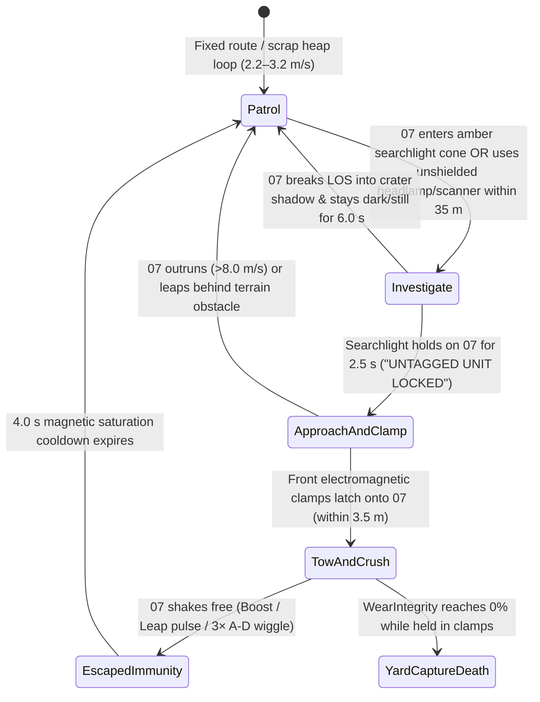

# Wear, Physical Repair & The Reclaimers — Design Specification

**Status:** `[DECIDED]` Core frame locked by Owner Ruling (2026-10-17) & `docs/VISION.md` Ruling 17 (`main` `e9a1b7af`); detailed mechanics, recipes, and tuning ranges below are `[PROPOSAL]` for owner review.  
**Bilingual Twin:** [`docs/design/wear-and-reclaimers-vi.md`](file:///D:/Project/MoonProject-wt/agy-wear/docs/design/wear-and-reclaimers-vi.md)  
**Concept Art Board:** [`Logs/wear/index.html`](file:///D:/Project/MoonProject-wt/agy-wear/Logs/wear/index.html) (`Logs/concepts/*.png`)

---

## Executive Summary & Design Frame

On 2026-10-17, the project owner established two foundational shifts now locked in [`docs/VISION.md`](file:///D:/Project/MoonProject-wt/agy-wear/docs/VISION.md#L180-L198) (**Ruling 17 — Wear, Repair, Reclaimers, and Death**):

1. **07 has a physical Wear ("Hull Integrity") meter alongside its Battery.** Driving too fast into hard obstacles, enduring harsh regional phenomena, or being grappled by automated **Reclaimer** machines drains wear. At `0%` wear, **07 dies**.
2. **Every step of damage, repair, and threat obeys physical and vacuum logic:**
   - **Battery stays range, never death** ([`docs/VISION.md` Ruling 15](file:///D:/Project/MoonProject-wt/agy-wear/docs/VISION.md#L163-L176)): `0%` battery still triggers the `25%`-speed solar trickle crawl (`M3-20`). Death happens *only* at `0%` wear.
   - **Bounces stay joyful:** Low-gravity hops, cushioned landings on lunar regolith, and gentle bumps **never** cost wear.
   - **07 has no hands** ([`docs/VISION.md` Ruling 14](file:///D:/Project/MoonProject-wt/agy-wear/docs/VISION.md#L158-L162)): Field repair (**Patch Kit**) and base repair (**Service Gantry**) are 100% physical, mechanical operations using 07's chassis electromagnet, front scoop, and chest weld-beam turret or overhead gantry arms.
   - **Calm tension, not combat:** 07 has no weapons. **Reclaimers**—1980s Departure-era automated salvage machines still feeding the L5 Mass Driver for the Arks—are slow, readable, avoidable industrial hazards that follow a **Stealth → Understand → Transponder Immunity → Reprogrammed Ally** progression arc.

---

## 1. The Wear Model

### 1.1 The Impact Rule: Relative Normal Speed, Threshold & Curve

In [`RoverController.cs`](file:///D:/Project/MoonProject-wt/agy-wear/Assets/_Project/Scripts/Rover/RoverController.cs#L38-L40), 07's physics body is driven by a rigid sphere collider (`_body`, `_sphere`) whose baseline locomotion tuning lives in [`DriveSettings.cs`](file:///D:/Project/MoonProject-wt/agy-wear/Assets/_Project/Scripts/Rover/DriveSettings.cs#L18-L24), [`BoostSettings.cs`](file:///D:/Project/MoonProject-wt/agy-wear/Assets/_Project/Scripts/Rover/BoostSettings.cs#L15-L24), and [`HoverJumpSettings.cs`](file:///D:/Project/MoonProject-wt/agy-wear/Assets/_Project/Scripts/Rover/HoverJumpSettings.cs#L20-L50):
- **Standard forward cruise (`_topSpeed`):** `8.0 m/s` (`DriveSettings.cs:18`)
- **Reverse top speed (`_reverseTopSpeed`):** `3.5 m/s` (`DriveSettings.cs:22`)
- **Boosted flat speed (`_topSpeed + _extraSpeed`):** `9.6 m/s` (`BoostSettings.cs:15`, engaging above `85%` cruise = `6.8 m/s`)
- **Downhill / leap-assisted peak speed:** `10.0–12.5 m/s`
- **Cushioned leap touchdown (`_cushionLandingSpeed`):** `1.6 m/s` (`HoverJumpSettings.cs:48`)

#### Normal-Speed Formulation (`[PROPOSAL]`)
Glancing scrapes along a crater wall or boulder side should spark harmlessly without punishing the player. Therefore, impact wear depends strictly on the **inward normal component of relative velocity** at the contact point:

$$v_\perp = \max\!\big(0,\; -(\mathbf{v}_{07} - \mathbf{v}_{\text{collider}}) \cdot \mathbf{n}_{\text{contact}}\big)$$

where $\mathbf{n}_{\text{contact}}$ is the unit surface normal pointing out of the obstacle toward 07.

- **Hard Impact Threshold ($v_{\text{min}}$):** **`6.8 m/s`** (`[PROPOSAL]` range: `6.5–7.5 m/s`, equal to `85%` of top cruise speed).
  - If $v_\perp < v_{\text{min}}$, **wear loss is `0`**. Bumping a rock while parking, reversing (`3.5 m/s`), crawling on low battery (`2.0 m/s`), or grazing a wall at a shallow $25^\circ$ angle at full cruise ($8.0 \times \sin 25^\circ = 3.38\text{ m/s} < 6.8\text{ m/s}$) costs **zero wear**.
- **Damage Curve Above Threshold ($v_\perp \ge v_{\text{min}}$):**
  Above $v_{\text{min}} = 6.8\text{ m/s}$ up to a saturation speed $v_{\text{max}} = 12.0\text{ m/s}$, wear loss scales smoothly via a convex power curve ($p = 1.5$) so barely exceeding the threshold is a mild warning tap while a full-boost downhill head-on slam is a heavy hit:

$$\Delta W(v_\perp) = \text{round}\!\left(W_{\text{hit,min}} + (W_{\text{hit,max}} - W_{\text{hit,min}}) \cdot \operatorname{clamp01}\!\left(\frac{v_\perp - v_{\text{min}}}{v_{\text{max}} - v_{\text{min}}}\right)^{1.5}\right)$$

| Impact Scenario | Relative Normal Speed $v_\perp$ | Formula Output ($\Delta W$ out of `100`) | Player Feel & Consequence |
| :--- | :---: | :---: | :--- |
| Gentle bump / reverse / shallow scrape ($< 30^\circ$) | `< 6.8 m/s` | **`0%`** | Harmless metallic clink + dust puff; zero wear loss. |
| Threshold brush (late braking into boulder) | `6.8 – 7.2 m/s` | **`4% – 6%`** | Mild wince chirp, tiny spark, HUD wear bar fades in. |
| Full unbraked head-on cruise slam (`100%` cruise) | `8.0 m/s` | **`12%`** | Audible panel thud, CRT face winces (`> <`), ~8 full slams to die from `100%`. |
| Full Boost Coil head-on crash (`8.0 + 1.6 m/s`) | `9.6 m/s` | **`24%`** | Heavy crunch, spark shower, bent antenna / dented stage reached in 2 hits. |
| Steep downhill + Boost runaway slam | `11.5 – 12.0+ m/s` | **`38% – 40%` (cap)** | Major structural hit; never a one-shot kill from full health (minimum 3 worst-case crashes to reach `0%`). |

- **Post-Impact Grace Cooldown:** **`1.0 s`** (`[PROPOSAL]` range `0.8–1.2 s`). Multi-point physics contacts or bouncing off one rock into an adjacent rock within `1.0 s` only register the single highest $v_\perp$ contact, preventing unfair physics-pinball instant deaths.

---

### 1.2 Which Surfaces Are Hard vs. Safe

To preserve Pillar 2 (*"Weight and Bounce"* — low-gravity hops and tumbling across lunar hills are joyful), colliders are split into two physical material categories via Unity layer / `PhysicsMaterial` tags:

| Surface Category | Examples in World | Wear on Contact? | Physical / Gameplay Rationale |
| :--- | :--- | :---: | :--- |
| **SAFE (Soft / Granular Regolith)** | Lunar mare dust, highland regolith slopes, crater rim dust banks, compacted dirt roads (`Terrain` layer). | **NEVER (`0%`)** | Deep lunar regolith compresses and cushions wheel/hull touchdowns. Combined with `HoverJumpSettings._cushionLandingSpeed = 1.6 m/s`, **vertical landings on terrain never cost wear at any height**. |
| **HARD (Rock, Metal & Structure)** | Discrete basalt boulders, jagged crater ejecta outcrops, crashed satellite trusses, abandoned rover hulls, base structures (`StructureDefinition`), mass-driver rails, Reclaimer chassis. | **YES (if $v_\perp \ge 6.8\text{ m/s}$)** | Unyielding solid basalt and cold-rolled steel deform 07's `1.5 mm` stamped aluminum-steel hull plates when struck head-on at high speed. |

> [!IMPORTANT]
> **Vertical Plunge Exception:** Even if 07 leaps (`HoverJump`) and lands *on top* of a flat metal pad or rock slab, its vertical velocity is governed by `HoverJumpSettings._cushionLandingSpeed = 1.6 m/s` (`<< 6.8 m/s`), so normal vertical landings on pads or rocks never hurt 07. Only slamming *horizontally* (or diving un-cushioned with empty battery/disabled coils down a cliff) into a hard rock or metal face at $v_\perp \ge 6.8\text{ m/s}$ causes wear.

---

### 1.3 The Creak Warning (Readable Before It Hurts)

Damage is never a surprise. Before 07 reaches a speed where a head-on collision with a hard object can hurt it, the rover's physical frame warns the player:
- **Activation Threshold:** Starts softly at **`6.5 m/s`** (`~81%` of cruise speed, just before the `6.8 m/s` impact threshold) and rises in volume and pitch density through `8.0 m/s` (cruise), `9.6 m/s` (boost), and `12.0 m/s` (downhill overspeed).
- **Audio Layer:** A tactile 1980s mechanical chassis rattle— coil-spring tension creaks, rubber bushing groans, and a faint high-harmonic D-major pentatonic wind-less frame hum (`A3–E4` chassis resonance transmitted through the suspension struts `Arm_FL..RR`).
- **Visual Micro-Cue:** Above `7.2 m/s`, the rear whip antenna (`Antenna` / `AntennaTip` in [`RoverModelNodes.cs`](file:///D:/Project/MoonProject-wt/agy-wear/Assets/_Project/Scripts/Rover/RoverModelNodes.cs#L30-L31)) whips backward into a deeper arc and the CRT scanlines exhibit a subtle `1 px` horizontal vibration.

---

### 1.4 The 4 Visual & Behavioural Stages

Wear is tracked as a normalized float `WearIntegrity` $\in [0.0, 1.0]$ (`100%` = pristine, `0%` = dead). Both 07's chassis (`RoverModelNodes.cs`) and the minimal HUD (`CellRowSettings.cs`) reflect wear in four distinct stages:

| Stage | Wear Range | HUD Gauge Behaviour | Visual Cues on 07 v3 (`RoverModelNodes.cs`) | Behavioural / Handling Changes |
| :--- | :---: | :--- | :--- | :--- |
| **0. Pristine** | **`100%`** | **Hidden.** Only the battery cell row is visible (or hidden when full). | Clean `R1_HullCream` (`#E4DFD3`) plates, crisp `R1_AccentCoral` stripe, straight `Antenna`, steady warm `R1_LampAmber` headlamps, calm CRT eyes (`O O`). | `100%` nominal (`8.0 m/s` cruise, full `7.0 m` leap, `1.0×` scan speed). |
| **1. Fresh (Scuffed)** | **`99% – 65%`** | **Visible (Warm Amber).** Small compact 5-segment hull-bar appears beside the battery gauge whenever `< 100%`; flashes briefly on hit. | Minor dust/paint scuffs along the front scoop (`DigScoop`) and bumper corners. On hit: `0.35 s` CRT wince (`FaceFeeling.Startled` + short 2-note pentatonic chirp `F#4 → D4`). | `100%` nominal. No speed or scan penalty—early scuffs are purely cosmetic feedback. |
| **2. Dented** | **`64% – 25%`** | **Visible (Deep Ochre-Amber).** Segments 4–5 dark; subtle pulse when taking new hits. | - Visible dent normal/mesh blendshapes on `Body` flank plates. - Rear `Antenna` bent `14°` to port. - Left headlamp (`HeadlampSocket`) flickers intermittently on bumps. - Hairline corner crack on `Visor` glass. - Idle CRT face defaults toward `FaceFeeling.Tired` (`- -`) when stopped. | `100%` nominal driving & leaping so mid-trip exploration never feels sluggish, plus mild intermittent left-headlamp flicker at night. |
| **3. Critical (Danger)** | **`24% – 1%`** | **Visible (Pulsing Coral-Red `#C86446`).** Last segment blinks at `1.5 Hz` with a soft Geiger-like relay tick. | - Heavy buckled dents on `Body` & `CargoHatch`. - Front-left wheel (`Wheel_FL` / `Arm_FL`) visibly cants at a `4°` wobble; `Shock_FL` sags. - Periodic golden-orange micro-sparks pop from `StitchOrigin` every `4–6 s`. - CRT face (`R1CrtFace.shader`) runs `_FaceCrtState.z` (`lowPower/jitter = 0.65`) with `FaceFeeling.Worried` (`> <`). | **Softened to protect 07 before death:** - **Top speed capped at `75%` (`6.0 m/s`)** — *below* the `6.8 m/s` hard-impact threshold so 07 cannot accidentally kill itself on flat ground! - **Boost Coils disabled.** - **Leap Coils (`HoverJump`) disabled** (pressing Space gives a `0.25 m` relay-click sputter hop). - **Scanner lock time `+40%` slower (`1.4×`).** |

> [!TIP]
> **Why Critical Stage (`< 25%`) Caps Top Speed at `6.0 m/s`:** Because `6.0 m/s` is below the `6.8 m/s` impact threshold, a critically wounded 07 limping home on flat ground **cannot die from an accidental flat-ground rock bump**. To lose the final `24%` wear, 07 must either careen down a steep crater slope above `6.8 m/s`, drive into an active regional hazard without protection, or get clamped by a Reclaimer. This makes the last `24%` feel tense and limping—never cheap.

---

### 1.5 The Death Moment & Restart Flow (Storyboard)

When `WearIntegrity` reaches `0%`, there is **no harsh arcade explosion, no red screen flash, and no "GAME OVER" text overlay**. Consistent with Pillar 1 (*"Lonely, Then Warm"*) and [`R1CrtFace.shader`](file:///D:/Project/MoonProject-wt/agy-wear/Assets/_Project/Shaders/R1CrtFace.shader#L34-L37) (which already implements CRT vertical line pinch via `_FaceContentState.y` and horizontal phosphor line glow via `_FaceContentState.z`), 07's death is a quiet, poignant `2.8 s` power-collapse vignette:

| Frame | Time Window | Visual & Shader Action (`R1CrtFace.shader` / `RoverModelNodes`) | Audio & Camera Action |
| :--- | :---: | :--- | :--- |
| **Frame 1: Final Shudder & Beacon Eject** | `0.0 s – 0.6 s` | Final impact sparks scatter across the regolith. All four suspension struts (`Shock_FL..RR`) compress as 07's chassis sags `8 cm` downward and its neck gimbal (`Neck`) droops `12°` forward. If the hold (`CargoHold`) contains any items, the rear `CargoHatch` pops open and physically ejects a sealed coral-and-brass **Cargo Beacon Pod** onto the dust beside 07. | Player input releases smoothly. Camera dollies out `1.8 m` and lowers to eye level. A soft, mournful two-note descending D-major pentatonic cello/synth interval (`A4 → D4`) sighs over a gentle mechanical relay latch-off. |
| **Frame 2: CRT Line Collapse** | `0.6 s – 1.5 s` | `FaceDisplay.cs` drives `ScreenVerticalPinch` (`0.0 → 1.0`) and `ScreenLineGlow` (`0.0 → 1.0`). 07's two warm amber pill eyes pinch vertically inward until they collapse into a **single razor-thin bright horizontal amber phosphor line** across the center of the dark CRT glass, which then contracts horizontally into a single dying center dot. Simultaneously, the headlamps (`R1_LampAmber`) and flank battery pips (`BatteryLamp_0..7`) dim from warm gold to dark red embers. | A classic 1980s analog CRT high-voltage capacitor discharge whisper (*fweeee-tik*) fades down as the radio carrier hum thins into pure lunar vacuum silence. |
| **Frame 3: Stillness & Relay Handshake** | `1.5 s – 2.8 s` | The CRT center dot vanishes into dark reflective glass. The rear `AntennaTip` light goes out. 07 sits motionless in the sharp lunar shadow under the starfield and dark Earth, while the ejected **Cargo Beacon Pod** beside it begins a slow, comforting `0.5 Hz` amber locator pulse. At `2.8 s`, the view fades cleanly to black (`1.2 s` transition) accompanied by a warm cassette-deck relay click, and opens inside the last docked **Service Gantry** or **Rover Bay**. | Silence for `1.0 s`, followed by the distant, reassuring hum of the base `Service Gantry` / `Rover Bay` capacitor charging up as 07's CRT boots back up (`BootProgress: 0.0 → 1.0`). |

---

### 1.6 Consequence of Death, Story-Logical Physical Return & 2 Alternatives

#### A. Default Consequence (`[DECIDED]` by Ruling 17)
1. **Where 07 Restarts:** 07 wakes up at the **last Service Gantry or Rover Bay** it docked at (defaulting to the Home Basin `Rover Bay` before a forward Gantry is built).
2. **What 07 Keeps:** All installed chassis/tool kits, battery/hold upgrades, unlocked Fabricator recipes, scanned encyclopaedia entries, reprogrammed allies, and story progress remain **100% intact**.
3. **What Stays at the Wreck Site:** Only the **loose materials and items currently in `CargoHold`** ([`M3-25`](file:///D:/Project/MoonProject-wt/agy-wear/docs/features/M3-25-cargo-and-storage.md)) remain behind, sealed inside the ejected **Cargo Beacon Pod** at the exact death coordinates (or in **Sorting Bin 03** of the Reclamation Yard if 07 died inside a Reclaimer's clamps — see §3.2).
   - The **Cargo Beacon Pod** emits a warm amber vertical strobe and appears on the compass/scanner HUD from any distance.
   - Driving up to the Cargo Beacon Pod and pressing Interact (`E`) or touching it with the magnetic scoop reloads all stored stacks back into 07's hold (or partial stacks if the holdalready has items).
   - **Multiple Deaths Rule:** Up to `3` active Cargo Beacons can exist in the world simultaneously (preventing accidental erasure of a rich haul if 07 crashes again on the recovery trip).

#### B. How 07 Physically Comes Back in Story Logic (No Respawn Magic)
Ruling 17 requires a **100% physical, in-story explanation** so returning to base never reads as videogame teleportation or supernatural resurrection. We anchor this in two interlocking pieces of [`story-v4.md`](file:///D:/Project/MoonProject-wt/agy-wear/docs/design/story-v4.md) hardware (`[PROPOSAL]` — combining Ruling 17's options into a seamless physical truth):

1. **Why the Cargo Stayed Behind ("Emergency Dead-Weight Jettison & Tow"):**
   - When 07's structural sensors detect `0%` hull integrity, its hardwired **Lumen Safety Reflex** automatically unlatches and kicks out the heavy **Cargo Hold Liner Pod (the Cargo Beacon)** to drop dead weight, protect the gathered ore/chips in a shock-proof casket, and fire a low-frequency recovery transponder.
   - During the `1.2 s` black fade (which represents a few quiet hours of lunar night/day), how does 07's lightened chassis get back to the bay?
     - **In the Home Basin / Friendly Regions (Standard Impact Death):** Either **Tilly (`03`)** (once befriended in `0.5/0.6`) or the base's automated **Magnetic Winch Crawler / Recovery Drone** hooks onto 07's lightened frame and tows it home along the regolith tracks to the **Rover Bay / Service Gantry**, where the overhead gantry arms hammer the dented plates flat, weld the cracked seams, and re-ignite the CRT tube. When 07's screen boots (`BootProgress 0 → 1`), the gantry welding arm is visibly retracting from 07's freshly hammered flank—showing the player that 07 was physically towed in and rebuilt while unconscious!
     - **When Crushed/Captured by a Reclaimer (or Lost in Deep Chasms):** The Reclaimer drags 07's old dented shell to the **Reclamation Yard**, where its cargo pod is sorted into **Bin 03**. Meanwhile, back at the Home Rover Bay / Service Gantry, **Kenji's 1988 Watchtower Backup Protocol** detects the loss of carrier signal from 07's main bus, flashes the **Mirrored Magnetic-Bubble Memory Image** (streamed continuously over the base's S-band telemetry link) into one of the **unpainted Spare `Lumen-07` Rolling Chassis** stacked in the back of the Rover Bay rack, stamps `07` onto its side, and lowers it onto the pad. *(Better yet: when 07 later visits the Reclamation Yard to recover its Cargo Beacon from Bin 03, it can spot its own old dented shell sitting in the bin and salvage `2 Metal + 1 Wiring` from it!)*

#### C. Two Design Alternatives for Death Consequence (with Pros & Cons)

Per `Logs/TASK.md`, here are two complete alternatives to the Default Cargo-Beacon Consequence for owner review:

| Consequence Model | How It Works | Pros | Cons |
| :--- | :--- | :--- | :--- |
| **Default (`[DECIDED]` Baseline): Gantry Restart + Full Cargo Beacon at Wreck Site** | 07 restarts at last Dock/Gantry with all kits; `100%` of loose hold cargo stays in a recoverable Cargo Beacon at the wreck site (or Reclamation Yard sorting bin). | - Zero permanent loss; turns death into a purposeful rescue excursion. - Cleanly separates *permanent progression* (kits/blueprints) from *trip stakes* (hold cargo). - Proven in *Subnautica* / *Hollow Knight* without feeling punitive. | - Requires driving back out to the wreck site, which can feel tedious if the player died very far away on a simple driving mistake. |
| **Alternative 1 (`[PROPOSAL]`): "Tilly's Heavy Tow" — Keep 75% Cargo, Lose 25% Knocked Loose (No Corpse Run)** | Tilly or the base recovery winch tows 07 *and* its damaged hold all the way back to the Gantry. Because the hold latch was buckled in the crash, `25%` of loose common materials (`Metal`, `Ilmenite`) spilled out on the tow home (rare unique items are never lost); `75%` remains right in 07's hold at wake-up. | - **Eliminates backtracking:** Player never has to repeat a long drive just to pick up dropped ore. - Seamless story logic (if Tilly towed 07 home, why wouldn't she tow the hold too?). - Keeps session pacing brisk. | - Less dramatic tension on the return trip with a full hold of rare T2 materials. - Permanently deletes `25%` of common ore on death instead of letting the player recover `100%`. |
| **Alternative 2 (`[PROPOSAL]`): "Stranded Hull & Service Drone" — Drive a Basic Spare Chassis Out to Weld 07 Back Up** | 07's actual body (with all its kits and cargo) stays powered-down at the wreck site. The player wakes up at base inside a bare-bones **Service Mule (`07-B`)** carrying one built-in jump-starter/weld charge, and drives out to physically weld and reboot their stranded main `07` hull on-site. | - **100% literal physical continuity:** There is only one `07` body, and you physically rescue it yourself. - Creates memorable emergent rescue missions. | - **High frustration risk:** Driving an un-upgraded spare rover across a distant `0.6+` region (especially if gated by regional hazards!) can soft-lock or exhaust the player. |

> [!NOTE]
> **Recommendation:** Keep the **Default (Gantry Restart + Recoverable Cargo Beacon)** as the core rule, and borrow the best narrative touch from Alternative 1: when 07 wakes up inside the Service Gantry / Rover Bay, play a `1.5 s` wake-up animation where the overhead gantry weld-arm retracts from 07's hull (or Tilly backs away from the pad with a friendly chirp), visually confirming that 07's chassis was physically towed home while its heavy Cargo Pod was jettisoned at the crash site for later pickup.

---

### 1.7 Proposed Tuning Numbers & Ranges (`[PROPOSAL]`)

| Parameter | Proposed Default | Tuning Range | Code / Asset Location | Notes |
| :--- | :---: | :---: | :--- | :--- |
| `MaxWearIntegrity` | **`100.0`** | `100 – 150` | `WearSettings.cs` (new) | Upgraded to `150` with Hardened Hull kit. |
| `CreakStartSpeed` | **`6.5 m/s`** | `6.0 – 7.2 m/s` | `WearSettings.cs` | `81%` of `8.0 m/s` cruise (`DriveSettings._topSpeed`). |
| `HardImpactMinSpeed` ($v_{\text{min}}$) | **`6.8 m/s`** | `6.5 – 7.5 m/s` | `WearSettings.cs` | Relative normal speed $v_\perp$ below this deals `0` wear. |
| `HardImpactMaxSpeed` ($v_{\text{max}}$) | **`12.0 m/s`** | `11.0 – 14.0 m/s` | `WearSettings.cs` | Speed where impact wear reaches `MaxHitWear`. |
| `MinHitWear` ($W_{\text{hit,min}}$) | **`4.0`** (`4%`) | `3.0 – 6.0` | `WearSettings.cs` | Wear lost right at $v_\perp = 6.8\text{ m/s}$. |
| `MaxHitWear` ($W_{\text{hit,max}}$) | **`40.0`** (`40%`) | `30.0 – 50.0` | `WearSettings.cs` | Cap per single impact (never 1-shots from full health). |
| `ImpactCurveExponent` ($p$) | **`1.5`** | `1.2 – 2.0` | `WearSettings.cs` | Smooth convex ramp between `6.8` and `12.0 m/s`. |
| `PostHitGraceSeconds` | **`1.0 s`** | `0.8 – 1.5 s` | `WearSettings.cs` | Prevents multi-contact bounce double-hits. |
| `DentedStageThreshold` | **`65%`** | `60% – 70%` | `WearSettings.cs` | Enters Stage 2 (dents, bent antenna, lamp flicker). |
| `CriticalStageThreshold` | **`25%`** | `20% – 30%` | `WearSettings.cs` | Enters Stage 3 (wobbly wheel, sparks, softened stats). |
| `CriticalTopSpeedMultiplier` | **`0.75×`** (`6.0 m/s`) | `0.70× – 0.80×` | `WearSettings.cs` | Safely below $v_{\text{min}} = 6.8\text{ m/s}$ on flat ground. |
| `CriticalScanTimeMultiplier` | **`1.40×`** (`+40%`) | `1.25× – 1.50×` | `WearSettings.cs` | Scanner takes slightly longer to lock in Stage 3. |

---

### 1.8 Interaction with Battery (`M3-20`), Leap Coils & Tow

1. **Battery (`M3-20-battery-chargers-crawl.md`):**
   - **Strictly Orthogonal Channels:** Battery measures *energy/range*; Wear measures *structural integrity*.
   - **Empty Battery Crawl Immunity:** When battery hits `0%`, 07 enters `25%` crawl speed (`2.0 m/s`). Because `2.0 m/s << 6.8 m/s`, **07 cannot take impact wear while crawling on an empty battery** on normal terrain.
   - **Combined Low-Battery + Critical Wear:** If both Battery is `0%` (`0.25×` speed) and Wear is `< 25%` (`0.75×` speed), speed uses `min(batteryMult, wearMult) = 0.25×` (`2.0 m/s`) rather than multiplying them into an unplayable crawl.
2. **Leap Coils (`HoverJumpSettings.cs`):**
   - **In Stages 0–2 (`100%–25%` wear):** Leap Coils work at `100%` effectiveness (`0.8 m` tap hop, `7.0 m` full leap, `1.6 m/s` cushioned touchdown). Cushioned vertical landings on regolith or structures cost **0 wear**.
   - **In Stage 3 (`< 25%` Critical wear):** Main Leap Coil discharge is **locked out** to prevent structural frame snap. Pressing `Space` produces a `0.25 m` warning hop, a coil-relay click, and a brief flash of the hull HUD bar.
   - **While Clamped by a Reclaimer:** Triggering a Leap Coil discharge (`Space`) acts as an electromagnetic counter-pulse that immediately adds **+50% break-free progress** against the Reclaimer's magnetic clamp (see §3.2).
3. **Tow & Recovery (`RecoverySettings.cs` / `TowableMagnet`):**
   - **Towing Heavy Objects:** Pulling a heavy scrap object or sibling rover via 07's magnetic tow hitch naturally keeps speed below `6.0 m/s`, so normal towing never triggers impact wear. If a towed object swings into 07's rear bumper on a sudden stop, **towed-payload self-contacts are ignored (`0` wear)** so towing physics never punish the player.
   - **Unsticking (`RecoverySettings.cs`):** Using the manual unstick/righting nudge (`RecoverySettings._verticalPop = 1.6 m/s`) grants a `1.5 s` impact-wear immunity window so popping free of a rock crevice never damages 07.

---

### 1.9 New Game Modes (`Survival`, `Calm`, and `Hardcore` Evaluation)

At **New Game** creation, the player chooses between clear, Subnautica-style experience modes:

| Mode | Status | Rules & Behaviour | Target Player |
| :--- | :---: | :--- | :--- |
| **1. Survival (Default)** | **`[DECIDED]`** | Full Wear, Physical Repair (Patch Kit & Service Gantry), Reclaimers, Regional Hazards, and Death/Cargo-Beacon restart loop active. Battery stays non-lethal range (`M3-20`). | Default experience: quiet exploration enriched by tactile engineering preparation and readable tension. |
| **2. Calm** | **`[DECIDED]`** | **No wear, no death.** `WearIntegrity` is locked at `100%` (HUD wear bar never appears). Hard impacts still play harmless metallic clinks and dust puffs. Reclaimers still patrol the `0.6+` horizons as atmospheric world-machines, **never clamp 07**, and can still be scanned and reprogrammed as base-scrap allies! | Players who want the pure contemplative *cozy lonely moon* experience without structural damage or cargo recovery runs. |
| **3. Hardcore ("Single Chassis")** | **`[PROPOSAL]` Evaluation** | Identical to Survival, except there are **no spare chassis in the Rover Bay**: if `WearIntegrity` hits `0%`, the save ends permanently after Frame 3 of the death collapse (fade to the dark Earth title screen). | Veteran players seeking high-stakes ironman tension on a second playthrough. |

> [!WARNING]
> **Does Hardcore One-Life Mode Fit *Lunarion*? (Director Evaluation):**  
> **Not for `0.5.7`, and only as an opt-in unlockable/advanced toggle in `1.0`.** A full playthrough of *Lunarion* (`0.5 → 1.0`) is a `12–20 hour` contemplative restoration of the Moon (`Pillar 3` & `Pillar 4`). Losing a 15-hour save of built bases, awakened sibling rovers, and orbital relays to a single downhill physics tumble or a first encounter with a Reclaimer violates our core promise that *"the Moon is quiet by default"* and risks making players drive timidly at `4 m/s` everywhere. **Recommendation:** Ship **Survival (Default)** and **Calm** in `0.5.7`. Keep **Hardcore** out of the primary 2-card New Game prompt (or offer it only as a small tucked-away *"Iron Chassis"* checkbox for repeat players once `0.6+` physics edge-cases are 100% battle-tested).

---

## 2. Physical Repair (Ruling 14: 07 Has No Hands)

Per [`docs/VISION.md` Ruling 14](file:///D:/Project/MoonProject-wt/agy-wear/docs/VISION.md#L158-L162), **07 has no hands, no robotic fingers, and no magic repair clouds**. Every repair action—whether in the field or at base—must be a physical operation performed by real mechanisms on 07's v3 body ([`RoverModelNodes.cs`](file:///D:/Project/MoonProject-wt/agy-wear/Assets/_Project/Scripts/Rover/RoverModelNodes.cs)) or on a base structure.

### 2.1 Field Repair: The Patch Kit (Self-Applied by 07)

#### Crafting & Inventory (`SalvageMaterial.cs` & `M3-27`)
Crafted at the **Fabricator** (`StructureIds.Fabricator = "structure.fabricator"`, or the early Rover Bay workbench in `0.5.7`) using existing materials from [`SalvageMaterial.cs`](file:///D:/Project/MoonProject-wt/agy-wear/Assets/_Project/Scripts/Core/SalvageMaterial.cs#L12-L41):

| Item ID | Name | Tier & Milestone | Fabricator Recipe (`SalvageMaterial`) | Craft Time | Hold Stack Size | Wear Restored |
| :--- | :--- | :---: | :--- | :---: | :---: | :---: |
| `item.patch_kit` | **Hull Patch Kit** | **T1 (`0.5.7`)** | **`2 × Metal` + `1 × Wiring`** | `2.5 s` | `3` per hold slot | **`+40%` (`+40` Wear)** |
| `item.patch_kit_heavy` | **Alloy Weld-Patch** | **T2 (`0.6+`)** | **`1 × Alloy` + `1 × Wiring` + `1 × OrangeBeads`** | `3.5 s` | `3` per hold slot | **`+80%` (`+80` Wear)** + clears Critical stage instantly |

- **How It Is Carried & Triggered:** Patch Kits sit physically as stamped sage-green-and-brass canisters/plates inside 07's **Cargo Hold** (`CargoHold`, `M3-25`). When `WearIntegrity < 100%` and 07 is stationary (or moving `< 1.0 m/s`), pressing the **Field Patch hotkey (`R`)** (or clicking the Patch Kit in the hold) triggers a **`3.5 s` physical self-repair sequence**.

#### 3.5-Second Storyboard: How 07 Patches Itself Without Hands
Because 07 already possesses a rear `CargoHatch`, a front `DigScoop` with an electromagnetic collector coil, and a gimballed chest **Cutter/Weld Turret (`CutterTurret` / `StitchOrigin`)** (`RoverModelNodes.cs:37-44`), 07 applies the patch plate using **magnetic clamping + self-welding**:

1. **Panel 1 — `0.0 s – 1.0 s` (Eject & Magnetic Latch):**
   - 07 brakes to a stop. Its rear `CargoHatch` pops open `25°` with a pneumatic click and kicks out a curved, pre-stamped sage-green metal hull plate (`R1_SagePatch` `#627360` with brass corner rivets).
   - Simultaneously, 07's chassis electromagnet and `DigScoop` energize with a low `D2` hum, catching the sliding plate in a visible amber-blue magnetic flux tether and drawing it around to the most dented flank plate on `Body`. 07's CRT head (`Head`) swivels down to watch the plate slide into place (`FaceFeeling.Curious`).
2. **Panel 2 — `1.0 s – 2.8 s` (Magnetic Clamp & Arc-Weld Stitch):**
   - With a solid metallic *CLACK*, the chassis electromagnet pulls the sage-green patch plate flush over the dent on `Body`.
   - 07's chest-mounted brass **Cutter/Welder Turret (`CutterTurret`)** pivots inward toward its own hull flank and fires a short-focus golden arc-weld beam from `StitchOrigin`, tracing a rectangular weld seam around the patch plate in `1.8 s`.
   - Bright golden-amber welding sparks shower onto the grey lunar regolith; 07's CRT eyes squint tightly (`> <`) against the bright welding flash.
3. **Panel 3 — `2.8 s – 3.5 s` (Pop-Out & Happy Chirp):**
   - As the weld seam cools from glowing orange to brushed brass (`R1_Brass`), internal thermal expansion pops the dented hull plate outward (`+40%` wear restored; bent antenna springs upright if crossing `65%`).
   - One `R1_SagePatch` repair plate remains visibly bolted to 07's cream hull until its next full overhaul at a Service Gantry!
   - 07's suspension gives a joyful little hop, and its CRT face beams with happy crescent eyes (`^ ^`) and a rising 3-note D-major pentatonic chime (`D4 → F#4 → A4`).

---

### 2.2 Base Repair: The Service Gantry (`structure.service_gantry`)

While Patch Kits consume hold slots and T1/T2 materials for emergency field repairs, the **Service Gantry** is an early, cheap, permanent base structure that repairs 07 automatically using base electricity (`PowerGrid.cs`).

#### Structure Specification (`StructureDefinition.cs` Compatible)

| Field (`StructureDefinition.cs`) | Value (`[PROPOSAL]`) | Design Rationale |
| :--- | :--- | :--- |
| **`_id` (`StructureIds`)** | `"structure.service_gantry"` | Added alongside `SolarPanel`, `BatteryRack`, `Fabricator`, `RoverBay` in [`StructureIds.cs`](file:///D:/Project/MoonProject-wt/agy-wear/Assets/_Project/Scripts/Gameplay/Building/StructureIds.cs#L12-L20). |
| **`_nameKey`** | `"building.service_gantry.name"` | Display name: **Service Gantry** (*Khung Bảo Dưỡng*). |
| **Footprint (`_width × _depth × _height`)** | **`2.8 m × 2.4 m × 2.35 m`** | Compact drive-through arch (`07 v3` is `1.48 m` wide × `1.49 m` long × `1.76 m` tall), slightly smaller than `UpgradeBay.fbx` (`3.20 m × 2.82 m`). |
| **`_maxGroundSlope` / `_clearance`** | **`15.0°` / `0.25 m`** | Matches standard base pad placement rules (`StructureDefinition.cs:29-33`). |
| **`_buildCost` (`Recipe`)** | **`3 × Metal` + `2 × Wiring` + `1 × Optics`** | Early and cheap T1 recipe—buildable within the first 15 minutes of `0.5.7` right after a Solar Panel and Battery Rack. |
| **`_buildSeconds`** | **`4.0 s`** | Fast assembly animation on the build pad. |
| **Power (`_consumeWatts` on `PowerGrid.cs`)** | **`120 W` (active repair) / `10 W` (idle standby)** | Draws from connected `SolarPanel` / `BatteryRack` network (`PowerGrid.cs`). If the grid has partial power (`0 < satisfaction < 1`), repair speed scales linearly with available power; at `0 W` during unbuffered lunar night, its amber work-lamp dims and repair pauses. |
| **`_ports` (`StructurePort[]`)** | **`2` ports:** `(-1.30, 0.08, 0.0)` dir `(-1, 0, 0)` `(+1.30, 0.08, 0.0)` dir `(+1, 0, 0)` | Left and right plinth cable sockets for daisy-chaining into the base power grid. |
| **Repair Rate** | **`+14% Wear / s`** (`~7.0 s` from `1% → 100%`) | Fast enough to feel snappy, slow enough (`3–7 s`) for the player to enjoy the tactile hammering and welding animation. |

#### Silhouette, Readability at a Glance & 1980s Retro-Future Style
- **Reads at a Glance:** Even from `60 m` away across the basin, the Service Gantry is unmistakable: an open **drive-through A-frame portal** with yellow-and-black hazard wheel guides on a dark iron ramp (`R1_Charcoal` `#26292E`), two cream-and-coral structural uprights (`R1_HullCream` `#E4DFD3` + `R1_AccentCoral` `#C86446`), an angled 1980s dark-glass CRT diagnostic board on the right pillar (`HULL INTEGRITY: 100%`), and **two prominent overhead articulated brass tools** hanging from a crossbeam rail:
  1. **Port Arm:** A chunky brass-and-copper **pneumatic planishing hammer** (`R1_Brass` + `R1_Copper`) that physically taps out hull dents (`tap-tap-clink` rhythm tuned to `D3/A3`).
  2. **Starboard Arm:** An articulated copper **arc-welder nozzle** with coiled orange power leads that stitches cracked seams with warm golden sparks and buffs off temporary field `R1_SagePatch` plates so 07 leaves with a factory-fresh cream hull.
- **Bonus Convenience:** While parked inside a powered Service Gantry, 07 also receives a standard base umbilical trickle charge (`+5%/s` battery), making the Service Gantry the natural "pit-stop arch" at the entrance to every base and forward outpost.

---

### 2.3 Optional Later Upgrades: Structural Mitigation Kits (`0.6+`)

As 07 explores rougher `0.6+` regions, the player can craft and install permanent structural kits at the **Rover Bay / Upgrade Bay** (`upgrade_bay.py`) that visibly alter 07's v3 silhouette and raise its durability:

| Kit ID | Name & Milestone | Recipe (`SalvageMaterial`) | Mechanical Effect on Wear Model | Visible Change on 07 v3 (`RoverModelNodes`) |
| :--- | :--- | :--- | :--- | :--- |
| `kit.bumper_frame` | **Spring-Steel Bullbar Bumper** (`0.5.7` late / `0.6` early) | `4 × Metal` + `2 × Alloy` + `1 × Wiring` | Raises hard-impact speed threshold $v_{\text{min}}$ from **`6.8 m/s` → `8.4 m/s`**. *(At `8.0 m/s` unboosted top cruise speed, 07 can now hit boulders head-on for **`0` wear**!)* | Bolts a heavy tubular charcoal-iron and brass leaf-spring bumper bar across 07's front fascia above `DigScoop` with two rubber impact buffers. |
| `kit.suspension_dampers` | **Nitrogen Piggyback Dampers** (`0.6`) | `2 × Alloy` + `2 × Coolant` + `2 × Wiring` | Raises $v_{\text{min}}$ by **`+1.2 m/s`** (up to **`9.6 m/s`** with Bullbar Bumper, covering full flat Boost!) and reduces high-speed impact curve $\Delta W$ by **`-30%`**. | Mounts finned copper-and-brass piggyback gas reservoirs onto all four shock absorbers (`Shock_FL..RR`) and thickens the coil springs. |
| `kit.hardened_hull` | **Ilmenite-Titanium Laminate Hull** (`0.6+`) | `4 × Alloy` + `3 × Ilmenite` + `2 × OrangeBeads` | Increases `MaxWearIntegrity` from **`100` → `150`** (`+50%` hull pool) and reduces **Reclaimer clamp crush rate** and **micrometeoroid wear** by **`-40%`**. | Adds riveted brushed-titanium and sage-green armor brow plates (`R1_SagePatch` + `R1_Steel`) over 07's wheel arches, flank shoulders, and CRT visor rim. |

---

## 3. Reclaimers: The Machines That Recycle Old Robots

### 3.1 Story & Lore Integration (`story-v4.md` & `inventions.md`)

To fit seamlessly into [`docs/design/story-v4.md`](file:///D:/Project/MoonProject-wt/agy-wear/docs/design/story-v4.md) (Decisions 1–5) and [`docs/design/inventions.md`](file:///D:/Project/MoonProject-wt/agy-wear/docs/design/inventions.md#L211-L234) (§2.7 *Mass Driver Rail*):

- **Who Built Them & Why (`1984–1987`):**
  During the final four years of the Departure (`1984–1988`), construction of the orbital **Arks at L4 and L5** hit a desperate bottleneck: raw lunar regolith smelting could not produce refined titanium-alloy plates, high-purity copper windings, and radiation-hardened optics fast enough before the predicted **1988 Extreme Solar Proton Storm**.
  - The **ILC Ark Material Command** contracted **Tycho Heavy Industries (Meridian Automated Systems)**—the same heavy-industrial consortium behind the automated strip-miners and the L5 Mass Driver (`story-v4.md` §5, `0.6-world-regions.md` Region 6)—to deploy **Automated Reclamation Divisions (`ARD-01` through `ARD-06`)**.
  - Their directive (`DIRECTIVE SCRAP-04`) was simple and unsentimental: patrol the lunar mares and highland haul-roads, sweep every piece of hardware with an inductive/optical transponder reader, and **harvest any vehicle, satellite, or outpost that did not broadcast a valid 1988 Ark Priority Cryptography Tag**. Decommissioned 1970s survey rovers, spent landers, and abandoned cables were dragged back to **Reclamation Yards**, sorted into alloy/optics bins, compacted into standard slugs, and fired up the **L5 Mass Driver Rail** to build the Ark hulls.
- **Why They Target 07 in `2024` (36 Years Later):**
  When the 1988 solar flare hit, the last human crews evacuated on the final Ark launches and never sent the `STOP-HARVEST` shutdown code. Protected by thick cast-iron magnetic-core memory and radiation shielding, the Reclaimers have kept running their loops for **36 years**.
  - Because `07` is a light **Lumen (ILC)** maintenance unit woken in `2024` by Kenji's patched watchtower script without a `1988` Ark Priority Transponder, any Reclaimer that catches `07` in its inspection beam reads:  
    `UNIT: LUMEN-07 // TRANSPONDER: EXPIRED (1988) // CLASSIFICATION: GRADE-A RECLAIMABLE ALLOY & OPTICS`.
  - They are not evil, angry, or aggressive. They are patient, heavy 1980s municipal recycling trucks doing their job for an evacuation that ended 36 years ago.
- **Where Their Yard & The Mass Driver Are:**
  - **The Home Basin (`0.5` — Crater Keep) has ZERO Reclaimers** (`VISION.md` Ruling 17): the Home Basin is surrounded by a steep highland ring ridge that the heavy tracked Reclaimers never cross.
  - **Forward Reclamation Yard (`Region 2: The Long Mare` eastern border, `0.6`):** A terraced basalt basin where `ARD-04` operates a regional sorting yard and rail spur feeding northeast toward the **Primary L5 Mass Driver Complex (`Region 6: The Industrial Dark`)**.

---

### 3.2 Behaviour: Calm Tension, Grapple Clamps & Yard Capture

Reclaimers never shoot projectiles, never sprint erratically, and never create twitch-combat panic. Their threat is **slow, mechanical, spatial tension**—like a lighthouse beam and a heavy tow-truck on a foggy pier:

#### 4-Stage Behavioural State Machine (`[PROPOSAL]`)

1. **Patrol (`2.2–3.2 m/s`):**
   - Reclaimers follow predictable compacted haul-tracks or circle high-value satellite debris fields.
   - Each unit sweeps a **sharp-edged conical beam of dusty amber-orange inspection light** (`28 m` range for Spotters, `38 m` range for Haulers) side-to-side in a steady `6.0 s` pendulum arc, accompanied by a rhythmic mechanical shutter tick (`72 BPM`).
2. **Spot & Investigate (`2.5 s` Verification Window):**
   - If 07 drives into the amber light cone—or leaves its own bright headlamps (`L`) switched on within `35 m` in line-of-sight—the Reclaimer stops its sweep, centres its beam on 07, and shifts its shutter tick to double-time (`144 BPM`) while querying 07's transponder for `2.5 s`.
   - **Immediate Counterplay:** If 07 switches off its headlamps, darts behind a boulder or crater rim into deep shadow, and stays still before the `2.5 s` query finishes, the Reclaimer's optical/inductive sensor loses lock, emits a low two-note `B2 → D2` stand-down hum, and resumes patrolling.
3. **Approach & Magnetic Clamp (`4.5–6.0 m/s`):**
   - Once locked (`UNTAGGED SCRAP CONFIRMED`), the Reclaimer energizes its front copper-wound **electromagnetic grapple clamps** (glowing warm orange-amber with visible magnetic field dust filings) and trundles toward 07.
   - Because 07's top cruise speed is `8.0 m/s` (`9.6 m/s` with boost), **a healthy 07 is always faster than a Heavy Hauler (`4.5 m/s`)** and can outrun or leap over a crater wall to escape—unless 07 is cornered in a wreck trench, overloaded, or caught off-guard by a fast **Nimble Spotter (`6.5 m/s`)** whose magnetic snare slows 07 down for the Hauler.
4. **Held in Clamps — Drag, Wear Drain & Shake-Free Escape:**
   - If the clamps latch (`< 3.5 m`), 07 is pulled into the Reclaimer's front magnetic jaw.
   - **While Held:** The Reclaimer drags 07 backward along the haul road toward the **Reclamation Yard** at `2.5 m/s` while the clamping magnets compress 07's hull, draining **`7.0% Wear / s`** (`[PROPOSAL]` range `6%–9%/s`) with rhythmic hydraulic groans and hull creaks.
   - **How 07 Shakes Free (Active Physical Counterplay):**
     A small 3-bar **Magnetic Slip Gauge** appears beside 07:
     - **Option A — Leap Coil Counter-Pulse (`Space`):** Discharging 07's electromagnetic Leap Coils inside the clamp creates an opposing magnetic flux spike that immediately fills **`+60%` of the break-free gauge** and shoves the clamp jaws apart!
     - **Option B — Boost Coil Surge (`Shift`):** Firing wheel Boost Coils adds **`+45%/s`** slip progress.
     - **Option C — Wheel Torque Wiggle (`A / D` alternating):** Rocking 07's 4 high-torque wheels left and right shears the magnetic contact air-gap (`+25%` per rhythmic rock; 4 rocks breaks free even with no Leap or Boost kit!).
     - Upon reaching `100%` slip (typically within `1.5–2.5 s`, losing only `10%–18%` wear), the magnetic lock snaps with a resonant brass-iron *CLANG*, kicking 07 backward `4 m` and granting a **`4.0 s` Magnetic Saturation Immunity window** (while the Reclaimer's overheated coils vent cold gas and reset) so 07 can cleanly drive away.

#### What Happens If Wear Hits Zero Inside a Reclaimer's Clamps? (`[DECIDED]` Special Case Recommendation)
`Logs/TASK.md` asks us to decide between the default wreck-in-place death rule vs. a **special case where 07's hull ends up in the Reclamation Yard and the cargo lands in their sorting bins**.

> [!IMPORTANT]
> **Design Decision (`[PROPOSAL]` — Recommended Special Case: "Sorted at the Yard"):**  
> If 07's wear reaches `0%` while held in a Reclaimer's clamps, **use the Reclamation Yard Special Case!**
> 1. **Why:** If a Reclaimer's entire narrative and mechanical purpose is to drag untagged rovers back to the Reclamation Yard for sorting, dropping a Cargo Beacon in the middle of a random patrol road feels contradictory—and worse, places the player's dropped cargo right underneath the still-patrolling Reclaimer!
> 2. **How It Plays Out:**
>    - During Frame 1–3 of the Death Moment, 07's CRT collapses to a horizontal amber line while held in the Hauler's jaws as the Hauler turns toward the distant amber glow of the **Reclamation Yard**.
>    - During the `1.2 s` black fade, Kenji's **Watchtower Backup Protocol** boots a fresh spare `Lumen-07` chassis for the player at their last docked **Service Gantry / Rover Bay** (see §1.6.B).
>    - Meanwhile, the Hauler completes its delivery: **100% of 07's hold cargo (inside its Cargo Beacon Pod) + 07's old dented hull shell** are deposited inside **`SORTING BIN 03: UNTAGGED UNITS`** at the edge of the **Reclamation Yard**!
> 3. **Why This Is Awesome Gameplay:**
>    - Getting captured on your first encounter with a Reclaimer **marks the exact location of the Reclamation Yard on your compass** via your Cargo Beacon's signal.
>    - The Sorting Bin sits in a sneakable/accessible outer bay of the Yard—and right beside your Cargo Beacon in Bin 03 sit **bonus piles of high-tier T2 salvage (`Alloy`, `CircuitChips`, `Optics`)** that the Reclaimers harvested from other 1980s wrecks, plus your own old dented shell (which yields `2 Metal + 1 Wiring` when scanned/salvaged)!
>    - Instead of feeling like a punishing setback, getting "recycled" once turns into a memorable *Star Wars Trash Compactor / WALL-E Salvage Yard* heist that teaches the player where the Reclaimers live and rewards them when they recover their bin.

---

### 3.3 Progression Arc: Counterplay → Understanding → Ally

Every threat in *Lunarion* follows a non-violent four-step mastery arc:

| Stage | Player Action | Mechanical & Narrative Payoff |
| :--- | :--- | :--- |
| **1. Counterplay (Avoid & Hide)** | - Switch off headlamps (`L`) when approaching an amber horizon glow. - Use crater rims, basalt boulders, and razor-sharp lunar shadows to stay out of the sweeping light cone. - If grazed by the outer beam, **stop moving immediately** in shadow (Reclaimer eddy-current sensors filter out stationary rocks). - If clamped, use **Leap pulse + A/D wiggle** to pop free. | Immediate tension and stealth gameplay on the Long Mare without needing any special gear. |
| **2. Understanding (Scan a Dormant/Broken Unit)** | - Along the western rim of the Long Mare (or just outside the Yard), 07 discovers a **crushed `SHEAR-85` Spotter** pinned under a basalt rockslide with its inspection lamp still clicking Weakly (`D4` tick). - Scanning (`Left Click / E`) its exposed **Magnetic-Core Transponder Reader** unlocks the encyclopaedia entry *"1985 Ark Directive SCRAP-04"* and the **Ark Transponder Tag** schematic. | Reveals the sad story of the L5 Ark construction and explains *why* the Reclaimers grab 07. |
| **3. Immunity (Craft the Ark Transponder)** | - Craft the **Ark Transponder Tag (`kit.ark_transponder`)** at the Fabricator:   **Recipe:** `1 × CircuitChips` + `2 × Wiring` + `1 × Optics` (`T2`, `0.6`). - Visually mounts a compact brass-and-sage dipole antenna box onto 07's rear `Antenna` mast with a blinking green-amber LED. | When any Reclaimer's beam sweeps over 07, its reader chimes a warm two-note harmonic handshake (`D4 → A4`), flashes green-amber (`TAG VALID: ARK MAINT. 07`), and **completely ignores 07**—letting 07 stroll right through the Reclamation Yard in broad daylight! |
| **4. Ally & Automation (Reprogram a Reclaimer)** | - In mid/late `0.6`, craft a **Home-Beacon Override Cartridge (`item.reclaimer_override`)**:   **Recipe:** `2 × CircuitChips` + `1 × Crystal` + `2 × Wiring`. - Approach a tagged Heavy Hauler (or repair a dormant Hauler in the Yard), open its rear 1980s magnetic-tape service hatch with 07's weld/interface beam, and slot in the cartridge. | Overwrites the Hauler's drop-off coordinates from `YARD BIN 01` to 07's **Base Storage Yard (`M3-25`)**. The friendly Hauler (now sporting a warm **Lumen cream-and-coral stripe** and a gentle amber lamp) patrols the mare autonomously and delivers **`4–6` units of `Metal`, `Wiring`, `Ilmenite`, or `Alloy`** to 07's base every lunar day! |

---

### 3.4 The 3 Reclaimer Machine Types & Vacuum-Shapes Audit

All three Reclaimer machines are designed as heavy `1984–1987` **Tycho / Ark Material Command** industrial hardware: weathered mustard-ochre (`#C88A32`) and charcoal-iron (`#26292E`) cast armor, faded black-and-amber hazard chevrons, heavy copper electromagnet windings (`#B86B35`), and shuttered halogen/arc searchlights.

#### Type A: `SHEAR-85` Nimble Spotter ("Tag-Hound")
- **Role:** Fast perimeter scout and magnetic snare unit that patrols ridge roads and flags untagged scrap for the Heavy Haulers.
- **Dimensions & Locomotion:** `2.2 m` long × `1.6 m` wide × `1.8 m` tall (slightly larger than `07 v3`). Moves at `3.2 m/s` patrol / `6.5 m/s` pursuit on **four independent multi-jointed hydraulic spider-wheel legs** (articulated steel legs ending in heavy grooved iron drum wheels that step over crater rocks and pivot `360°` in place).
- **Tools & Silhouette:** Topped by a rotating turret carrying a large **shuttered conical amber-red searchlight**, a parabolic S-band transponder dish, and a front-mounted **electromagnetic snare winch** on a telescoping steel boom.
- **Behaviour:** If it locks onto an untagged 07, it fires/extends its magnetic winch cable (`8 m` reach) to tether 07 (`-40%` top speed, `-3.5% Wear/s`) while sounding a rhythmic `A3` beacon ping to summon the nearest Heavy Hauler. 07 can snap the tether with a single **Leap Coil hop**, a **Boost surge**, or by sweeping 07's **chest Cutter Beam** across the taut cable!

#### Type B: `BALER-IV` Heavy Clamp-Hauler ("Scrap-Crawler")
- **Role:** Slow, unstoppable heavy salvage bulldozer that crushes and drags untagged rovers and satellite frames back to the Reclamation Yard.
- **Dimensions & Locomotion:** `4.8 m` long × `3.2 m` wide × `3.0 m` tall (`~3×` 07's mass). Trundles at `2.2 m/s` patrol / `4.5 m/s` approach on **four heavy articulated steel tank-tread bogies** (`R1_Charcoal` tracks with brass bogie pins) that leave deep double-track imprints in the lunar dust.
- **Tools & Silhouette:**
  - **Front:** Two massive horseshoe-shaped **copper-wound electromagnetic grapple clamps** mounted on hydraulic rams, flanked by a wide `1980s` shuttered amber floodlight and an inductive tag-reader coil.
  - **Rear:** An open slanted steel **scrap dump-hopper** filled with crushed satellite struts, tangled copper harnesses, and old 1970s rover wheels.
  - **Service Hatch:** A rear punch-tape / magnetic-cassette terminal accessible once 07 has an Ark Transponder Tag (used in Phase 4 to reprogram the Hauler into a base-supply ally).

#### Type C: `GOLIATH-L5` Yard Gantry-Crane & Jaw-Crusher (Horizon Landmark)
- **Role:** Colossal stationary/rail-bound industrial landmark at the heart of the **Reclamation Yard**, visible from kilometers away across the Long Mare.
- **Dimensions & Locomotion:** `14.0 m` tall × `18.0 m` span, riding back and forth at `1.0 m/s` along **heavy iron railway tracks** straddling three recessed concrete-and-steel **Sorting Bins (`BIN 01: HULL ALLOY`, `BIN 02: OPTICS & CHIPS`, `BIN 03: UNTAGGED UNITS`)**.
- **Tools & Silhouette:** A towering steel bridge truss carrying a suspended `3.0 m` circular **industrial lifting electromagnet** on braided steel cables, heavy exposed copper busbars, and high-intensity rotating amber warning beacons that sweep the dusk horizon like a lighthouse—acting as a visual lure that draws curious players toward the Yard.

#### Mandatory Vacuum-Shapes Audit ([`docs/design/vacuum-shapes.md`](file:///D:/Project/MoonProject-wt/agy-wear/docs/design/vacuum-shapes.md))
Per `RULES.md` ("Vacuum logic") and `docs/design/vacuum-shapes.md`, every machine passes the 6-question gate with **zero atmospheric shapes**:

| Machine | 1. How does it stay up? | 2. How does it turn? | 3. How does it dump heat? | 4. Why this silhouette? | 5. Any banned Earth-air shapes? | 6. Could it exist in *2001* / Apollo? |
| :--- | :--- | :--- | :--- | :--- | :---: | :---: |
| **`SHEAR-85` Spotter** | 4 articulated hydraulic legs with grooved steel drum wheels on regolith. | Independent wheel-leg differential torque + turret ring gear. | Dorsal conductive copper radiator fins (radiative, zero fans). | Low-CG tripod/quadruped surveyor built to straddle crater boulders. | **NONE** (0 rotors, 0 wings, 0 fins). | **YES** (Lunokhod + Apollo LRV + industrial spider-excavator). |
| **`BALER-IV` Hauler** | 4 heavy articulated steel tank-tread bogies under `1/6 g` ballast weight. | Skid-steer differential track drive. | Rear flat black-anodized radiative heat-sink plates (`R1_Charcoal`). | Bulldozer + open ore-hopper + front horseshoe electromagnets. | **NONE** (0 exhaust stacks with smoke, 0 fans, 0 aerodynamic fairings). | **YES** (1980s strip-mine crawler adapted for vacuum). |
| **`GOLIATH-L5` Yard Crane** | Flanged steel railway wheels on bolted basalt rail sleepers. | Linear rail travel + overhead trolley winch. | Passive structural steel truss radiation into `3 K` black sky. | Bridge crane straddling sorting bins at the Mass Driver loader. | **NONE** (0 wind vanes, 0 cooling towers). | **YES** (Heavy industrial rail gantry). |

---

### 3.5 Sound Language (D Major Pentatonic: `D E F# A B`)

Consistent with `docs/VISION.md` Pillar 1 and our audio direction, Reclaimers never use harsh dissonant horror screeching or combat sirens. Their soundscape is **heavy, mechanical, harmonic, and hypnotic**—pitched strictly to **D major pentatonic (`D E F# A B`)**:

1. **The Low Motor Drone (`D1 + A1` Open Fifth):**
   - A deep, warm sub-bass hum (`36.7 Hz` `D1` fundamental + `55.0 Hz` `A1` fifth) generated by high-torque brushed DC traction motors and steel track links clanking slowly over basalt (`clack-thrum... clack-thrum`). In vacuum, the sound gets louder and fuller when 07's wheels touch the same rock slab or haul road (ground-borne vibration conduction!).
2. **The Searchlight Sweep Tick (`F#4` Relay Metronome):**
   - As the shuttered amber inspection lamp swings left and right, a crisp mechanical escapement relay ticks on **`F#4` (`370 Hz`)** at `72 BPM` (1.2 ticks/s).
   - If 07 enters the beam (`Investigate` state), the tick doubles to `144 BPM` and alternates **`F#4 – A4`** like a questioning telegraph.
3. **The Magnetic Clamp Clunk & Eddy-Current Hum (`D2` Thud + `B2 → E3` Hum):**
   - When the horseshoe electromagnet energizes, a resonant transformer hum rises from **`B2` to `E3`**, culminating in a heavy damped brass-on-iron **`D2` clunk** when the jaws latch.
4. **The Transponder Handshake Chime (`D4 → F#4 → A4`):**
   - Once 07 crafts the **Ark Transponder Tag**, being swept by a Reclaimer's beam produces a warm, reassuring three-note major triad arpeggio (`D4 – F#4 – A4`) as the machine salutes 07 and rolls peacefully past.

---

## 4. Regional Hazards (`0.6+`, 1–2 Lines Each)

Beyond hard driving impacts and Reclaimers, each `0.6+` world region ([`docs/design/0.6-world-regions.md`](file:///D:/Project/MoonProject-wt/agy-wear/docs/design/0.6-world-regions.md)) features a signature **lunar physical phenomenon** that gradually drains wear if entered unprotected—and each is neutralized by a **crafted protection kit** that doubles as a natural **progression gate** into that region:

| Region (`0.6-world-regions.md`) | Lunar Phenomenon & Wear Drain (1–2 Lines) | Crafted Protection & Region Gate (`SalvageMaterial`) |
| :--- | :--- | :--- |
| **1. The Long Mare (`Region 2`) — Micrometeoroid Showers** | Periodic hypervelocity dust-grain showers streak silently from the black sky, peppering exposed plains with tiny bright impact sparks (`-4% Wear/hit` unless 07 shelters under a gantry roof, boulder overhang, or wreck arch). | **Whipple Canopy Shield (`kit.whipple_shield`):** Crafted from `3 × Alloy + 2 × Metal`. Bolts a spaced dual-layer sacrificial brass-and-sage bumper canopy over 07's head and shoulders, reducing micrometeoroid wear to **`0%`**. |
| **2. Mare Rims & Dawn Terminator — Electrostatic Dust Curtains** | Along sunlit/shadowed terminator ridges, solar UV charges razor-sharp silicate dust into glowing `1.5 m` levitating curtains that cling to 07's joints, abrade wheel bearings, and cloud the CRT visor (`-2.5% Wear/s` while driving fast through dense curtains). | **Copper Grounding Whiskers & Seal Boots (`kit.grounding_whiskers`):** Crafted from `3 × Wiring + 2 × OrangeBeads`. Trailing braided copper discharge brushes on 07's rear bumper bleed off static charge and negate dust abrasion. |
| **3. The Glass Field (`Region 3` — Aristarchus) — Razor Impactite & Thermal Vent Shock** | Fields of volcanic orange glass (`OrangeBeads`) and fractured impact-melt ribbons slice unarmored rubber tyres above `5.0 m/s` (`-3% Wear/s`), while active outgassing fissures vent sudden thermal-shock plumes. | **Sintered Ilmenite Tyre Treads (`kit.sintered_treads`):** Crafted from `4 × Ilmenite + 2 × Glass + 2 × Metal`. Replaces 07's rubber chevron treads with woven steel-ilmenite mesh tyres (like the Apollo LRV), granting full immunity to glass shards. |
| **4. The South Pole (`Region 5` — Shackleton Interior) — Deep Cryogenic Cold (`40 K`)** | Inside permanently shadowed polar craters where sunlight has not touched in two billion years, `40 K` extreme cold makes standard hull steel brittle (`2.0×` impact wear) and steadily freezes unheated actuator seals (`-2.0% Wear/s` after `20 s` in deep shadow). | **Closed-Loop Thermal Circulation Jacket (`kit.cryo_heater`):** Crafted from `3 × Coolant + 2 × OrangeBeads + 2 × Alloy`. Circulates warm fluid from 07's battery bus through copper manifold pipes on `Body`, keeping 07 warm and immune in eternal shadow. |
| **5. The Industrial Dark (`Region 6` — Mass Driver) — Leaking Cryo-Hydrazine & Inductive Arcing** | Cracked Departure-era propellant pipelines and unshielded Mass Driver capacitor banks leak frozen corrosive thruster salts and high-voltage ground arcs across the factory floor (`-5.0% Wear/s` in hazard pools). | **Fluoropolymer Dielectric Undercoat (`kit.chemical_seal`):** Crafted from `2 × Superconductor + 2 × Coolant + 2 × Glass`. Insulates 07's lower tub and wheel hubs against chemical corrosion and inductive rail arcs. |

---

## 5. Phasing, Code Domains & Automated Tests

### 5.1 Milestone Phasing (`0.5.7` vs. `0.6+`)

| Milestone | Scope Shipped | Player Experience Goal |
| :--- | :--- | :--- |
| **`0.5.7` (Base Building Release)** | 1. **Core Wear Model:** Relative normal speed $v_\perp$ impact math (`6.8 m/s` threshold), hard vs. regolith collider classification, creak warning (`6.5 m/s+`), 4 visual/behavioural stages, and Critical stage speed-softening (`6.0 m/s` cap). 2. **Death & Restart Loop:** 3-frame CRT line collapse (`R1CrtFace.shader`), **Cargo Beacon Pod** drop & recovery (`M3-25`), restart at last Service Gantry / Rover Bay with wake-up weld vignette. 3. **Physical Repair:** **Hull Patch Kit** (`2 Metal + 1 Wiring`, `3.5 s` self-weld animation) + buildable **Service Gantry** (`structure.service_gantry`, `3 Metal + 2 Wiring + 1 Optics`, `120 W` on `PowerGrid.cs`). 4. **New Game Modes:** **Survival** (default) and **Calm** (no wear, no death). | Establishes the tactile loop of careful high-speed driving, joyous penalty-free regolith bouncing, field patching, and returning home to the Service Gantry. |
| **`0.6+` (World Regions Release)** | 1. **Reclaimers:** `SHEAR-85` Spotter, `BALER-IV` Heavy Hauler, and `GOLIATH-L5` Yard Gantry-Crane. 2. **Reclamation Yard & Capture Special Case:** Sorting Bins (`Bin 03` cargo recovery + bonus T2 salvage) at the Long Mare / Industrial Dark border. 3. **Mastery Arc:** Dormant Reclaimer scan → **Ark Transponder Tag** (`kit.ark_transponder`) → **Home-Beacon Override Cartridge** (reprogrammed Hauler delivering scrap to base). 4. **Regional Hazards & Mitigation Kits:** Bullbar Bumper, Nitrogen Dampers, Hardened Hull, plus the 5 regional hazard protection kits. | Expands wear from driving physics into world exploration, stealth tension, region gating, and late-game base automation. |

---

### 5.2 Code Domains Touched

| Domain / Assembly | Existing Files Referenced | New / Modified Types (`0.5.7` & `0.6+`) |
| :--- | :--- | :--- |
| **`Core` (`Project.Core`)** | [`SalvageMaterial.cs`](file:///D:/Project/MoonProject-wt/agy-wear/Assets/_Project/Scripts/Core/SalvageMaterial.cs) | `GameMode.cs` (`Survival`, `Calm`), `WearState.cs` (pure C# serializable struct & impact math helper). |
| **`Rover` (`Project.Rover`)** | [`RoverController.cs`](file:///D:/Project/MoonProject-wt/agy-wear/Assets/_Project/Scripts/Rover/RoverController.cs), [`DriveSettings.cs`](file:///D:/Project/MoonProject-wt/agy-wear/Assets/_Project/Scripts/Rover/DriveSettings.cs), [`BoostSettings.cs`](file:///D:/Project/MoonProject-wt/agy-wear/Assets/_Project/Scripts/Rover/BoostSettings.cs), [`HoverJumpSettings.cs`](file:///D:/Project/MoonProject-wt/agy-wear/Assets/_Project/Scripts/Rover/HoverJumpSettings.cs), [`FaceDisplay.cs`](file:///D:/Project/MoonProject-wt/agy-wear/Assets/_Project/Scripts/Rover/FaceDisplay.cs), [`RoverModelNodes.cs`](file:///D:/Project/MoonProject-wt/agy-wear/Assets/_Project/Scripts/Rover/RoverModelNodes.cs) | `WearSettings.cs` (`ScriptableObject`), `RoverWearController.cs` (`OnCollisionEnter` $v_\perp$ filter, stage modifiers, creak audio trigger, death sequence), `PatchKitApplicator.cs` (`3.5 s` self-weld state machine driving `CargoHatch`, `CutterTurret`, `StitchOrigin`). |
| **`Gameplay` (`Project.Gameplay`)** | [`StructureDefinition.cs`](file:///D:/Project/MoonProject-wt/agy-wear/Assets/_Project/Scripts/Gameplay/Building/StructureDefinition.cs), [`StructureIds.cs`](file:///D:/Project/MoonProject-wt/agy-wear/Assets/_Project/Scripts/Gameplay/Building/StructureIds.cs), [`PowerGrid.cs`](file:///D:/Project/MoonProject-wt/agy-wear/Assets/_Project/Scripts/Gameplay/Building/PowerGrid.cs) | `StructureIds.ServiceGantry`, `ServiceGantryController.cs` (pad trigger, `PowerGrid` satisfaction check, `+14%/s` repair tick, arm animations), `CargoBeaconPod.cs` (world entity storing dropped `CargoHold` inventory stacks), `RespawnCoordinator.cs`. |
| **`World` (`Project.World` — `0.6+`)** | `WorldRegions`, `SalvageNode` | `ReclaimerController.cs` (`Patrol / Investigate / Clamp / Tow / Ally` state machine), `ReclaimerSearchlight.cs` (cone LOS + shadow raycast check), `ReclamationYardBin.cs` (`Bin 03` cargo deposit), `RegionalHazardZone.cs`. |
| **`UI` (`Project.UI`)** | [`CellRowSettings.cs`](file:///D:/Project/MoonProject-wt/agy-wear/Assets/_Project/Scripts/Rover/CellRowSettings.cs) | `WearGaugeView.cs` (5-segment companion bar beside battery row, auto-hidden at `100%` or in `Calm` mode), `MagneticSlipPromptView.cs` (break-free widget when clamped). |
| **`Art & Shaders`** | [`R1CrtFace.shader`](file:///D:/Project/MoonProject-wt/agy-wear/Assets/_Project/Shaders/R1CrtFace.shader), [`build_rover.py`](file:///D:/Project/MoonProject-wt/agy-wear/tools/art/blender/rover/build_rover.py), [`upgrade_bay.py`](file:///D:/Project/MoonProject-wt/agy-wear/tools/art/blender/upgrade_bay.py) | Dent blendshapes / decal toggle on `Rover_07`, detachable `R1_SagePatch` plate mesh node, `ServiceGantry.fbx` generator (`tools/art/blender/service_gantry.py`), `CargoBeacon.fbx`, Reclaimer meshes (`0.6+`). |
| **`Audio` (`Project.Audio`)** | Procedural / clip synth | Chassis creak loop (`6.5–12.0 m/s`), D-major pentatonic wince chirp (`F#4–D4`), CRT collapse discharge, Reclaimer `D1/A1` motor drone & `F#4` shutter tick. |

---

### 5.3 Automated Test Suite (`EditMode` & `PlayMode`)

Per `RULES.md` ("Testing Rules"), every mechanic ships with deterministic EditMode and PlayMode tests:

1. **Impact Threshold & Curve Math (`RoverWearMathTests.cs` — EditMode):**
   - `ImpactBelowThreshold_DealsZeroWear`: Verifies $v_\perp \in [0, 6.79]\text{ m/s}$ returns exactly `0f` wear loss.
   - `GlancingScrapeAtFullCruise_DealsZeroWear`: Verifies `8.0 m/s` velocity at $20^\circ$ incidence angle ($v_\perp = 8.0 \sin 20^\circ = 2.74\text{ m/s} < 6.8\text{ m/s}$) returns `0f` wear loss.
   - `RegolithSurface_NeverDealsWearAtAnySpeed`: Verifies contact with a `Terrain`/`Regolith` collider at `15.0 m/s` returns `0f` wear loss.
   - `HardImpactAboveThreshold_FollowsConvexCurveAndCapsAtMax`: Verifies $v_\perp = 6.8\text{ m/s} \to 4.0$, $v_\perp = 8.0\text{ m/s} \to \approx 12.0$, $v_\perp = 9.6\text{ m/s} \to \approx 24.0$, and $v_\perp \ge 12.0\text{ m/s} \to 40.0$ (capped).
   - `PostHitGraceWindow_SuppressesSecondaryBounce`: Verifies a second contact `0.4 s` after a hit deals `0` additional wear unless its $v_\perp$ exceeds the first hit.
2. **Critical Stage & Softening (`RoverWearStageTests.cs` — EditMode):**
   - `StageTransitions_At65And25Percent`: Verifies `Pristine (100%)`, `Fresh (99–65%)`, `Dented (64–25%)`, and `Critical (24–1%)`.
   - `CriticalStage_CapsTopSpeedBelowImpactThreshold`: Verifies that at `< 25%` wear, effective max cruise speed is `6.0 m/s` (`< 6.8 m/s`), Leap Coils are blocked, and scan duration multiplier is `1.4f`.
3. **Death, Restart & Cargo Beacon Recovery (`RoverDeathAndBeaconPlayModeTests.cs` — PlayMode):**
   - `ZeroWear_TriggersCrtCollapseAndSpawnsCargoBeacon`: Reduces wear to `0%` while holding `3 Metal + 2 Optics`; asserts CRT `ScreenVerticalPinch` reaches `1.0`, a `CargoBeaconPod` spawns at the death position containing `3 Metal + 2 Optics`, and 07's hold is emptied.
   - `RestartFlow_PlacesRoverAtLastServiceGantryWithKitsIntact`: Asserts 07 respawns at the last visited `ServiceGantry` (or `RoverBay`) with `100%` wear and all equipped kits preserved.
   - `CargoBeaconRecovery_RestoresDroppedHoldInventory`: Drives respawned 07 to the `CargoBeaconPod`, triggers recovery, and asserts `3 Metal + 2 Optics` return to 07's hold and the beacon despawns.
4. **Physical Repair (`RepairPlayModeTests.cs` — PlayMode):**
   - `PatchKit_ConsumesOneKitAndRestores40WearAfter3Point5Seconds`: Applies `item.patch_kit` at `35%` wear; asserts `3.5 s` sequence completes and wear becomes `75%`.
   - `ServiceGantry_RepairsRoverOnlyWhenPoweredByGrid`: Places damaged 07 (`50%` wear) inside `ServiceGantry` with `0 W` power (asserts wear stays `50%`), then connects a `SolarPanel` (`120 W+`) and asserts wear climbs to `100%`.
5. **Calm Mode Invariance (`CalmModeTests.cs` — EditMode & PlayMode):**
   - `CalmMode_HardImpactAndReclaimerClamp_NeverReduceWear`: In `GameMode.Calm`, slams 07 into a hard boulder at `12.0 m/s` and simulates hazard exposure; asserts `WearIntegrity` remains `100%` and HUD wear bar stays hidden.

---

## 6. Risks and Answers

### 6.1 Risk: Frustration and Lost Time
- **The Risk:** In a relaxing exploration game, dying 2 km from home or losing hours of progress to an unseen rock on a dark slope can cause players to quit in frustration.
- **Our Answer (5 Layers of Protection):**
  1. **Zero Permanent Progress Loss:** Installed kits, base structures, blueprints, and story progress are **never** lost on death—only the current trip's unbanked hold cargo stays in the Cargo Beacon.
  2. **Joyful Bounces Stay Free:** `100%` of regolith landings, low-gravity hops, and bumps below `6.8 m/s` cost **zero wear**. You only take impact wear when driving near full cruise/boost speed (`6.8–12.0 m/s`) straight into a solid rock or metal wall.
  3. **Loud Early Warning + Self-Protecting Critical Stage:** The `6.5 m/s` chassis creak warns you before impact speed is reached, and **Critical Stage (`< 25%`) caps top speed at `6.0 m/s`**—meaning a critically damaged 07 limping across flat terrain *cannot accidentally kill itself* on a stray rock.
  4. **Forward Service Gantries Shorten Every Trip:** Because the **Service Gantry** costs only `3 Metal + 2 Wiring + 1 Optics`, players naturally build one at every forward outpost (`M3-22`), ensuring a restart is never more than `60–90 seconds` from the wreck site.
  5. **Bullbar Bumper Kit Eliminates Cruise-Speed Impacts:** By mid-game (`0.6`), installing the **Bullbar Bumper (`kit.bumper_frame`)** raises $v_{\text{min}}$ to `8.4 m/s`, making normal `8.0 m/s` cruise driving completely immune to rock impacts.

### 6.2 Risk: Breaking the Solitude Pillar (`Pillar 6 — "Quiet by Default, Alive Underneath"`)
- **The Risk:** If Reclaimers feel like aggressive *Far Cry* patrol guards or combat enemies chasing 07 across every hill, the lonely, contemplative magic of the Moon evaporates.
- **Our Answer:**
  1. **The Home Basin (`0.5`) Is 100% Sanctuary:** No Reclaimer ever enters Crater Keep.
  2. **Slow Industrial Cadence, Not Aggression:** Reclaimers move at `2.2–3.2 m/s` along fixed historical haul-tracks and scrap yards. They never hunt 07 outside their patrol corridors, never fire weapons, and broadcast their presence from a kilometer away via warm, sweeping amber lighthouse beams and low `D1/A1` motor hums.
  3. **From Stranger to Quiet Worker:** Once 07 crafts the **Ark Transponder Tag**, Reclaimers become peaceful background scenery—lumbering 1980s dinosaurs of the Departure that salute 07 with a gentle `D–F#–A` chime and can even be reprogrammed to haul scrap to 07's base. They reinforce the loneliness of the 1988 evacuation rather than breaking it.

### 6.3 Risk: Alienating Cozy Players → The Calm Mode Answer
- **The Risk:** Some players fell in love with *Lunarion* specifically for stress-free, zero-fail-state lunar tinkering.
- **Our Answer:** **Calm Mode** is a first-class option on the New Game screen (not a hidden cheat). In Calm Mode, wear is locked at `100%`, the wear HUD gauge never appears, and Reclaimers never clamp 07—yet the player still gets to experience the full story, scan the Reclaimers, visit the Reclamation Yard, and reprogram a Hauler to bring scrap home.

### 6.4 What *Subnautica* Teaches Here, and Where We Improve on It

| What *Subnautica* Taught Us (And We Keep) | Where *Subnautica* Stumbled → How *Lunarion* Improves on It |
| :--- | :--- |
| **1. Vehicle hull damage makes safe havens feel warm.** Returning a dented *Seamoth* into a *Moonpool* makes your base feel like a real shelter. Our **Service Gantry** recreates that exact tactile relief when the hammer and welding arms descend onto 07. | **1. In *Subnautica*, jumping out of your vehicle with a handheld *Repair Tool* broke vehicle immersion.** In *Lunarion*, you *are* the rover (`Ruling 14`). Applying a **Patch Kit** is a physical self-operation using 07's own magnetic latch and chest weld-beam—no disembodied floating repair gun. |
| **2. Readable spatial predators (*Reaper Leviathans* / *Crabsquids*) create unforgettable stories without giving the player a gun.** Our **Reclaimers** use slow searchlights, acoustic signatures, and light-discipline counterplay (`headlamps off`). | **2. *Subnautica* threats stayed permanent nuisances even in late game.** Once you scanned a Leviathan, it still bit your sub every time you passed. In *Lunarion*, every threat follows **Counterplay → Understand → Transponder Immunity → Reprogrammed Ally**, turning yesterday's hazard into tomorrow's automated scrap-hauler. |
| **3. Losing your vehicle in deep water was devastating (destroying installed upgrade modules).** | **3. Zero permanent vehicle/kit loss.** In *Lunarion*, 07's kits and upgrades are never destroyed on death; only loose hold cargo stays in a clearly beaconed pod—or lands inside **Sorting Bin 03** at the Reclamation Yard alongside bonus T2 loot! |
| **4. *Subnautica*'s Seamoth took annoying chip damage from bumping small fish at cruise speed.** | **4. Strict Normal-Speed Threshold ($v_\perp \ge 6.8\text{ m/s}$) + Critical Speed Cap (`6.0 m/s`).** Gentle bumps, shallow scrapes, and all regolith landings deal **`0` wear**, and Critical stage softens 07's top speed below the damage threshold so you never die to a clumsy low-speed bump. |
